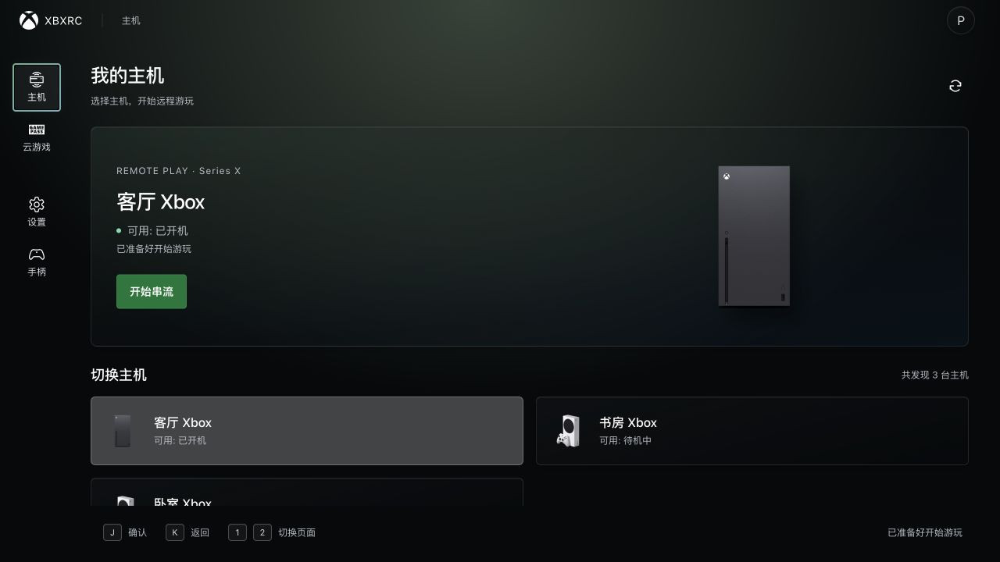
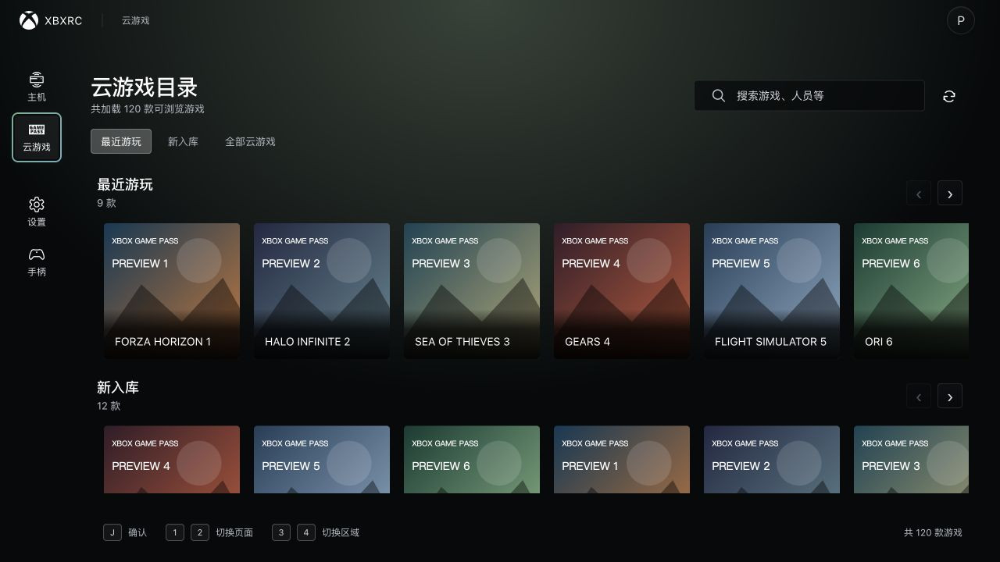
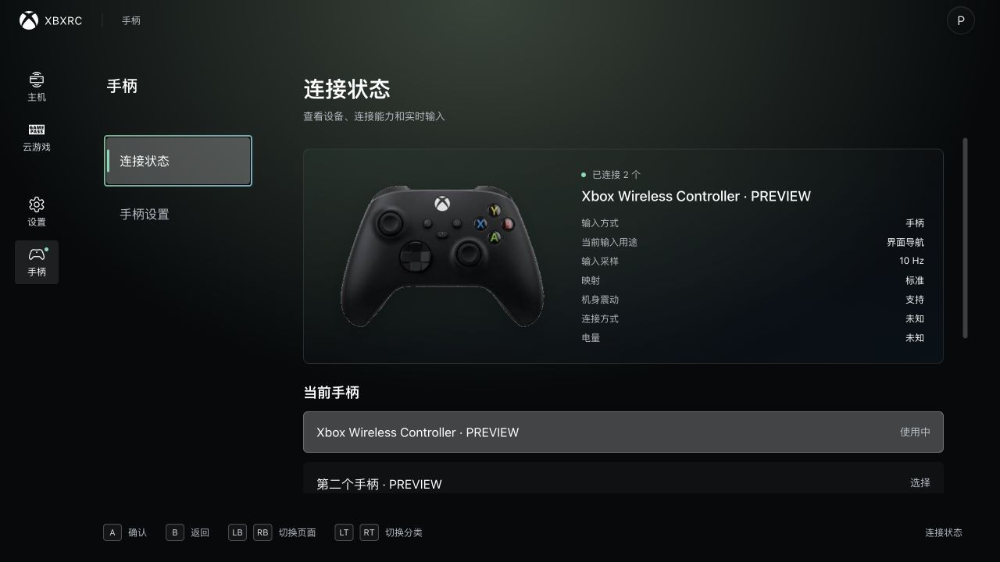

<div align="center">


# xbxrc

**Your Xbox console and cloud games, on your desktop.**

A community-built Xbox streaming client for macOS and Windows.

<p>
  <a href="https://github.com/xuasir/xbxrc/releases"></a>
  <a href="https://v2.tauri.app/"></a>
  <a href="https://vuejs.org/"></a>
  <a href="LICENSE"></a>
</p>

**English** · [简体中文](README.zh-CN.md)

[Features](#features) · [Download](#download) · [Open source](#open-source-acknowledgments) · [Report an issue](https://github.com/xuasir/xbxrc/issues)

</div>

<picture>
  <source media="(prefers-color-scheme: dark)" srcset="docs/assets/readme/home-dark.jpg">
  <source media="(prefers-color-scheme: light)" srcset="docs/assets/readme/home-light.jpg">
  
</picture>

## Features

xbxrc brings **Xbox Remote Play** and **Xbox Cloud Gaming (xCloud)** into one desktop app. Sign in with your Microsoft account, choose a console or a cloud game, and play with your controller or keyboard.

| Feature | What you can do |
| --- | --- |
| **Xbox Remote Play** | Discover consoles linked to your account, view their power state, switch between devices, wake a compatible console and start streaming. Shut down your console when ending a session. |
| **Xbox Cloud Gaming** | Browse recently played games, new arrivals and the full available catalog; search for a title and launch it. View queue progress and choose your preferred region and game language. |
| **Controller-friendly navigation** | Use a controller across pages, game cards, settings and dialogs. On-screen hints follow the active input source; shoulder buttons switch pages and triggers switch sections. |
| **Input customization** | Select a controller, inspect live button, stick and trigger input, customize bindings and stick behavior, adjust vibration strength, or use configurable keyboard-to-controller input. |
| **Picture controls** | Configure console and cloud resolution preferences separately, choose automatic or custom bitrate limits and H.264 profiles, and adjust picture fit, sharpening, brightness, contrast and saturation. |
| **Experimental super resolution** | Try FSR1-based upscaling and sharpening, toggle it during a session, and export A/B comparison screenshots. Availability and performance depend on the device and WebView. |
| **In-session tools** | Switch fullscreen, adjust volume, enable your microphone, send text to the console and use Xbox guide-button actions from the streaming menu. |
| **Diagnostics and desktop comfort** | Check resolution, RTT, jitter, frame rates, bitrate and packet loss; inspect connection diagnostics and record runtime traces. Choose a light or dark theme, English or Simplified Chinese, and stable or beta updates. |

Resolution settings include 720p, 1080p and 1440p preferences. The negotiated stream depends on console or cloud-service capabilities, account access, network conditions and device support.

## A closer look

<table>
  <tr>
    <td width="50%" align="center"><strong>Browse cloud games</strong></td>
    <td width="50%" align="center"><strong>Manage your controller</strong></td>
  </tr>
  <tr>
    <td><a href="docs/assets/readme/cloud-games.jpg"></a></td>
    <td><a href="docs/assets/readme/controller.jpg"></a></td>
  </tr>
</table>

*Screenshots show the app's Vue interface with demo data. Account, device and game entries illustrate the layout; cloud cover art is marked PREVIEW.*

## Download

Get the available installers and release notes from **[GitHub Releases](https://github.com/xuasir/xbxrc/releases)**.

| Platform | Package | Requirements |
| --- | --- | --- |
| macOS | `.dmg` | Apple Silicon · macOS 26.0 or later |
| Windows | `.exe` installer | x64 · Microsoft Edge WebView2 runtime |

Choose the **Browser edition** for everyday use. **Native WIP** is a separate development edition for native streaming and controller work. Stable and beta update channels are available in the app's settings.

### Start playing

1. Install xbxrc and sign in with your Microsoft / Xbox account.
2. For **Remote Play**, enable remote features on your Xbox console, select it on the console page, and start streaming. Wake-up support also depends on the console's remote-management and power settings.
3. For **Cloud Gaming**, open the cloud catalog, select a game and start playing. Availability follows Microsoft's regional, subscription and game-access requirements.
4. Connect a compatible controller, or enable keyboard input on the controller settings page. Tune picture and input settings to suit your setup.

## Open-source acknowledgments

xbxrc is built on the work of open-source maintainers and contributors. Thank you for the libraries, tools and protocol research that make this app possible.

### Libraries and tools

| Project | Used for |
| --- | --- |
| [Tauri](https://github.com/tauri-apps/tauri) and [Tauri plugins](https://github.com/tauri-apps/plugins-workspace) | Desktop shell, system integration, local configuration and application updates. |
| [Vue](https://github.com/vuejs/core), [Vue Router](https://github.com/vuejs/router) and [Vue I18n](https://github.com/intlify/vue-i18n) | Reactive UI, page navigation and localization. |
| [Tokio](https://github.com/tokio-rs/tokio) and [reqwest](https://github.com/seanmonstar/reqwest) | Asynchronous Rust tasks and HTTP calls for authentication, Xbox APIs and session signaling. |
| [Serde](https://github.com/serde-rs/serde), [serde_json](https://github.com/serde-rs/json) and [thiserror](https://github.com/dtolnay/thiserror) | Serialization, configuration and error modeling. |
| [rustls](https://github.com/rustls/rustls), [ring](https://github.com/briansmith/ring) and [RustCrypto](https://github.com/RustCrypto) | TLS, signatures and authentication cryptography, including P-256, HMAC and SHA-256. |
| [rfd](https://github.com/PolyMeilex/rfd) and [tauri-plugin-keepawake](https://crates.io/crates/tauri-plugin-keepawake) | Native file dialogs and keeping the device awake during streaming. |
| [AMD FidelityFX FSR](https://github.com/GPUOpen-Effects/FidelityFX-FSR) and [FidelityFX CAS](https://github.com/GPUOpen-Effects/FidelityFX-CAS) | Algorithm references for experimental FSR1 upscaling and CAS-style sharpening. |
| [TypeScript](https://github.com/microsoft/TypeScript), [Vite](https://github.com/vitejs/vite) and [Sass](https://github.com/sass/dart-sass) | Frontend types, development tooling and styles. |
| [ESLint](https://github.com/eslint/eslint), [Antfu's ESLint config](https://github.com/antfu/eslint-config), [Vue Language Tools](https://github.com/vuejs/language-tools) and [Vitest](https://github.com/vitest-dev/vitest) | Code conventions, Vue type checking and regression tests. |

Thanks also to [Chrono](https://github.com/chronotope/chrono), [UUID](https://github.com/uuid-rs/uuid), [rust-url](https://github.com/servo/rust-url), [Rand](https://github.com/rust-random/rand), [Base64](https://github.com/marshallpierce/rust-base64), [parking_lot](https://github.com/Amanieu/parking_lot), [log](https://github.com/rust-lang/log) and [env_logger](https://github.com/rust-cli/env_logger) for the supporting Rust utilities.

### Xbox community projects

The following projects informed our research, design and implementation:

- **[Geocld / XStreamingDesktop](https://github.com/Geocld/XStreamingDesktop)** — Xbox desktop streaming workflows and client implementation references.
- **[unknownskl / Greenlight](https://github.com/unknownskl/greenlight)** — Remote Play, xCloud and Xbox streaming protocol exploration.
- **[unknownskl / xbox-webapi-node](https://github.com/unknownskl/xbox-webapi-node)** — Xbox authentication and Web API research; the current desktop app implements its shared services in Rust.

Each upstream project's copyright and license terms apply to its own work. Dependency declarations are available in [package.json](package.json), [Cargo.toml](Cargo.toml) and the individual crate manifests.

## Development

<details>
<summary><strong>Build and run locally</strong></summary>

The desktop app uses **Tauri 2 + Vue 3 + TypeScript + Rust**. The `main` branch delivers the Browser edition using WebView WebRTC, media playback and the Browser Gamepad API. The `rust` branch develops Native WIP with shared authentication, Xbox API and session contracts.

Use **Node.js 24**, **pnpm 9** and the **Rust toolchain pinned in [rust-toolchain.toml](rust-toolchain.toml)**. Install the platform-specific [Tauri prerequisites](https://v2.tauri.app/start/prerequisites/).

```bash
git clone https://github.com/xuasir/xbxrc.git
cd xbxrc
pnpm install
pnpm tauri dev
```

`pnpm tauri dev` starts the desktop app and its Vite frontend. Useful checks and builds:

```bash
pnpm lint
pnpm typecheck
pnpm test
pnpm tauri build
```

| Directory | Contents |
| --- | --- |
| `src/` | Vue UI, controller navigation and browser streaming runtime. |
| `src-tauri/` | Tauri shell, native integration, configuration, updates and diagnostics. |
| `crates/` | Shared Rust authentication, Xbox API, cloud catalog and streaming/session libraries. |

See [development and validation docs](dev-docs/README.md) for implementation guidance, [project docs](docs/README.md) for plans and reports, and [iosapp/README.md](iosapp/README.md) for the iOS project.

</details>

## License

xbxrc is released under the **[MIT License](LICENSE)**. Xbox, Microsoft and game trademarks belong to their respective owners.
