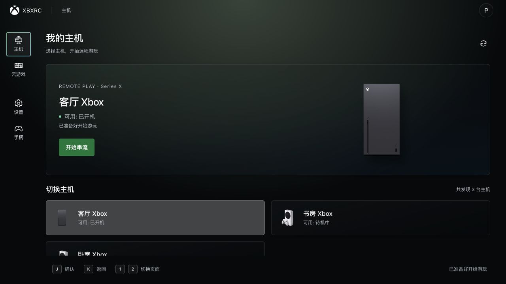
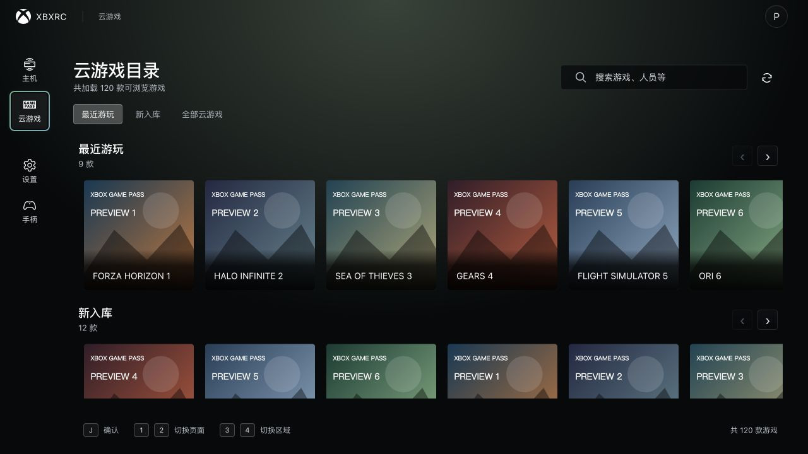
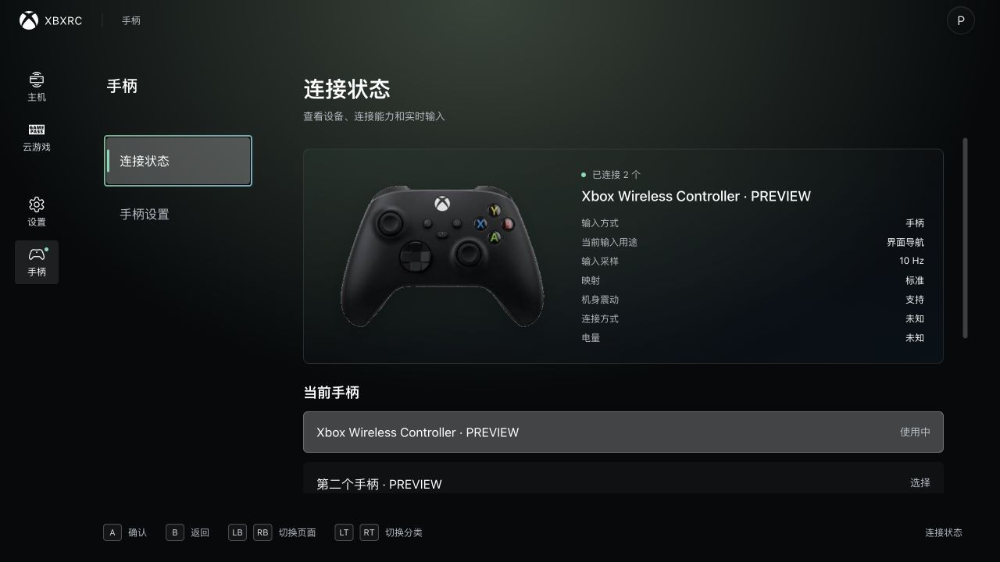

<div align="center">


# xbxrc

**把 Xbox 主机和云游戏，带到你的桌面。**

面向 macOS 与 Windows、由社区维护的 Xbox 串流客户端。

<p>
  <a href="https://github.com/xuasir/xbxrc/releases"></a>
  <a href="https://v2.tauri.app/"></a>
  <a href="https://vuejs.org/"></a>
  <a href="LICENSE"></a>
</p>

[English](README.md) · **简体中文**

[功能亮点](#功能亮点) · [下载安装](#下载安装) · [开源致谢](#开源致谢) · [反馈问题](https://github.com/xuasir/xbxrc/issues)

</div>

<picture>
  <source media="(prefers-color-scheme: dark)" srcset="docs/assets/readme/home-dark.jpg">
  <source media="(prefers-color-scheme: light)" srcset="docs/assets/readme/home-light.jpg">
  
</picture>

## 功能亮点

xbxrc 将 **Xbox 主机远程游玩（Remote Play）** 和 **Xbox 云游戏（xCloud）** 集中在一个桌面应用中。登录 Microsoft 账号，选择主机或云游戏，即可使用手柄或键盘开始游玩。

| 功能 | 你可以做什么 |
| --- | --- |
| **主机远程游玩** | 发现账号关联的 Xbox 主机，查看开机与待机状态、切换设备、唤醒支持远程管理的主机并开始串流；结束游玩时可关机并退出。 |
| **云游戏目录** | 浏览最近游玩、新入库和全部可用游戏，搜索标题并启动游戏；查看排队进度，选择连接地区与游戏语言偏好。 |
| **手柄操作界面** | 用手柄浏览页面、游戏卡片、设置和弹窗；肩键切换页面，扳机切换分类，底部操作提示随当前输入来源更新。 |
| **输入自定义** | 选择手柄，实时查看按钮、摇杆和扳机输入，调整游戏键位、摇杆行为与震动强度；支持可配置的键盘模拟手柄输入。 |
| **画面调节** | 分别设置主机与云游戏的分辨率偏好，选择自动码率或手动上限、H.264 编码档位，调整画面适配、锐化、亮度、对比度与饱和度。 |
| **实验性超分辨率** | 使用基于 FSR1 的放大与锐化，串流中随时切换，并导出超分 A/B 对比截图；可用性与性能取决于设备和 WebView 能力。 |
| **串流内工具** | 切换全屏、调整音量、开启麦克风、向主机发送文本，通过串流菜单触发 Xbox 导航键操作。 |
| **诊断与桌面体验** | 查看分辨率、RTT、抖动、帧率、码率与丢包，展开连接诊断并记录运行日志；支持深浅色主题、中英文界面，以及稳定版和测试版更新通道。 |

分辨率设置提供 720p、1080p 和 1440p 等偏好档位。实际协商的串流规格由主机或云服务能力、账号权限、网络环境与设备支持共同决定。

## 界面一览

<table>
  <tr>
    <td width="50%" align="center"><strong>浏览云游戏</strong></td>
    <td width="50%" align="center"><strong>管理手柄</strong></td>
  </tr>
  <tr>
    <td><a href="docs/assets/readme/cloud-games.jpg"></a></td>
    <td><a href="docs/assets/readme/controller.jpg"></a></td>
  </tr>
</table>

*截图来自应用的实际 Vue 界面，使用演示数据。账号、设备与游戏条目用于展示布局，云游戏封面带有 PREVIEW 标识。*

## 下载安装

前往 **[GitHub Releases](https://github.com/xuasir/xbxrc/releases)** 获取可用安装包与版本说明。

| 平台 | 安装包 | 环境要求 |
| --- | --- | --- |
| macOS | `.dmg` | Apple Silicon · macOS 26.0 及以上 |
| Windows | `.exe` 安装程序 | x64 · Microsoft Edge WebView2 运行时 |

日常使用选择 **Browser 版**；**Native WIP** 是用于原生串流与手柄开发验证的独立版本。应用设置中可选择稳定版或测试版更新通道。

### 开始游玩

1. 安装 xbxrc，登录 Microsoft / Xbox 账号。
2. **主机串流**：在 Xbox 主机上启用远程功能，在主机页选择设备并开始串流。待机唤醒还取决于主机的远程管理与电源设置。
3. **云游戏**：进入云游戏目录，选择游戏并开始游玩。可用内容遵循 Microsoft 的地区、订阅与游戏访问权限要求。
4. 连接兼容手柄，或在手柄设置中启用键盘模拟；按使用习惯调整画面与输入参数。

## 开源致谢

xbxrc 建立在开源维护者与贡献者的工作之上。感谢这些项目提供的基础库、开发工具与协议研究，让桌面 Xbox 串流体验得以持续完善。

### 使用的开源库与工具

| 项目 | 在应用中的用途 |
| --- | --- |
| [Tauri](https://github.com/tauri-apps/tauri) 与 [Tauri Plugins](https://github.com/tauri-apps/plugins-workspace) | 桌面应用壳层、系统集成、本地配置与应用更新。 |
| [Vue](https://github.com/vuejs/core)、[Vue Router](https://github.com/vuejs/router) 与 [Vue I18n](https://github.com/intlify/vue-i18n) | 响应式界面、页面路由与多语言支持。 |
| [Tokio](https://github.com/tokio-rs/tokio) 与 [reqwest](https://github.com/seanmonstar/reqwest) | Rust 异步任务，以及认证、Xbox API 和会话信令所需的 HTTP 请求。 |
| [Serde](https://github.com/serde-rs/serde)、[serde_json](https://github.com/serde-rs/json) 与 [thiserror](https://github.com/dtolnay/thiserror) | 数据序列化、配置读写与错误建模。 |
| [rustls](https://github.com/rustls/rustls)、[ring](https://github.com/briansmith/ring) 与 [RustCrypto](https://github.com/RustCrypto) | TLS、安全签名与认证加密，包括 P-256、HMAC 和 SHA-256。 |
| [rfd](https://github.com/PolyMeilex/rfd) 与 [tauri-plugin-keepawake](https://crates.io/crates/tauri-plugin-keepawake) | 原生文件对话框，以及串流期间的设备保活。 |
| [AMD FidelityFX FSR](https://github.com/GPUOpen-Effects/FidelityFX-FSR) 与 [FidelityFX CAS](https://github.com/GPUOpen-Effects/FidelityFX-CAS) | 实验性 FSR1 超分辨率与 CAS 风格锐化的算法参考。 |
| [TypeScript](https://github.com/microsoft/TypeScript)、[Vite](https://github.com/vitejs/vite) 与 [Sass](https://github.com/sass/dart-sass) | 前端类型、开发构建与样式处理。 |
| [ESLint](https://github.com/eslint/eslint)、[Antfu ESLint Config](https://github.com/antfu/eslint-config)、[Vue Language Tools](https://github.com/vuejs/language-tools) 与 [Vitest](https://github.com/vitest-dev/vitest) | 代码规范、Vue 类型检查与回归测试。 |

同时感谢 [Chrono](https://github.com/chronotope/chrono)、[UUID](https://github.com/uuid-rs/uuid)、[rust-url](https://github.com/servo/rust-url)、[Rand](https://github.com/rust-random/rand)、[Base64](https://github.com/marshallpierce/rust-base64)、[parking_lot](https://github.com/Amanieu/parking_lot)、[log](https://github.com/rust-lang/log) 与 [env_logger](https://github.com/rust-cli/env_logger) 提供的 Rust 基础工具。

### Xbox 社区项目

以下项目为本项目的研究、设计与实现提供了参考：

- **[Geocld / XStreamingDesktop](https://github.com/Geocld/XStreamingDesktop)**：Xbox 桌面串流流程与客户端实现参考。
- **[unknownskl / Greenlight](https://github.com/unknownskl/greenlight)**：Remote Play、xCloud 与 Xbox 串流协议探索。
- **[unknownskl / xbox-webapi-node](https://github.com/unknownskl/xbox-webapi-node)**：Xbox 认证与 Web API 研究；当前桌面应用的公共服务由 Rust 实现。

上游项目各自的版权与许可证适用于其对应成果。具体依赖声明见 [package.json](package.json)、[Cargo.toml](Cargo.toml) 与各 crate 的清单。

## 本地开发

<details>
<summary><strong>展开构建与运行说明</strong></summary>

桌面应用采用 **Tauri 2 + Vue 3 + TypeScript + Rust**。`main` 分支交付 Browser 版，通过 WebView WebRTC、媒体播放和 Browser Gamepad API 运行串流；`rust` 分支开发 Native WIP，共享认证、Xbox API 与会话合同。

开发环境采用 **Node.js 24**、**pnpm 9** 与 **[rust-toolchain.toml](rust-toolchain.toml) 固定的 Rust 工具链**，并安装对应平台的 [Tauri 环境依赖](https://v2.tauri.app/start/prerequisites/)。

```bash
git clone https://github.com/xuasir/xbxrc.git
cd xbxrc
pnpm install
pnpm tauri dev
```

`pnpm tauri dev` 同时启动桌面应用与 Vite 前端。常用检查与构建命令：

```bash
pnpm lint
pnpm typecheck
pnpm test
pnpm tauri build
```

| 目录 | 职责 |
| --- | --- |
| `src/` | Vue 界面、手柄导航与浏览器串流运行时。 |
| `src-tauri/` | Tauri 壳层、系统集成、配置、更新与诊断。 |
| `crates/` | Rust 公共认证、Xbox API、云游戏目录与串流会话库。 |

开发规范与验收方式见 [dev-docs](dev-docs/README.md)，方案与报告见 [项目文档](docs/README.md)，iOS 工程说明见 [iosapp/README.md](iosapp/README.md)。

</details>

## 许可证

xbxrc 使用 **[MIT License](LICENSE)**。Xbox、Microsoft 与游戏相关商标归各自权利人所有。
