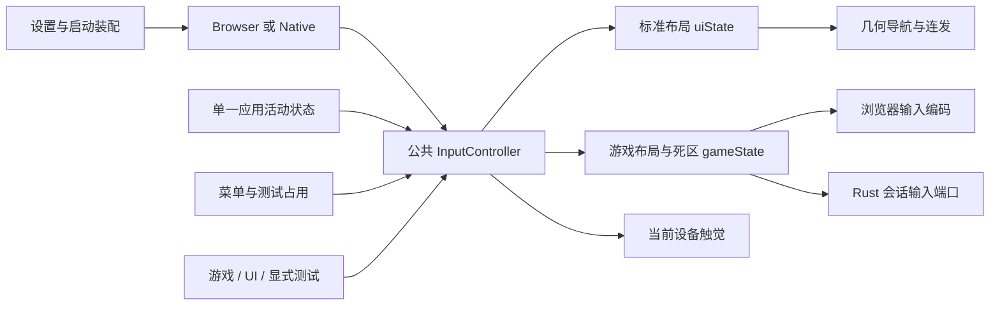

# 手柄导航系统 (Gamepad Navigation System)

## 概述 (Overview)

本系统是一个基于**几何空间寻路 (Geometric Pathfinding)** 的现代手柄导航引擎，完全替代了传统的、需要手动维护邻居节点 (`neighbors`) 的方案。它专为 Xbox 云游戏和串流场景设计，提供了与主机原生 UI 一致的丝滑体验。

## 核心架构 (Core Architecture)

代码统一收敛在 `src/navigation/core/` 目录下：

- **`pathfinding.ts`**: 核心算法。利用 `getBoundingClientRect()` 获取 DOM 坐标，在指定方向上计算候选元素的距离和对齐度得分，选出最佳目标。
- **`engine.ts`**: 状态管理器。维护当前焦点、Scope 栈、区域记忆 (`Zone Memory`) 和自动滚动逻辑。
- **`input.ts`**: 意图分发器。作为 UI 层的事件总线，接收来自手柄监听器的标准化指令。
- **`gamepad-listener.ts`**: 订阅公共 `InputController.uiState`，将标准按键映射为 UI 导航意图，并在离开 UI 或进入独占录入时停止连发。
- **`haptics.ts`**: 反馈系统。通过公共 `InputController` 发出 UI 震动请求；音效沿用界面音效配置。

## 使用指南 (Usage Guide)

### 1. 使元素可聚焦 (Focusable)

使用 `Focusable` 组件包装任何需要响应手柄点击的 UI 元素。

```vue
<script setup>
import { Focusable } from '@/navigation/core/vue'
</script>

<template>
  <Focusable as="button" @click="handleAction">
    确认按钮
  </Focusable>
</template>
```

- **`as`**: 指定渲染的标签（默认 `div`）。
- **`@click`**: 手柄 A、触屏和鼠标共用的动作入口。触屏/鼠标点击同步几何焦点，弹层关闭后回到来源行。
- **注意**: 引擎会自动计算上下左右关系，无需手动声明 `neighbors`。

原生输入使用 `@nav-action` 消费手柄确认：引擎先向当前节点派发可取消的 `nav-action`，控件调用 `event.preventDefault()` 后完成自身录入；其余控件继续调用既有 `click()`。返回同样先派发 `nav-back`，消费后保持当前 Scope，其余控件继续既有返回链路。设置输入复用 `SettingInputControl`：A 打开文字或数字键盘，完成回填父表单草稿并恢复来源输入，B 取消键盘草稿；父表单负责最终保存。键盘模拟启用时输入默认 readonly，方向键/J/K 保持导航；鼠标点击进入直接编辑，失焦或 B/Esc 退出直接编辑。

### 2. 区域隔离与管理 (Focus Scope)

使用 `FocusScope` 划分布局区域（如顶部导航、侧边栏、弹窗）。

```vue
<script setup>
import { FocusScope } from '@/navigation/core/vue'
</script>

<template>
  <!-- 弹窗场景：active 为 true 时焦点会被锁死在该区域内 -->
  <FocusScope id="modal-id" :active="isModalOpen">
    <div class="modal">
       <Focusable as="button">选项 1</Focusable>
       <Focusable as="button">选项 2</Focusable>
    </div>
  </FocusScope>
</template>
```

- **焦点记忆**: 当从区域 A 移到区域 B 再切回 A 时，引擎会自动恢复区域 A 上次的焦点。
- **自动聚焦**: Scope 激活时会自动寻找其内部标记为 `data-nav-default-focus` 的元素或第一个可聚焦元素。

### 3. 反馈配置 (Feedback Configuration)

系统对接了全局持久化配置，用户可以在设置页面控制：

- **UI Haptics**: 手柄震动开关。
- **UI Audio**: 界面音效开关。

开发者可以通过 `syncHapticsConfig` 强制同步状态，或在 `haptics.ts` 中扩展新的震动模式。

### 4. 页面与 Tab 切换 (Page & Tab Navigation)

手柄肩键和扳机键被映射为两级导航意图：

| 按键 | 意图 | 用途 |
|------|------|------|
| LB (L1) | `PagePrev` | 一级页面导航：XHome ← XCloud ← Setting |
| RB (R1) | `PageNext` | 一级页面导航：XHome → XCloud → Setting |
| LT (L2) | `TabPrev` | 二级 Tab/区域导航（上一个 Tab 或区域） |
| RT (R2) | `TabNext` | 二级 Tab/区域导航（下一个 Tab 或区域） |

引擎提供了 `onPageSwitch` 和 `onTabSwitch` 回调 API 供业务组件订阅：

```typescript
import { navigationEngine } from '@/navigation/core'

// 订阅页面切换
const dispose = navigationEngine.onPageSwitch((direction) => {
  // direction: 'prev' | 'next'
  // 执行路由跳转等逻辑
})

// 订阅 Tab/区域切换
const dispose2 = navigationEngine.onTabSwitch((direction) => {
  // direction: 'prev' | 'next'
  // 执行 Tab 切换或区域跳转等逻辑
})

// 组件卸载时取消订阅
dispose()
dispose2()
```

当前已集成的使用场景：
- **`AppShellLayout.vue`**：LB/RB 在 xhome/xcloud/setting 页面间切换
- **`Setting.vue`**：LT/RT 在 5 个设置 Tab 间切换
- **`XCloud.vue`**：LT/RT 在"最近游玩"、"新游戏"、"全部游戏"区域间跳转

## 性能优化建议 (Performance Tips)

1. **避免频繁重建 DOM**: 引擎使用了 `MutationObserver` 缓存可聚焦元素。频繁的 DOM 销毁和重建会导致缓存失效并触发重计算。
2. **布局透明**: 默认情况下 `Focusable` 和 `FocusScope` 使用 `display: contents`，不会影响 CSS Flex/Grid 布局。如果需要自定义样式，请显式提供 `as` 属性。
3. **快速移动**: 引擎会自动检测快速连按，并将滚动模式切换为 `instant` 以保证寻路坐标的准确性。

## 维护者注意事项

- **不要** 在业务代码中直接监听 `keydown` 事件来处理导航。
- **不要** 手动计算网格索引，除非是处理极特殊的环形滚动逻辑。
- UI 导航经 `gamepad-listener.ts`；游戏输入、设备选择与震动通过公共 `InputController`。


## 统一输入接入（2026-10-27）

`src/shared/gamepad/runtime.ts` 在应用启动时装配一个 `GamepadBackend`，默认 Browser。Browser 使用 Gamepad API，rAF 与 4ms 定时器共用一个采样函数；状态变化立即发布，相同状态以 100ms 心跳发布。实际精度由浏览器和 WebView 调度决定。Native 按需以 `StandardDevices` 模式启动现有 SDL3 service，跳过库级槽位映射和活动设备选择。原生桥启动结果与事件共用 `devices` 投影，每台连接设备仅携带 `deviceId/name/supportsRumble/state`；设备标准态变化持续发布。媒体运行方式与输入后端独立。



- `keep-active` 为各平台缺省值；应用活动事件保持输入归属。`follow-app` 使用 Tauri 主窗口 `onFocusChanged` 及一次初态 `isFocused`，明确失焦时释放，初态获取失败时放行。当前来源表达窗口焦点；Windows/FSE 可靠性等待实机证据，保守默认继续采用保持输入。
- `InputController` 根据策略、串流就绪与 capture 集合派生 `ui / stream / blocked`。设置测试和录入独占输入，原始状态仍可展示；界面导航与游戏状态归零。
- 单活动设备在连接期间锁定；显式选择可切换。断开后其他设备通过新按键取得控制权。交接吸收已经按住的控件，各自释放后恢复，其余控件可立即使用。
- UI 使用标准布局或设备映射的标准投影。游戏分支执行设备来源到 Xbox 输出的映射、左右独立死区、固定扳机死区和左右独立 Y 反转。传输编码边界执行一次协议 Y 轴转换。
- 开启键盘模拟后，键盘桥同时提交保存的游戏绑定与固定菜单布局；UI 合并物理与键盘输入，每个来源独立等待持键释放。WASD/方向键移动，J 确认、K 返回、1/2 切换页面、3/4 切换分类；Enter/Tab/Esc 保持原生表单行为，输入框与独占录入由编辑器消费。
- 浏览器串流先发送 metadata，再订阅输入；变化时发送并保留 100ms 空闲心跳。待发队列按 128 状态 / 250ms 限制，数字边沿和扳机变化保持顺序，连续纯摇杆状态取最新值；普通释放与交接优先使用 1KiB 余量，缓冲恢复直接触发 flush，50ms 轮询兜底。超预算显式归零并同步新鲜当前态，trace 记录清空/保留条目数、源身份与等待时间。Rust 串流按会话与递增序号接收公共状态，有界队列保留释放帧，传输成功后确认出队。
- 串流菜单与诊断菜单快捷键在公共层按配置的 Xbox 输出组合识别，完整释放前触发一次并吸收组成键输出；菜单默认 Menu+View，诊断默认未绑定。软 Home 通过公共状态传递。触觉按 owner、开关、当前设备及四路独立强度处理；Browser actuator 按实际 `trigger-rumble` 能力传递左右握把与左右扳机参数。

设置入口为“控制器 → 手柄设置”。“输入映射”统一编辑键盘和接入设备到标准 Xbox 输出的绑定，按来源分别保存。摇杆、震动、测试、高级工具使用 `/controller/:tool` 完整子页，连接页 `/controller/live` 复用输入测试组件。`/controller/keyboard` 保留兼容入口并初选键盘。

Xbox 图片表示输出目标，17 个按钮标注与实际热点共享选择和高亮；八个摇杆方向热点仅用于键盘来源。确认目标后在原图直接录入，等待全部释放或轴回中提交，自动结束独占并恢复原目标焦点。入口持键等待真实释放；最大同时按住集合形成 2–4 来源组合，组成键的单键输出在组合成立期间被吸收。标准占用来源沿用交换规则，独立背键及非标准原始按钮/轴按稳定设备布局标识保存。图示组在内容区居中，左右引线等距留白；标题旁显示活动来源小标，顶部提供恢复默认和应用，标题 20px。录入状态与取消按钮占据固定位置。来源切换保留草稿；恢复默认仅重置当前来源；返回提供放弃确认。键盘模拟开关位于外层手柄设置。

Browser 保留最多 128 原始按钮和 64 轴。`gamepad_game_controls.deviceMappings` 最多 64 布局、每布局 21 目标，支持按钮组合、带正反向与范围的轴。标准设备从旧 `buttons/extraButtons` 完整迁移；非标准设备默认四个摇杆轴直通、按钮未绑定，逐目标标定。标准手柄 UI 导航消费物理标准态，非标准手柄通过同一设备映射产生标准导航投影；游戏消费输出映射。键盘和屏幕虚拟输入直接表达标准输出。公共输入交接同时处理原始模拟扳机、轴与虚拟持键释放。

摇杆、震动调节在选中标注或图上热点下方展开高对比浮层。死区采用 0–30%、1% 步进滑杆，左右 Y 反转独立保存。几何引擎移动前派发可取消 `nav-direction`，滑杆消费左右方向进行调节，上下方向继续公共几何寻路。四路震动独立配置左右握把与左右扳机，标题右侧按钮测试当前通道；双路设备按实际能力提示扳机不可用。界面震动总开关在“设置 → 通用”，串流菜单/诊断菜单快捷键分组位于应用更新上方。

输入测试始终可进入，自动识别最近活动的键盘或接入设备，标题旁显示来源小标，显示保存映射后的 Xbox 按键值与左右摇杆位置。扩展按钮在首次实际输入后展示对应名称、数值与点按效果。测试和实时输入共用持续独占观察会话；手柄断开后键盘仍可观察，公共键盘桥的观察模式在游戏来源设为手柄或键盘模拟关闭时也可采集。观察期 UI 导航与游戏输出保持中立。出口为任意同设备的 Menu+View 标准投影长按 1 秒或 Ctrl+Shift+Esc，以及触屏/鼠标返回按钮；来源变化重置长按计时，重新接入设备的首个组合输入也可退出。图内录入允许录入 Menu+View，取消按钮、Esc 或键盘安全出口结束。

停用、卸载、退出统一释放 capture、键盘观察、计时器和触觉。设备或布局变化结束该设备的图内录入；自动测试允许接入、断开及活动来源变化。保存与焦点恢复按会话身份校验。键盘绑定及来源变更释放已有持键；组合配置 TS/Rust 校验保持一致。背键独立采样以固件和 Browser API 上报为准，真实设备及串流验收见[报告](../docs/reports/2026-11-11-gamepad-locked-input-and-extra-buttons.md)。

桌面已移除原生业务路由 RPC、焦点恢复扫描、全槽归零等待、重复 overlay gate 和 `ohmygamepad-host` 依赖。通用 ohmygamepad crate 的槽位/profile API继续服务库级调用；桌面只消费设备标准状态，SDL3触觉使用同一设备句柄。Windows 专用 haptics crate 保留为库，当前桌面 Native 采用 SDL3 实际能力。

验证范围、构建结果和平台待验项见 [统一手柄改造报告](../docs/reports/2026-10-27-unified-gamepad-input.md)。
