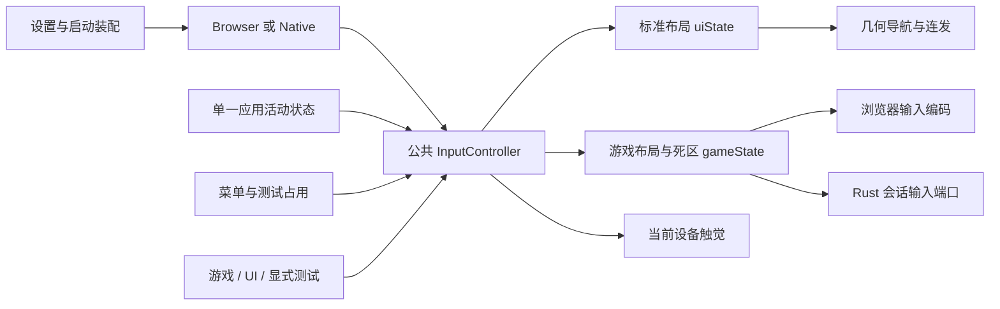

# 手柄导航系统 (Gamepad Navigation System)

## 概述 (Overview)

本系统是一个基于**几何空间寻路 (Geometric Pathfinding)** 的现代手柄导航引擎，完全替代了传统的、需要手动维护邻居节点 (`neighbors`) 的方案。它专为 Xbox 云游戏和串流场景设计，提供了与主机原生 UI 一致的丝滑体验。

## 核心架构 (Core Architecture)

代码统一收敛在 `src/navigation/core/` 目录下：

- **`pathfinding.ts`**: 核心算法。利用 `getBoundingClientRect()` 获取 DOM 坐标，在指定方向上计算候选元素的距离和对齐度得分，选出最佳目标。
- **`engine.ts`**: 状态管理器。维护当前焦点、Scope 栈、区域记忆 (`Zone Memory`) 和自动滚动逻辑。
- **`input.ts`**: 意图分发器。作为 UI 层的事件总线，接收来自手柄监听器的标准化指令。
- **`gamepad-listener.ts`**: 订阅公共 `InputController.uiState`，将标准按键映射为 UI 导航意图，并在离开 UI 或进入独占录入时停止连发。
- **`haptics.ts`**: 反馈系统。通过公共 `InputController` 发出 UI 震动请求；音效沿用界面音效配置。

## 使用指南 (Usage Guide)

### 1. 使元素可聚焦 (Focusable)

使用 `Focusable` 组件包装任何需要响应手柄点击的 UI 元素。

```vue
<script setup>
import { Focusable } from '@/navigation/core/vue'
</script>

<template>
  <Focusable as="button" @click="handleAction">
    确认按钮
  </Focusable>
</template>
```

- **`as`**: 指定渲染的标签（默认 `div`）。
- **`@click`**: 手柄 A、触屏和鼠标共用的动作入口。触屏/鼠标点击同步几何焦点，弹层关闭后回到来源行。
- **注意**: 引擎会自动计算上下左右关系，无需手动声明 `neighbors`。

### 2. 区域隔离与管理 (Focus Scope)

使用 `FocusScope` 划分布局区域（如顶部导航、侧边栏、弹窗）。

```vue
<script setup>
import { FocusScope } from '@/navigation/core/vue'
</script>

<template>
  <!-- 弹窗场景：active 为 true 时焦点会被锁死在该区域内 -->
  <FocusScope id="modal-id" :active="isModalOpen">
    <div class="modal">
       <Focusable as="button">选项 1</Focusable>
       <Focusable as="button">选项 2</Focusable>
    </div>
  </FocusScope>
</template>
```

- **焦点记忆**: 当从区域 A 移到区域 B 再切回 A 时，引擎会自动恢复区域 A 上次的焦点。
- **自动聚焦**: Scope 激活时会自动寻找其内部标记为 `data-nav-default-focus` 的元素或第一个可聚焦元素。

### 3. 反馈配置 (Feedback Configuration)

系统对接了全局持久化配置，用户可以在设置页面控制：

- **UI Haptics**: 手柄震动开关。
- **UI Audio**: 界面音效开关。

开发者可以通过 `syncHapticsConfig` 强制同步状态，或在 `haptics.ts` 中扩展新的震动模式。

### 4. 页面与 Tab 切换 (Page & Tab Navigation)

手柄肩键和扳机键被映射为两级导航意图：

| 按键 | 意图 | 用途 |
|------|------|------|
| LB (L1) | `PagePrev` | 一级页面导航：XHome ← XCloud ← Setting |
| RB (R1) | `PageNext` | 一级页面导航：XHome → XCloud → Setting |
| LT (L2) | `TabPrev` | 二级 Tab/区域导航（上一个 Tab 或区域） |
| RT (R2) | `TabNext` | 二级 Tab/区域导航（下一个 Tab 或区域） |

引擎提供了 `onPageSwitch` 和 `onTabSwitch` 回调 API 供业务组件订阅：

```typescript
import { navigationEngine } from '@/navigation/core'

// 订阅页面切换
const dispose = navigationEngine.onPageSwitch((direction) => {
  // direction: 'prev' | 'next'
  // 执行路由跳转等逻辑
})

// 订阅 Tab/区域切换
const dispose2 = navigationEngine.onTabSwitch((direction) => {
  // direction: 'prev' | 'next'
  // 执行 Tab 切换或区域跳转等逻辑
})

// 组件卸载时取消订阅
dispose()
dispose2()
```

当前已集成的使用场景：
- **`AppShellLayout.vue`**：LB/RB 在 xhome/xcloud/setting 页面间切换
- **`Setting.vue`**：LT/RT 在 5 个设置 Tab 间切换
- **`XCloud.vue`**：LT/RT 在"最近游玩"、"新游戏"、"全部游戏"区域间跳转

## 性能优化建议 (Performance Tips)

1. **避免频繁重建 DOM**: 引擎使用了 `MutationObserver` 缓存可聚焦元素。频繁的 DOM 销毁和重建会导致缓存失效并触发重计算。
2. **布局透明**: 默认情况下 `Focusable` 和 `FocusScope` 使用 `display: contents`，不会影响 CSS Flex/Grid 布局。如果需要自定义样式，请显式提供 `as` 属性。
3. **快速移动**: 引擎会自动检测快速连按，并将滚动模式切换为 `instant` 以保证寻路坐标的准确性。

## 维护者注意事项

- **不要** 在业务代码中直接监听 `keydown` 事件来处理导航。
- **不要** 手动计算网格索引，除非是处理极特殊的环形滚动逻辑。
- UI 导航经 `gamepad-listener.ts`；游戏输入、设备选择与震动通过公共 `InputController`。


## 统一输入接入（2026-10-27）

`src/shared/gamepad/runtime.ts` 在应用启动时装配一个 `GamepadBackend`，默认 Browser。Browser 使用 Gamepad API 和一个 rAF 采样循环；Native 按需启动现有 SDL3 service，订阅每台设备的未过滤标准状态。媒体运行方式与输入后端独立。



- `keep-active` 为各平台缺省值；应用活动事件保持输入归属。`follow-app` 使用 Tauri 主窗口 `onFocusChanged` 及一次初态 `isFocused`，明确失焦时释放，初态获取失败时放行。当前来源表达窗口焦点；Windows/FSE 可靠性等待实机证据，保守默认继续采用保持输入。
- `InputController` 根据策略、串流就绪与 capture 集合派生 `ui / stream / blocked`。设置测试和录入独占输入，原始状态仍可展示；界面导航与游戏状态归零。
- 单活动设备在连接期间锁定；显式选择可切换。断开后其他设备通过新按键取得控制权。交接吸收已经按住的控件，各自释放后恢复，其余控件可立即使用。
- UI 使用标准布局。游戏分支执行一次按键双射、左右独立死区、固定扳机死区和右 Y 反转。传输编码边界执行一次协议 Y 轴转换。
- 浏览器串流先发送 metadata，再订阅输入；变化时发送并保留 100ms 空闲心跳。Rust 串流按会话与递增序号接收公共状态，有界队列保留释放帧，传输成功后确认出队。
- Menu+View 在公共层识别；软 Home 通过公共状态传递。触觉同样按 owner、开关和当前设备处理，游戏/测试强度使用同一预设。

设置入口为“设置 → 手柄”：设备与行为、操控、震动、测试与高级四组。后台策略和触觉保存成功后即时生效；布局、摇杆和键盘使用草稿；后端下次启动装配。旧 profiles 保留在历史存储，桌面使用公共游戏布局配置。输入测试最长 20 秒，录入最长 10 秒，退出释放独占 capture。

桌面已移除原生业务路由 RPC、焦点恢复扫描、全槽归零等待、重复 overlay gate 和 `ohmygamepad-host` 依赖。通用 ohmygamepad crate 的槽位/profile API继续服务库级调用；桌面只消费设备标准状态，SDL3触觉使用同一设备句柄。Windows 专用 haptics crate 保留为库，当前桌面 Native 采用 SDL3 实际能力。

验证范围、构建结果和平台待验项见 [统一手柄改造报告](../docs/reports/2026-10-27-unified-gamepad-input.md)。
