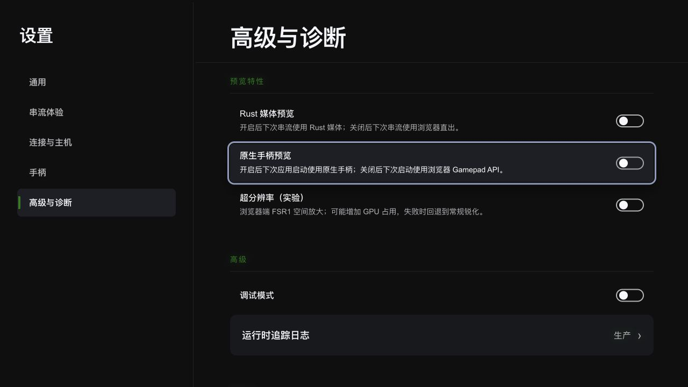

# 浏览器稳定版 P0 代码与交互验收

日期：2026-11-02。基线：`65e28495`。实现位于当前工作树。状态：代码与本地验证完成，平台与长测验收待补齐。

## 装配与交互合同

- 稳定默认：Browser Gamepad API、浏览器 WebRTC、WebView video/audio 直出。Tauri/Rust 承担桌面宿主、认证、会话与信令。
- 「高级与诊断 → 预览特性」统一承载 Rust 媒体、原生手柄与浏览器超分。两个原生开关分别直接决定媒体与输入后端；默认均关闭。
- Rust 媒体开关在下一次串流生效；原生手柄开关在下一次应用启动生效。当前后端与保存后的选择分别显示。
- 活动配置删除 `stream_runtime_mode`、`gamepad_backend`、`use_vulkan`、`polling_rate`。归一化按新字段白名单投影，旧键退出活动合同。Rust streaming snapshot 的内部装配 DTO 与原生领域采样参数继续服务既有消费者。
- 开关行统一提供描述、辅助技术关联与保存锁定；原生启动 RPC 校验对应开关及宿主能力。

## 自动验证

| 项目 | 结果 | 证据边界 |
| --- | --- | --- |
| `pnpm lint:fix` / `pnpm lint` | 通过 | 前端风格与静态诊断 |
| `pnpm typecheck` | 通过 | Vue / TypeScript 合同 |
| `pnpm test` | 50 文件 / 473 项通过 | 配置矩阵、Browser 采样、输入、会话替换与现有串流/渲染回归 |
| `pnpm build` | 通过 | 生产前端打包 |
| FFmpeg wrapper + `cargo test -p xbxrc --lib` | 208 项通过 | 新预览 RPC 许可、装配槽及现有 Tauri 单元测试 |
| `cargo fmt --all -- --check` | 通过 | Rust 格式 |
| `pnpm test:lifecycle` | 3 项测试 / 22 组故障回放通过 | trace gate 的成功、失败和退出码合同 |
| `pnpm release:verify-pipeline` | macOS / Windows 产物模拟通过 | 收集、清单和 updater 产物布局 |
| `pnpm test:macos-runtime` | 8 项通过 | 包内路径、系统版本、架构、签名、资产摘要与全部FFmpeg库的隔离版本查询 |
| macOS SDK 运行依赖检查 | ARM64 28 / x64 21 个二进制通过 | 真实SDK的完整依赖闭包、签名与固定资产摘要 |
| macOS release app / DMG | 构建与只读安装包检查通过 | app 15 个运行二进制；移动目录后检查通过；DMG 中 86 个文件与构建 app 逐项一致，CRC 有效 |
| `git diff --check` | 通过 | 补丁格式 |

Rust 编译保留既有两个 input metadata helper 未使用警告。

## 输入可靠性

发送结果由 DataChannel 贯通到 InputService；成功后才推进 sequence、消费 metadata 和发送统计。普通发送水位为 16KiB，中性释放允许最多额外 1KiB 的小报文；输入最多保留 8 条边沿，连续相同按钮态合并最新模拟值。溢出时以中性释放与最新状态构成有界队列，trace 记录丢弃事实。

metadata 最多保留 58 条，单报文最多 29 条；50ms 重试与 100ms 心跳保证闲置时提交。rAF 连续 100ms 缺少新采样时，Browser 后端通过定时器重新读取真实设备状态；停止、替换会话时回收输入和采样定时器。测试覆盖握手发送失败、数据失败、按钮按下/松开顺序、摇杆合并、软/硬水位、中性释放、metadata 消费、溢出与通道替换。

DataChannelHub在会话退出/替换时撤销事件监听并关闭通道，ControlChannel回收延迟上报定时器；重新bind前回收旧peer与媒体资源。故障后重连与显式关闭后重连两组回归覆盖旧握手、close、震动、track、ICE与诊断事件隔离，确认新输入继续发送、旧队列失效和所有退出定时器归零。

## 原生生命周期

启动应用时保留轻量 service 与空装配槽；StartRuntime 校验许可后创建引擎状态和 16ms tick。实例与控制 epoch 在同一锁内捕获，Stop 撤销排队控制；停止任务独立于 RPC 等待方，并发停止共享同一结果。引擎 StopRuntime 控制完成后恢复 macOS WebView 宿主并开放新实例，启动失败清理按实例身份匹配。

单元测试证明装配槽唯一性、停止期间的重启隔离与共享完成结果。真实媒体 actor、GPU、设备和系统窗口回收继续通过实机 trace 验收。

## 隔离 UI 验证

使用实际 Setting.vue、公共输入控制器与模拟 RPC；模拟配置保存在测试页面的 sessionStorage。验证经过默认关闭、两个开关独立保存、保存期间锁定、重开保留配置、手柄高级面板显示「当前正在使用：浏览器 · 下次启动生效」、关闭两个预览与返回页面。测试页和服务器已关闭。

## 发版与待验

macOS最低系统要求按用户确认统一为26.0，覆盖应用声明、Cargo链接目标、SDL/CMake与三条CI宿主。现有FFmpeg 8.1 SDK改为`@rpath` install name；ARM64固定随包提供7个X11/XCB传递库及其COPYING通知。运行库清单记录上游来源、原始和归一化SHA256，重复整理保持资产摘要及组件身份一致。

应用把当前架构的独立库装配到标准`Contents/Frameworks`，由Tauri按同一身份签名。ad-hoc签名使用对应的非Hardened Runtime策略；证书签名保留Hardened Runtime。隔离C探针在相同策略下加载全部7个FFmpeg库并查询版本，验证62/62/11/62/60/6/9的ABI主版本；这项证据覆盖动态依赖加载，Tauri窗口、GPU、输入设备与串流生命周期继续实机验收。

最终本地 ARM64 产物为 `target/release/bundle/macos/xbxrc.app` 与 `target/release/bundle/dmg/xbxrc_0.1.0_aarch64.dmg`。app 的 15 个运行二进制覆盖全部包内依赖，架构为 ARM64，最低系统版本为 26.0；移至 `/private/tmp/xbxrc-p0-relocated-dHbXFg/xbxrc.app` 后依赖闭包与签名检查继续通过。DMG 经 CRC 校验及只读挂载检查，内含 app 的 86 个文件/链接与构建目录逐项一致，主程序 SHA256 一致；挂载设备已卸载。

| 产物身份 | 值 |
| --- | --- |
| DMG SHA256 | `84b18bc605c9802158734123fd799c8f4b3948aee89e98fd768819bd4ab0b0e2` |
| 主程序 SHA256 | `19a4db040ecc550eed00c6862bae5437571ab596fc450ac60addbf8d6595c11b` |
| 构建 source SHA256 | `cad0a0368622cfe27ecfb4de08237f8e0e5f65d627b45896240cae44b7c08a4e` |
| 构建时间 Unix ms | `1793601161257` |
| 构建日志 | `/private/tmp/xbxrc-p0-package-build.log` |
| 最终 Tauri 测试日志 | `/private/tmp/xbxrc-p0-tauri-tests.log` |

本次为版本 0.1.0 的本地 ad-hoc 验收包，构建覆盖 `createUpdaterArtifacts: false`。正式 updater 签名、公证与发行继续按发布流程执行；平台实机验收使用上述具体产物身份。

build-tauri、release-beta、release-stable 三条流水线均加入前端 lint/类型/测试、Rust 格式/Tauri 单元测试、生命周期故障回放；原有产物构建与校验继续执行。GitHub runner 的实际执行结果需要 CI 运行取证。

- Windows/ROG：真实 Gamepad、后台/FSE、断连重连、菜单归属、键盘模拟、震动及退出释放。
- macOS/Windows：home/cloud 启动、取消、失败清理、断网恢复、预览启停与资源回收；确认 Browser 默认路径的原生实例/tick 为零。
- home/cloud 各 2 小时，稳定默认路径 8 小时长测；记录构建身份、系统/WebView/设备、输入、网络健康、恢复链、media supply、steady supply、帧供给 delta 与 submit/present 长尾。
- 自动实机运行沿当前任务的暂停约定；真实呈现和浏览器内部恢复状态按各自可观测边界取证。

## 手动验收顺序

2026-11-02 用户再次确认“保持自动运行暂停，手动验收”。自动启动应用、操作窗口与发起串流继续暂停；上述构建、隔离加载与只读包检查已经完成。

使用上述 DMG 的具体构建，记录系统版本、WebView、手柄型号、home/cloud 会话类型及操作时间。在「高级与诊断」将「运行时追踪日志」设为「开发」完成短测；长测使用「生产」并记录实际采样范围。日志位于应用日志目录的 `runtime-logs/`，实际呈现和系统资源证据另外记录。

| 顺序 | 操作 | 通过标准 |
| --- | --- | --- |
| 1. 稳定默认 | 关闭 Rust 媒体、原生手柄预览与浏览器超分，设置中性画面并重启；分别进行 home/cloud 短串流 | 手柄高级面板显示当前 Browser；浏览器直出有画面/声音，UI与串流输入归属正确；原生实例/tick 为零单独取证 |
| 2. Browser 输入与重连 | 快速按下/松开、摇杆回中、开关串流菜单、切换前后台、手柄断连/重连；退出后再次串流 | 松开状态及时提交，菜单及游戏控制符合当前归属；新会话输入持续有效，旧会话事件及震动退出生效范围 |
| 3. Rust 媒体独立预览 | 保持 Browser 手柄，开启 Rust 媒体；下一次串流生效，重复启动/停止五次，并覆盖启动取消、失败及断网恢复 | 当前会话与下次选择的生效时机正确；失败后可以重新启动，停止后 WebView 宿主恢复；GPU/线程/设备资源回收有证据 |
| 4. 原生手柄独立预览 | 关闭 Rust 媒体，开启原生手柄并重启；测试导航/串流/震动；关闭原生手柄后再次重启 | 当前后端与保存选择分别显示；重启后按选择切换，媒体保持浏览器路径；设备能力支持的输入及触觉通过 |
| 5. 组合与长测 | 补齐两个预览均开启的启停检查，再回到两个预览关闭；home/cloud 各2小时、稳定核心路径8小时 | 重复会话保持可恢复，资源增长可解释；网络、恢复、media/steady supply、帧差及呈现长尾按实际观测范围记录 |

Windows/ROG 补齐真实 FSE、后台输入、设备重连与触觉检查；CI runner 取证保持待验。短测通过后进入长测，资源与真实呈现缺少观测的项目保留待验状态。

P1 继续承担诊断聚合与 Cargo/FFmpeg 发行裁剪；当前同包预览仍包含原生依赖。
