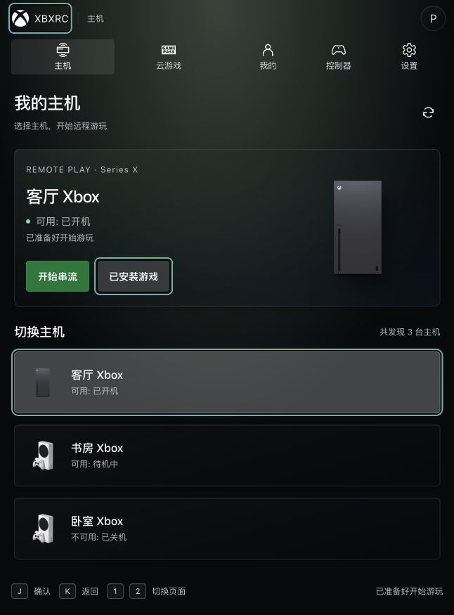
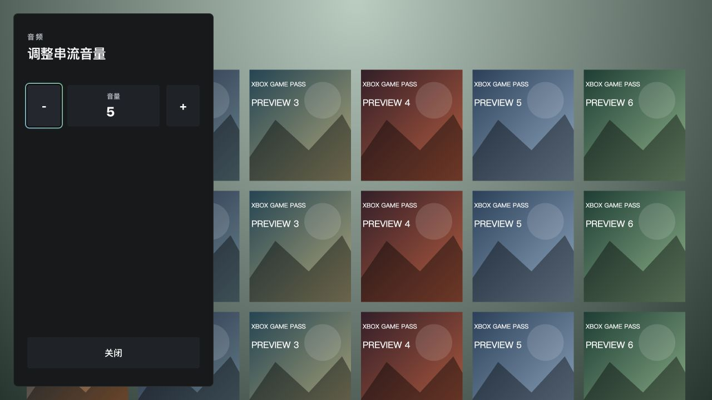

# PC 全页面导航焦点审计

> 本文及原始测试记录 2026-11-06 审计基线。焦点修复与窄屏悬浮导航已交付，最新结果见 [修复报告](../../../docs/reports/2026-11-06-pc-navigation-focus-recovery-report.md)；正式回归使用 `src/**/*.test.ts`，全量 666 项通过。下文保留修复前复现和截图。

- 日期：2026-11-06（Asia/Shanghai）
- 源码：`main` / `cb53524e6840005fee235e03adbabdd3b3facc99`
- 执行：主窗口，单窗口
- 状态：审计完成；修复方案见 [RFC](../../../docs/rfcs/2026-11-06-pc-navigation-focus-recovery.md)

## 结论

确认五类缺口：焦点有效性和空域恢复、旧焦点标记清理与页面记忆、最上层 Scope 归属、异步 Scope 生命周期、音量弹层返回与键盘隔离。前三类位于共享引擎，影响所有采用该引擎的 PC 页面。现有页面中的常规详情返回已经具备来源恢复，统一修复需要保留这些行为。

本轮交付源码审计、独立故障复现、真实 Vue 页面证据和修复 RFC。应用源码保持当前审计基线。浏览器预览使用实际 Vue 组件、几何导航及键盘输入桥，RPC 使用本地内存夹具；预览的保存、账户注销及数据查询作用于夹具内存。

## 页面覆盖

| 页面 / 入口 | 当前处理 | 审计结果与证据范围 |
| --- | --- | --- |
| 登录 | 独立 `login.scope`，默认 `login.sign-in`；加载期间按钮由 loading 替代 | 按钮出现时 `activeElement.id=''`、焦点标记为空；空域节点到达的引擎复现失败 |
| 主机 | 壳层 Scope；主操作随选中主机重建 | 主机卡片 → 云游戏 → 主机，实际焦点回 Logo，原卡片保留高亮；安装库 → 主机累计三处焦点标记 |
| 云游戏 | 壳层 Scope；区域 LT/RT、目录渐进渲染、搜索和轨道显露 | 已有 `onDeactivated` 取消分类订阅；页面返回记忆依赖壳层，目录收缩及窗口密度变化沿用共享失焦恢复 |
| 我的：账户与好友 | `useLibraryNavigation` 保存位置；好友列表邻近回退 | 好友详情默认 `friend.back`，返回正确恢复 `my.friend.2533274799`；后台恢复与保存仍读取全局第一处焦点标记 |
| 我的：成就 | 分类位置记忆、游戏列表邻近回退 | 游戏详情默认 `game.back`，返回正确恢复 `my.achievements.game.1000` |
| 我的：统计 | 共用 `GameHistoryPanel`，异步时长排序与来源恢复 | 源码核对完成；继续受共享有效性与后台恢复 Scope 归属影响 |
| 我的：相册 | 列表邻近回退、预览 `SettingModalShell`、停用关闭预览 | Esc 关闭截图后正确恢复 `album.screenshot.screenshot-0` |
| 好友详情 | 路由快照、返回、分类及游戏历史 | 常规进入 / 返回实测通过；恢复候选的有效性与最上层归属由共享修复承接 |
| 个人 / 主机游戏详情 | 同一 `GameDetail`，按游戏 / 分类记忆；成就与相册子面板 | 两种来源返回实测通过；异步安装数据改变 titleId 会触发恢复，恢复函数需检查最上层 Scope |
| 主机安装库 | 返回与默认入口、搜索 / 存储 / 排序、列表邻近回退 | 默认 `console.games.back`，游戏详情返回正确恢复 `console.game.installed-0`；返回 Home 出现三个标记 |
| 设置四分类 | 壳层 Scope、分类滚动记忆、行编辑与多层确认 | 通用分类 → 控制器 → 设置，实际焦点回 Logo，通用分类保留第二处标记；常规编辑恢复的原有测试通过 |
| 控制器两子页 | 活动标记、LT/RT、子页滚动位置与独占录入会话 | 源码已核对停用和录入清理；页面恢复缺少统一来源记录，子页延迟聚焦需要身份校验 |
| xHome / xCloud 串流 | 独立 `stream.page`；菜单打开时释放页面 Scope，关闭转移至 focus sink | 根页与输入捕获源码核对完成；连接 / chrome 自动隐藏 / 真实手柄留作修复后的实机验收 |
| 串流菜单 / 文本 / 警告 / 诊断 | 自有最上层 Scope、Escape、Tab 循环 | 已有各自事件处理；候选筛选及空候选行为需要统一有效性约束 |
| 串流音量 | Scope、按钮、原生数值输入；传入 `on-back` 属性 | 实际组件预览中 K（B）和 Esc 均保持面板打开；点击关闭按钮能关闭。组件缺少返回 / Tab 处理 |
| 头像账户与注销确认 | 独立 Scope、Tab 循环、Escape；页面内容 inert | 打开正确聚焦 `user-menu.my`，确认默认取消；Home 残留标记仍可成为全局查询的第一处结果 |

## 五类缺口

### F1 / P1：当前焦点有效性及空域恢复

- [engine.ts:47](../../../src/navigation/core/engine.ts#L47) 的观察器只在当前节点移出 document 时恢复。禁用、隐藏、inert，以及 `currentFocus=null` 后新节点到达，都跳过恢复。
- 观察属性仅为 `data-focusable/disabled/aria-disabled`。方向寻路与恢复候选使用不同筛选；`focusFirstAvailable` 直接取 selector 首项，`focusFirstInScope` 的默认目标只校验存在，记忆 / 来源只校验 selector 和 document。
- [engine.ts:202](../../../src/navigation/core/engine.ts#L202) 在空焦点时提前退出整条意图处理，页面切换与 Back 一并停止。隐藏的当前节点依然能接收确认。
- 独立复现覆盖禁用、隐藏、默认 / 记忆 / 来源目标、初始可见目标、节点到达、空域页面切换和返回。

### F2 / P1：旧焦点标记残留及页面来源记忆

- [engine.ts:94](../../../src/navigation/core/engine.ts#L94) 直接将 `currentFocus` 设为 null，旧元素的 `is-focused/data-focused` 保留。KeepAlive 将其回插后，旧高亮和当前焦点同时显示。
- 壳层默认是 Logo。Home / XCloud / Setting / Controller 的页面激活与返回缺少统一来源恢复；它们共用 `app.shell` 区域记忆。
- [library-view.ts:47](../../../src/pages/library/library-view.ts#L47)、保存与分类切换，以及云游戏区域切换，读取 `document.querySelector('[data-focused="true"]')`。标记残留会进一步污染区域识别与保存结果。
- 实测记录：

```json
{"case":"home-roundtrip","active":"top-nav.brand","focused":["top-nav.brand","xhome.host.stream-x"]}
{"case":"settings-roundtrip","active":"top-nav.brand","focused":["top-nav.brand","setting.tabs.general"]}
{"case":"home-library-return","active":"top-nav.brand","focused":["top-nav.brand","xhome.installed-games","xhome.host.stream-x"]}
{"case":"profile-open","active":"user-menu.my","focused":["xhome.installed-games","xhome.host.stream-x","user-menu.my"]}
```



### F3 / P1：程序化聚焦可以越过最上层 Scope

- [engine.ts:157](../../../src/navigation/core/engine.ts#L157) 的 `focusElement` 对外部来源缺少有效性与最上层域校验，rAF 提交也只检查节点连接及当前引用。
- [engine.ts:117](../../../src/navigation/core/engine.ts#L117) 对已有下层域重复传 `active=true` 仍执行 `focusFirstInScope`，可将焦点从上层弹窗拉回下层。
- [library-view.ts:72](../../../src/pages/library/library-view.ts#L72) 延迟恢复检查页面 active / key；最上层弹层、候选所属根及候选可用性仍需补齐。
- 独立复现确认“打开弹层后后台恢复到来源”和“上层存在时重新激活下层”均将高亮移出上层。

### F4 / P1：延迟激活与缓存生命周期

- [FocusScope.vue:22](../../../src/navigation/core/vue/FocusScope.vue#L22) 的 watch 与 mounted 在等待 nextTick 后直接激活，缺少关闭 / 卸载后的身份校验。
- 真实 Vue 生命周期复现：卸载后出现 `false -> true`；active 改为 false 后最后调用仍为 true；KeepAlive 停用缺少释放调用。
- `FocusScope` 只处理 mounted / unmounted。Scope 栈的 `isTopmostScope` 只读最后的 id；过期激活可能留下阻断肩键回调的栈项。

### F5 / P1：串流音量面板返回及键盘隔离

- `StreamAudioSheet` 为控件传入 `:on-back="handleClose"`；当前 `Focusable` 只定义 click / navAction / navBack，`on-back` 作为普通属性传递。
- 其他串流弹层自己订阅 Escape / Tab，音量面板缺少对应订阅；`xstream-page-ui` 的 keydown 监听负责显示 chrome。
- 组件预览默认聚焦 `preview.audio.decrease`，K 与 Esc 后面板均保持打开，点击关闭按钮成功。



## 验证与复跑

- 原有定向回归：4 文件 / 23 项通过，覆盖已有设置确认、输入编辑、详情分类与录入会话。
- 独立审计：2 文件 / 18 项，3 项夹具对照通过、15 项正确行为断言失败。全部失败均为行为断言；摘要见 [results.json](results.json)。
- 引擎用受控 DOM 状态调用生产 `NavigationEngine`；Scope 用真实 Vue hooks 与自定义 renderer，spy 记录生产组件的激活调用。
- 审计配置独立于默认 `src/**/*.test.ts` 回归入口。修复阶段将相关断言迁入正式测试，再统一维护。
- 审计 TypeScript 类型检查、独立 ESLint、`pnpm lint:fix`、15 个文档链接 / 资源与 `git diff --check` 通过；本轮修改集中于审计证据、RFC 和任务记录。

```sh
./node_modules/.bin/vitest run --config dev-docs/validation/2026-11-06-pc-navigation-focus-audit/vitest.config.ts
./node_modules/.bin/vue-tsc --noEmit --project dev-docs/validation/2026-11-06-pc-navigation-focus-audit/tsconfig.json
./node_modules/.bin/vitest run src/navigation/core/engine-settings.test.ts src/pages/library/library-navigation.test.ts src/components/settings/keyboard-editing.test.ts src/pages/settings/useGamepadPanelSession.test.ts
```

补充截图：[设置双焦点](assets/settings-double-focus.jpg)、[登录按钮出现时空焦点](assets/login-ready-no-focus.jpg)。浏览器临时标签已关闭，预览服务本轮启动并在审计收口时停止。

## 保留的约束与待验范围

- 继续使用 Vue 3 + TypeScript、Tauri + Rust、公共 InputController 和几何寻路。方向评分与现有滚动安全留白保持既有主线。
- Stream 的 focus sink 是关闭弹层后承接持键释放的专用节点；统一有效性需明确支持此用途。
- 好友 / 游戏详情、相册、设置多层确认与录入预算的已验证返回行为继续作为回归对照。
- 原生 select 的手柄录入、真实窗口失焦 / 恢复、串流 chrome 隐藏、长时间加载及物理手柄按键保持，归入修复验收矩阵。
- 推荐优先完成共享有效性、标记清理与 Scope 生命周期，再接入页面来源记忆和音量面板返回。
