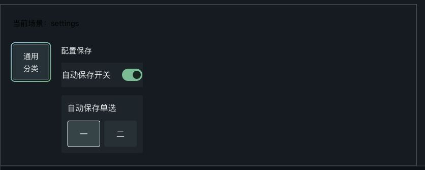

# 手柄导航覆盖与 A 确认焦点跳转审计

- 日期：2026-11-09，Asia/Shanghai。
- 源码：`main` / `20348f4cbfb294efe118082d1831d466b08a2554`；导航模块使用当前工作区源码。
- 执行：主窗口，单窗口。
- 状态：排查与复现完成；应用源码保留审计基线，修复作为后续任务。
- 接续结果（2026-11-09）：焦点、173 个交互声明及超窄屏适配已经完成，见[完整本地前端验证](../2026-11-09-gamepad-focus-action-completion/README.md)与[Report](../../../docs/reports/2026-11-09-gamepad-focus-action-completion.md)；下文保留审计时的失败基线。

## 结论

主要按钮、卡片、开关和自定义单选组件已经接入几何导航；完整交互覆盖存在三类缺口：7 处原生下拉框的选项操作、云游戏搜索与串流文字输入的屏幕键盘、相册原生视频控件的内部操作。

A 确认后的焦点跳转已经在实际 Vue 控件中复现。设置保存整组禁用控件，刷新按钮在请求期间禁用自身，引擎会清除来源高亮并聚焦其他有效节点。后续动画帧的原生 `focus` 事件经过 `Focusable.handleFocus` 再次调用 `focusElement`，清掉 `pendingRecovery`，保存结束后焦点继续留在回退节点。

本轮交付源码覆盖清单、事件循环断言、8 个浏览器场景和设置截图。浏览器预览使用生产 `Focusable`、`FocusScope`、`SettingSectionList`、`LibraryRefresh`、`SettingInputControl` 与导航引擎；保存、输入来源配置及反馈使用本地夹具，A 经生产 `inputDispatcher` 注入。

## 导航覆盖

扫描 `src` 下全部 60 个 Vue 文件，得到 106 处 `Focusable` 模板声明。动态列表共用同一声明，运行时节点数量随数据变化。所有声明都显式指定 `as`，其布局采用实际元素。清单由 [audit-coverage.mjs](audit-coverage.mjs) 生成，见 [coverage.json](coverage.json)。

另外核对 9 处原生指针处理：壳层滑动、6 处弹层遮罩与2处已有外层焦点归属的输入。壳层页面切换同时提供一级导航与 LB/RB 入口。

引擎的候选入口是 [focus-target.ts](../../../src/navigation/core/focus-target.ts#L1) 的 `data-focusable="true"` selector，普通节点继续校验可用性、布局、祖先可见性和最上层 Scope。原生表单标签通过组件包装或显式标记接入。

| 控件类型 | 当前接入 | 本轮判断 |
| --- | --- | --- |
| 按钮、卡片、开关、自定义单选 | `Focusable`；A 共用既有 click | 主要操作可达；普通按钮对照保持来源，异步禁用受下文 F1 影响 |
| 设置文字 / 数字输入、库内搜索 | `SettingInputControl` 消费 `nav-action`，打开 `SettingKeyboardSheet` | 实际组件 A 打开键盘并进入首个按键 |
| 原生 select | 7 处 `Focusable as="select"`，业务动作绑定 change | 能聚焦；A 的合成 click 保持选择器收起，鼠标 click 正常展开 |
| 云游戏搜索 | 原生 search input，显式导航标记及 focus 同步 | 能聚焦；A 落在原生 click，屏幕键盘接入存在缺口 |
| 串流文本 / 音量输入 | 外层 `Focusable`，原生输入 focus 同步 | 文本录入使用原生编辑；音量已有可导航的加减按钮 |
| 相册视频 | 原生 `video controls`；另有 `album.preview.play` | 播放 / 暂停有导航按钮；进度、音量等浏览器内部控件落在显式导航候选之外 |
| 各弹层遮罩 | 触屏 / 鼠标关闭入口 | 导航关闭按钮及 B 承担同一关闭动作 |

7 处原生下拉框分别为：

| 页面 | 节点 |
| --- | --- |
| 主机安装库 | `console.games.storage`、`console.games.sort` |
| 我的账户与好友 | `my.friends.filter` |
| 游戏成就详情 | `game.achievements.filter` |
| 相册 | `album.filter`、`album.game-filter` |
| 我的成就 / 统计共用面板 | `my.${mode}.filter` |

## F1：临时禁用及原生 focus 回调打断来源恢复

触发链：

1. [Setting.vue](../../../src/pages/Setting.vue#L283) 设置 `pendingActionKey`；[SettingSectionList.vue](../../../src/pages/settings/SettingSectionList.vue#L38) 将全部配置行设为 disabled。刷新入口 [LibraryRefresh.vue](../../../src/pages/library/LibraryRefresh.vue#L10) 将 busy 直接映射为 disabled。
2. [Focusable.vue](../../../src/navigation/core/vue/Focusable.vue#L57) 调整 tabindex、导航标记、aria-disabled 和原生 disabled，来源退出有效候选。
3. [engine.ts](../../../src/navigation/core/engine.ts#L333) 的观察器清除来源高亮，聚焦同页邻近控件，并将来源记入 `pendingRecovery`。这一步已经产生可见焦点转移。
4. [engine.ts](../../../src/navigation/core/engine.ts#L247) 在动画帧执行 DOM `focus()`；[Focusable.vue](../../../src/navigation/core/vue/Focusable.vue#L46) 接收原生 focus 并再次调用共享引擎。
5. [engine.ts](../../../src/navigation/core/engine.ts#L231) 在判断“同一当前节点”前清空 `pendingRecovery`，程序化同步清掉恢复事务。
6. 来源重新启用后，观察器看到回退节点继续有效，焦点停在回退节点。下一次 A 会作用于该节点。

真实组件记录：

```text
设置：audit.setting.toggle → disabled → audit.sidebar → 保存完成 → audit.sidebar
刷新：audit.refresh → disabled → audit.safe → 请求完成 → audit.safe

afterDisabledMutation: pendingRecovery = 来源 ID
nativeFocus:          pendingRecovery = ""
afterA:               current = 回退节点
```

原生回退节点对照保留恢复记忆，重新可用后回到来源。普通按钮 A 对照执行 1 次 click，焦点始终保持来源。这两个对照将故障定位到临时禁用及 `Focusable` 原生 focus 同步的组合。



## F2：原生控件的确认合同

[engine.ts](../../../src/navigation/core/engine.ts#L483) 先派发可取消的 `nav-action`，随后执行 `target.click()`。7 处原生 select 共用这个默认确认路径，业务只绑定 change；实际 `Focusable as="select"` 对照中，A 的 click 次数为 1、`isTrusted=false`、`:open=false`、值保持 `one`，鼠标操作的 `:open=true`。

云游戏搜索的 [XCloud.vue](../../../src/pages/XCloud.vue#L479) 和串流文字的 [StreamTextSheet.vue](../../../src/components/stream/StreamTextSheet.vue#L110) 采用原生输入 / 聚焦链。已具备完整屏幕键盘路径的 [SettingInputControl.vue](../../../src/components/settings/SettingInputControl.vue#L26) 可作为统一接入入口。

相册的 [AlbumPanel.vue](../../../src/pages/library/AlbumPanel.vue#L183) 采用浏览器原生 video controls，几何候选只遍历显式节点。外部播放按钮已经提供播放 / 暂停；内部进度和音量操作需要明确手柄入口。

## 验证证据

| 验证 | 结果 |
| --- | --- |
| 现有导航、设置、Scope、页面恢复、库内导航与录入会话回归 | 8 文件、72 项通过 |
| 新增事件循环审计 | 4 项：3 项对照通过；来源恢复目标断言失败，实际返回 `fallback-control` |
| 实际 Vue 浏览器预览 | 8 场景；设置保存和刷新结束后停在回退节点、原生 / Focusable 回退差异、下拉框及输入对照已确认 |
| 源码覆盖扫描 | 60 Vue 文件、106 Focusable 声明、7 原生 select、5 原生交互标签位置 |
| 代码规范与类型 | `pnpm lint:fix`、专项 ESLint、主线与专项 typecheck、3 份 JavaScript 语法检查通过 |

[engine-eventloop.test.ts](engine-eventloop.test.ts) 在受控 DOM 上将 rAF 延迟到观察器之后，并模拟生产 `Focusable.handleFocus` 的反馈。原有 [focus-dom.ts](../../../src/navigation/core/__tests__/focus-dom.ts#L136) 同步执行 rAF，其 `focus()` 只更新 active 引用；新场景补入浏览器真实反馈时序。

独立审计入口保留失败的目标行为断言，用于后续修复对照。结果见 [engine-results.json](engine-results.json)。浏览器原始阶段数据、唯一高亮、实际焦点和恢复记忆见 [browser-results.json](browser-results.json)。

```sh
node dev-docs/validation/2026-11-09-gamepad-focus-action-audit/audit-coverage.mjs
./node_modules/.bin/vitest run --config dev-docs/validation/2026-11-09-gamepad-focus-action-audit/vitest.config.ts
./node_modules/.bin/vue-tsc --noEmit --project dev-docs/validation/2026-11-09-gamepad-focus-action-audit/tsconfig.json
node node_modules/vite/bin/vite.js --config dev-docs/validation/2026-11-09-gamepad-focus-action-audit/browser/vite.config.mjs
```

本轮本机隔离预览的临时标签与服务在收口时关闭。Windows WebView、物理手柄、系统软键盘和实际串流交互按仓库约定由用户实机验收。

## 历史约束与修复顺序

- [2026-11-06 焦点恢复 RFC](../../../docs/rfcs/2026-11-06-pc-navigation-focus-recovery.md) 和 [Report](../../../docs/reports/2026-11-06-pc-navigation-focus-recovery-report.md) 已确定单一高亮、同页回退、临时来源记忆、新操作取消恢复、最上层 Scope 与 Stream focus sink 合同。本轮确认恢复事务在原生事件反馈时序中仍存在缺口。
- 2026-11-07 登录恢复的 MutationObserver 收敛、2026-11-08 串流父 Scope 有效性修复继续沿用；任务账本中的 Windows 掌机菜单及新 production trace 验收继续按既有任务推进。
- 当前模块入口为 `engine.ts`、`Focusable.vue`、`focus-target.ts`、`usePageFocus.ts` 与公共 `InputController`；几何寻路和公共输入归属保持当前主线。

建议优先完善 busy 操作的焦点保持：保存期间拦截重复确认并保留来源位置；程序化原生 focus 同步保留恢复事务，显式用户导航和点击决定取消恢复。随后将 7 处下拉框接入现有单选弹层，将搜索和串流文字接入共享屏幕键盘，并补齐视频内部操作所需的手柄入口。
