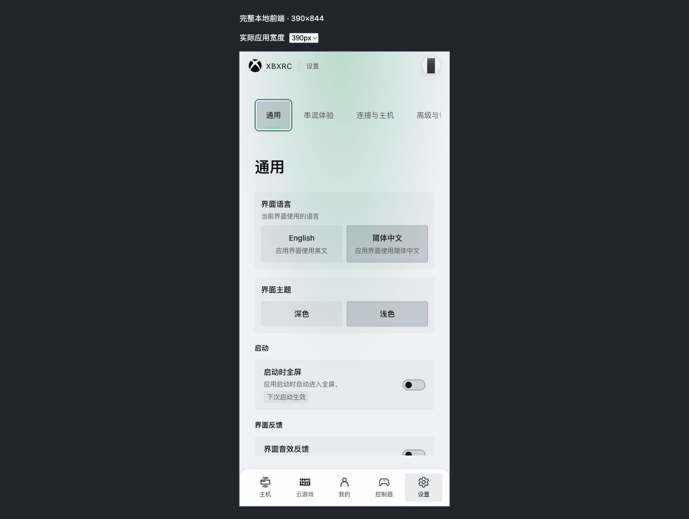

# 手柄焦点、交互导航与超窄屏完成验证

- 日期：2026-11-09，Asia/Shanghai。
- 执行：主窗口，单窗口。
- 完整前端：`pnpm dev` / `http://127.0.0.1:1420/`，本轮保留服务与窄屏预览。
- 最终结果：114 项完整 App 断言、86 文件 803 项全量测试、6 文件 63 项定向回归全部通过；173 个业务交互声明全部覆盖。
- 文档：[RFC](../../../docs/rfcs/2026-11-09-gamepad-focus-action-completion.md) · [Report](../../../docs/reports/2026-11-09-gamepad-focus-action-completion.md) · [修复前审计](../2026-11-09-gamepad-focus-action-audit/README.md)。

## 启动与操作

在仓库根目录启动同一前端服务：

```sh
pnpm dev --host 127.0.0.1 --port 1420
```

- [完整 App](http://127.0.0.1:1420/dev-docs/validation/2026-11-09-gamepad-focus-action-completion/project.html)。
- [实际窄屏容器](http://127.0.0.1:1420/dev-docs/validation/2026-11-09-gamepad-focus-action-completion/project-narrow.html)，可选择 320 / 390 / 600 / 601px 宽度，实际高度 844px。
- J = A 确认；K = B 返回；方向键 = Dpad；1 / 2 = LB / RB 切页；3 / 4 = LT / RT 切分类。

`project.html` 先安装离线 RPC 数据，再导入生产 `/src/main.ts`。App、路由、BrowserGamepadBackend、InputController、导航引擎及页面使用当前生产源码；主机、库、好友、媒体、配置、更新返回固定测试数据。每个浏览器实例生成独立 `instanceId`，异步前后对照要求实例相同。

浏览器的 viewport 覆盖在本轮实际返回 1280×720，因此 `project-narrow.html` 使用 iframe 提供真实布局视口。隐藏结果中的 `viewport.width / height` 和页面矩形已确认窄屏尺寸；完整 App 仍由同一 `src/main.ts` 装配。

## 自动回归

```sh
pnpm test:navigation-coverage --output dev-docs/validation/2026-11-09-gamepad-focus-action-completion/navigation-coverage.json
pnpm test --reporter=json --outputFile=dev-docs/validation/2026-11-09-gamepad-focus-action-completion/frontend-results.json
pnpm lint:fix
pnpm typecheck
pnpm build
pnpm test:trace-production
```

生产 trace 成本检查单独运行，以原始成本预算验收。最终 2 项通过；首次并发检查的 P95 0.563333ms 超过 0.5ms 预算，结束并发后独立重跑通过。

## 证据

| 文件 | 内容 |
| --- | --- |
| [validation-summary.json](validation-summary.json) | 最终检查汇总、Git 身份与 72 个验证相关源码文件 SHA256 |
| [project-browser-results.json](project-browser-results.json) | 完整 App 114 项结果、焦点 / busy / 来源及实际几何可达图 |
| [frontend-results.json](frontend-results.json) | 86 文件 803 项全量结果 |
| [targeted-results.json](targeted-results.json) | 6 文件 63 项焦点、选择、键盘、视频与主机状态回归 |
| [navigation-coverage.json](navigation-coverage.json) | 62 Vue 文件、173 个交互声明、108 个 Focusable 声明与 0 violations |
| [pathfinding-before-results.json](pathfinding-before-results.json) | 宽行几何修复前 5 项失败与 2 项对照通过 |
| [project-wide-row-before.json](project-wide-row-before.json) | 完整设置页向下跨过宽行开关的真实矩形基线 |
| [project-console-refresh-before.json](project-console-refresh-before.json) / [after](project-console-refresh-after.json) | 主机刷新期间串流入口可达与 A 去重修复对照 |
| [page-tab-memory-before-results.json](page-tab-memory-before-results.json) | 分类恢复修复前 1 项失败、10 项对照通过 |
| [project-tab-memory-before.json](project-tab-memory-before.json) / [after](project-tab-memory-after.json) | 同一实例分类 A 确认被旧记忆覆盖，以及 390px 两轮修复后往返 |
| [project-tab-memory-wide-after.json](project-tab-memory-wide-after.json) | 1280×720 四分类连续两轮确认保持来源 |
| [project-narrow-stacked-final.json](project-narrow-stacked-final.json) | 390×844 布局矩形、悬浮面板 0px 高度、94px 底部避让及唯一焦点 |
| [project-home-timeline.json](project-home-timeline.json) / [settings](project-settings-timeline.json) | 完整页面保存 / 刷新、重复 A 与进行中主动导航 |
| [project-search-timeline.json](project-search-timeline.json) / [video](project-video-timeline.json) | 搜索草稿、键盘取消、录像操作与返回 |
| [project-stream-failure-timeline.json](project-stream-failure-timeline.json) | 离线串流故障弹层、诊断展开与资源清理完成 |
| [browser-results.json](browser-results.json) | 早期 15 项隔离组件验证 |

`project-fixture.js` 中的可达图调用生产 `findNextFocusable`，候选来自当前最上层有效 Scope 和实际 DOM 矩形。关键确认、返回和方向操作同时经过真实 InputController，记录原生焦点、唯一高亮、busy、请求计数与 pending。

## 超窄屏结果

≤600px：二级菜单在上方水平滚动，内容区占下一行完整宽度；底部悬浮面板视觉隐藏，状态继续供辅助技术读取。601px：左右分栏与悬浮提示恢复。320px 最后一个二级菜单能够通过方向键完整显露，并向下进入内容控件。



完整 App 区域的 390×844 截图另存为 [project-settings-light-narrow-stacked-detail.jpg](project-settings-light-narrow-stacked-detail.jpg)，从完整截图的实际 iframe 矩形裁出，包含应用标题栏、二级菜单、内容和一级导航。

## 验证边界

离线数据验证 UI 导航、焦点恢复、忙碌去重、草稿输入与弹层边界。录像样本为本地 24 秒视频，音量以界面 90% / 100% 反馈确认；全屏检查覆盖窗口内全屏及 B 返回。实体手柄、Windows WebView、系统全屏、真实账户与网络串流按仓库约定交由实机验收。

新增交互入口继续运行覆盖检查，并用实体手柄验收连续 A 保存 / 刷新、分类往返、选择 / 输入和录像两级 B 返回。
