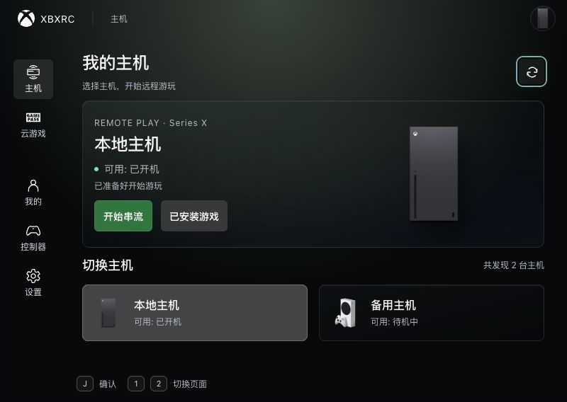

# 焦点裁切、滚动条与界面密度验证

日期：2026-11-09。任务：`2026-11-09-ui-focus-inset-density`。

## 调整与对照

主页内层滚动区统一保留 8px 焦点安全边距。800×568 的刷新按钮焦点环原先向右超出滚动边界 4px；调整后四边完整。全局隐藏纵向与横向滚动条，继续使用浏览器原生滚动。底栏右侧状态文字暂时视觉隐藏，保留 `status / alert` 的辅助技术反馈。

| 项目 | 调整前 | 调整后 |
| --- | --- | --- |
| 常规底部操作提示栏 | 72px | 48px |
| 800×568 主页展示卡片实际高度 | 226px | 208px |
| 800×568 展示卡片内边距 | 24px | 16px |
| 常规展示卡片内边距 | 32px | 24px |
| 设置选项内边距 | 12px 16px | 8px 12px |
| 账户菜单内边距 | 24px | 16px |

页面标题、控制器、资料页与弹层同时收紧间距。设置控件高度保持 44px，设置行最小高度为 52px。≤600px 继续上下分栏并隐藏悬浮提示；601px 时提示栏实际高度为 36px。圆角沿用 4 / 6 / 8 / 10px 共享尺度。

## 本地前端验证

使用 `pnpm dev --port 1430 --host 127.0.0.1` 启动当前项目，访问本目录 [验证入口](index.html)。入口以固定尺寸 iframe 加载生产 `/src/main.ts`、完整 App、路由及几何导航系统；Rust RPC 数据复用 [本地离线数据](../2026-11-09-gamepad-focus-action-completion/project-fixture.js)。

| 场景 | 应用尺寸 | 主题 | 检查重点 |
| --- | --- | --- | --- |
| 主页 | 800×568、1280×720 | 深色 | 刷新焦点四边、卡片密度、底栏 |
| 设置 | 1280×720 | 深色、浅色 | 列表滚动与末项焦点 |
| 设置 | 390×844、600×568、601×568 | 浅色 | 分栏、分类焦点、提示栏断点 |
| 控制器 | 390×844 | 浅色 | 展示区与输入区内边距 |
| 我的 | 390×844 | 浅色 | 页面密度与滚动区 |
| 好友筛选弹层 | 390×844 | 浅色 | 12px 面板边距、焦点完整 |
| 云游戏 | 800×568 | 浅色 | 刷新焦点与长内容滚动区 |
| 账户菜单 | 390×844 | 浅色 | 16px 面板边距、进入我的与注销焦点 |

共 12 个场景，全部采样焦点的 `clipping` 为空。各滚动容器均为 `scrollbar-width: none`，WebKit 滚动条 `display: none`、宽高 0px。设置列表通过滚轮从 `scrollTop: 0` 滚至 `295`；云游戏内容高度 1798px、可视高度 331px，窄屏横向游戏轨道同样保留原生滚动。底部状态文字为 1×1px、`clip-path: inset(50%)`。

原始记录见 [browser-results.json](browser-results.json)，裁切对照见 [before.json](before.json) 与 [home-after.json](home-after.json)，源码身份与检查汇总见 [validation-summary.json](validation-summary.json)。本轮临时 1430 服务已关闭，端口监听检查为空。

## 静态检查

`pnpm lint:fix`、`pnpm typecheck`、`pnpm build` 与 `git diff --check` 全部通过。本轮 14 个源码文件的修改均为样式；11 个 Vue 文件的模板及脚本与任务开始前一致。

