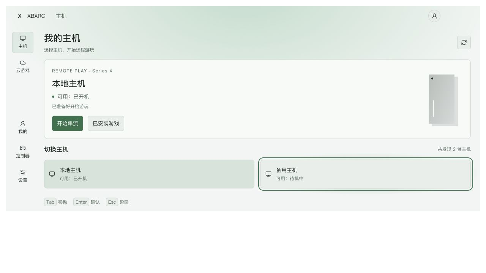

# 应用轻流动方案验证

日期：2026-11-09，Asia/Shanghai。主窗口直接执行。

[方案](../../../docs/isu/2026-11-09-ui-motion-vitality-plan.md)与独立示意已完成；浏览器 21 项检查全部通过。正式应用的 Vue 装配、实体手柄和媒体供帧成本接续实施阶段验收。

## 结果与证据

- [browser-results.json](browser-results.json)：五页宽屏 / 实际 320px 排布、当前页面与焦点、140ms 柔光起止、弹层 inert / 背景暂停、Enter / J 确认、Esc / K 返回、减少动态效果和连续切页，共 21 项断言及实际快照。
- [validation-summary.json](validation-summary.json)：最终示意 SHA256、字节数、静态检查与服务清理状态。
- [preview-light-wide.png](preview-light-wide.png)：最终浅色主机页，备用主机获得焦点。
- [settings-light-320.png](settings-light-320.png)：浅色 320px 排布检查图；采集于补齐减少动态效果入口前，最终偏好行为以 browser-results.json 为准。

柔光在移动期间具有预期的位置差，停止后的中心偏差为 0px。减少动态效果以 animation-name: none 判断环境光静止；animation-play-state 的 CSS 默认值仍可为 running。

## 复查入口

当前示意源码：

```text
/Users/guo.xu/.codex/visualizations/2026/11/09/01a1bf8e-6ca7-7920-bc74-82b2817ee6ee/xbx-motion-vitality.html
```

本次使用 visualize 的 render.py 包装为 sandbox iframe，在临时 8949 服务中操作原生按钮和键盘，按真实 DOM 矩形核对焦点。浏览器 viewport 352px 对应包装内实际内容宽度 320px，默认 viewport 对应 1248px 内容宽度。

最终脚本通过 JavaScript 语法、literal imports 与静态 DOM 引用检查，浏览器错误为 0。预览浏览器页关闭、viewport 覆盖复原、8949 服务关闭。


