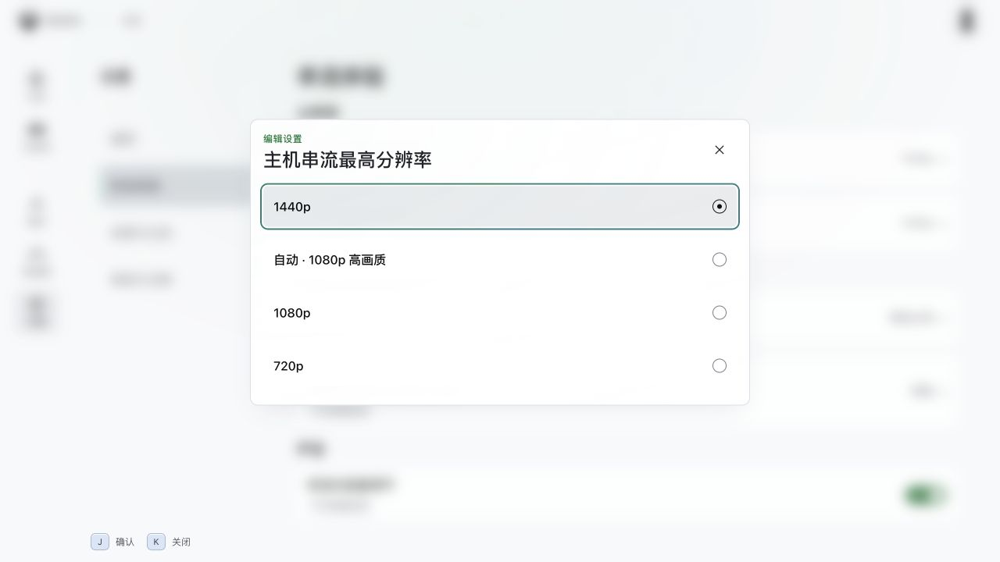

# 弹窗首次进入动效修复

日期：2026-11-10。任务：`2026-11-10-overlay-mount-enter-motion`。

## 原因与修复

设置页数值编辑器和单选弹窗以当前行的 `nodeId` 为组件 key。打开时 key 更新，共享 `UiMotionTransition` 随弹窗首次挂载；Vue Transition 默认跳过首次挂载的进入过渡。

共享过渡仅为 `kind='overlay'` 开启 `appear`，首次挂载复用既有进入逻辑：遮罩整体淡入 180ms，面板延后 20ms、用 160ms 从 `translateY(6px)` 回到静止位置。静止偏好、媒体生命周期、输入中断和焦点恢复继续沿用共享合同。

## 实际 Vue 回归

扩展既有[完整前端入口与回归](../2026-11-10-ui-motion-vitality/index.html)。真实运行 Vue、WAAPI、导航引擎及页面，以原有内存夹具提供 Rust RPC 数据。

- 修复前：[before.json](before.json) 的前 22 项通过，新增第 23 项在主机分辨率弹窗失败；面板 transform 为 `none`，动画记录缺失。
- 修复后：1280×720 / 390×844 各 44 项通过，浏览器运行错误均为 0。[宽屏](browser-wide.json)、[窄屏](browser-narrow.json)。
- 新增场景覆盖主机分辨率首次 / 重复打开、主机和云游戏码率编辑项切换，以及四次关闭后的来源焦点恢复。
- 实测面板进入记录为 160ms、延后 20ms、起点 `translateY(6px)`；系统减少动态效果时首次挂载保持静止和可操作焦点。
- 原有账户菜单、嵌套确认、页面动效、媒体生命周期和浅色合同回归全部通过。
- `src/app/ui-motion.test.ts` 与 `src/components/settings/navigation-controls.test.ts` 共 23 项通过；`pnpm lint:fix`、`pnpm typecheck`、`pnpm build` 与 `git diff --check` 通过。

静止后的浅色弹窗截图：

临时 1430 服务与浏览器标签已关闭。原生窗口的实际观感由用户体验验收。
