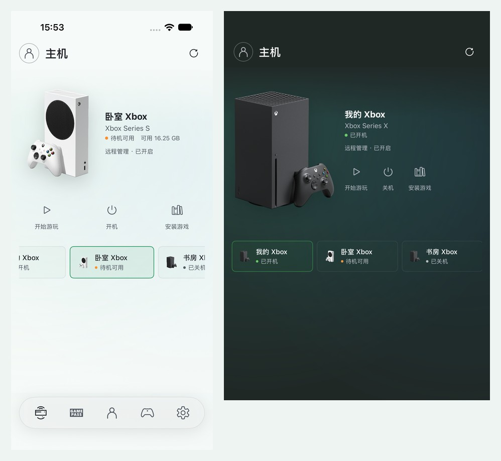

# 主机图片与横向切换验收

当轮页面采用透明主机图与信息左右布局、下方横向机器切换、18pt 线框动作和至少 44pt 点击范围。最终手机定向交互、14 张中英文尺寸布局、Simulator/Device 构建与静态检查通过；运行、源码校验和手动验收范围见[验证清单](validation.json)。

2026-11-18 精简后保留三张设备状态截图：[开机](host-hero-series-x.png)、[待机](host-hero-series-s.png)、[离线](host-hero-offline.png)。14 张逐尺寸截图与重复手机预览已清理，[截图清单](manifest.json)记录保留状态图的来源与 SHA-256。最新单台设备要求见[导航任务](../2026-11-17-ios-navigation-surface/README.md)。
