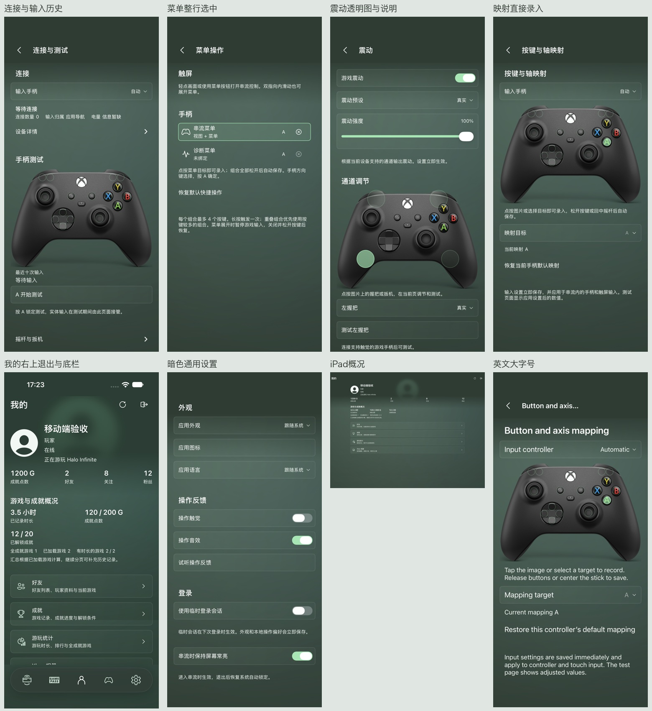

# 最新批注逐条验收与对照

本轮共16项修订：关联聊天5图12条、本聊天追加退出位置1图1条、Xbox手柄图标及暗色主题两项文字要求。原文、坐标、来源和SHA见[来源清单](source-manifest.json)，实施与全局覆盖见[报告](../../../docs/reports/2026-11-17-ios-latest-annotation-followups.md)。

## 分批对照

| 批次 | 批注与同尺寸对照 |
| --- | --- |
| 第1批，2来源图 | A01–A04：连接篇幅、热点/十次历史、移除长按调节、整行高亮。[667×809pt对照](batch-1-comparison.jpg)。 |
| 第2批，2来源图 | A05–A09：透明手柄图与图下说明、三独立入口、目标选择直接录入。[667×809pt对照](batch-2-comparison.jpg)。 |
| 第3批，1来源图 | A10–A12：背景通顶、右上刷新、概况/四子页。[550×804pt对照](batch-3-comparison.jpg)。 |
| 追加退出与图标 | A13–A14：右上退出、标准Xbox手柄。[402×874pt实际应用对照](additions-comparison.jpg)。最新退出位置更新A12原位置要求。 |
| 追加暗色主题 | A15–A16：更亮的浅绿画布、透明横条、高对比度文字。[390×844pt对照](dark-theme-comparison.jpg)。 |

前三批修订前采用历史间距轮的同尺寸源码截图，原用户图片继续完整归档。追加退出对照使用用户本轮标注的实际应用原图。暗色对照采用本轮主题修改前后的实际绘制。

## 最终矩阵

手机和iPad分别完成192张双语信息页绘制、200张设置/壳层绘制，最终共784张。矩阵页数按测试窗口和生产页面区分；每端运行相同尺寸矩阵。

| 信息布局 | 尺寸pt | 主题/字号 |
| --- | --- | --- |
| narrow-light | 320×800 | 浅色/large |
| phone-dark | 390×844 | 深色/large |
| phone-accessibility | 390×844 | 深色/accessibility3 |
| window-dark | 550×804 | 深色/large |
| controller-window-dark | 667×809 | 深色/large |
| landscape-dark | 844×390 | 深色/large |
| tablet-light | 1024×768 | 浅色/large |
| tablet-dark | 1366×1024 | 深色/large |

信息矩阵覆盖12页×8布局×中英×2端=384张。设置/壳层矩阵覆盖20页×10布局×2端=400张，包含320pt大字号、744pt分屏、834pt纵屏、1366pt宽窗和英文串流设置。

矩阵页数、尺寸与运行次数保留于上表和[验证清单](validation.json)；四份完整附件矩阵已于2026-11-18清理。

[图像归档清单](manifest.json)记录精简后的5张关键界面、分批对照和哈希；6张用户原图按[来源清单](source-manifest.json)完整保留。最终暗色实际应用图为[我的](phone-final-dark-annotations-my-overview.png)与[退出确认](phone-final-dark-annotations-my-sign-out-confirmation.png)，子页返回结果见[交互清单](interaction-results.json)。另保留[窄屏大字号通用设置](final-phone-narrow-accessibility-settings-general.png)、[iPad大字号画面设置](final-ipad-accessibility-settings-picture.png)和[iPad宽窗通用设置](final-ipad-tablet-large-settings-general.png)。其余单图、重复返回图及主题修改前单图已清理。

[对比度记录](contrast.json)使用相对亮度公式；把三层环境光的最大透明度同时叠加，再叠加普通表面上端作为保守边界。辅助文字最低4.58:1，正文最低4.93:1，动作图标最低3.39:1。头像/媒体实际图和真实串流内容通过视觉及实机检查补齐。

原始截图包含确定性测试数据和远端图片回退。验证清单中的/tmp路径记录当轮结果包与导出来源；仓库保留关键界面、用户原图、六张对照/预览和测试摘要。
