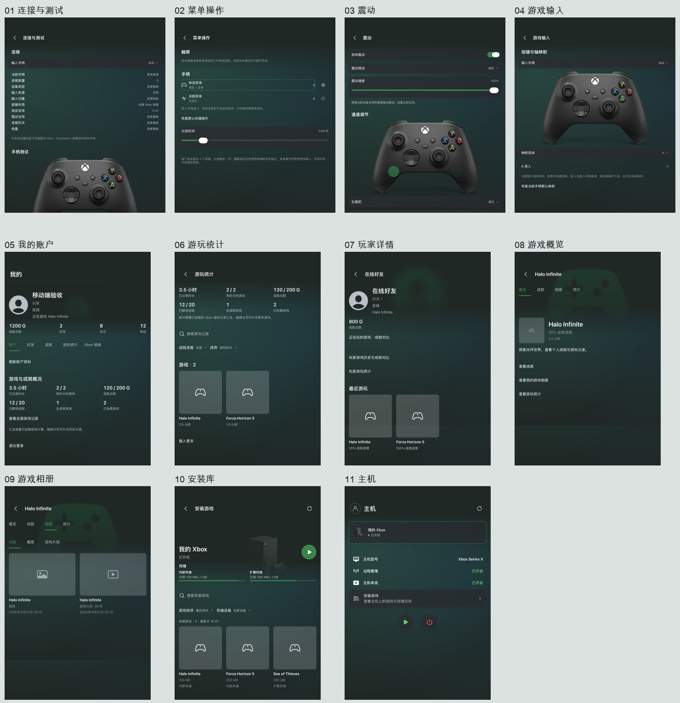

# iOS 十一图批注修订历史证据

[原图清单](source-manifest.json)保留 11 张批注图片的页面、原始来源与 SHA-256。覆盖连接测试、菜单操作、震动、游戏输入、账户、游玩统计、玩家详情、游戏概览、相册、安装库与主机，最终行为见[交付报告](../../../docs/reports/2026-11-17-ios-spacing-review.md)。

手机与 iPad 当轮各完成 176 张布局绘制：11 页 × 8 种布局 × 中英，总计 352 张。尺寸范围为 320–1366pt，覆盖深浅主题、横屏和辅助字号。[交互清单](interaction-results.json)保留手机 13 项适用检查、iPad 15 项检查的最终状态；[验证清单](validation.json)保留设备构建、源码与交互日志校验信息。

2026-11-18 精简后保留总览、原图来源和测试摘要；55 张代表 PNG、完整附件矩阵与逐图清单已清理。后续同尺寸批注对照见[最新批注归档](../2026-11-17-ios-latest-annotations/README.md)。
