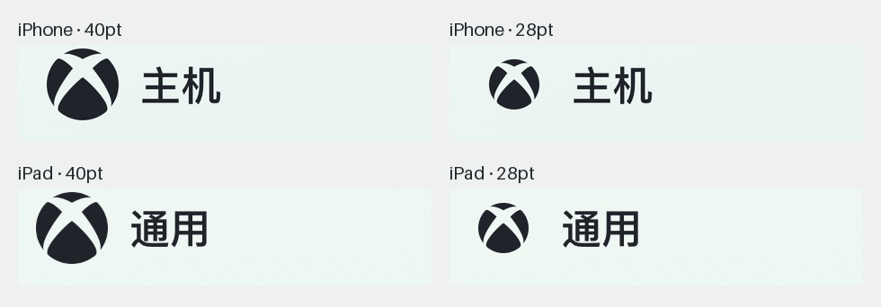

# 顶部 Xbox 标志比例验收

2026-11-18：Xbox 图形从 40pt 调整为 **28pt**，在原有 **40pt 槽位**内居中，槽位与标题间距保持 12pt。手机和 iPad 五个根页的标题位置、导航栏高度及底栏实际下沿 24pt 保持稳定。当前规范见 [iosapp/DESIGN.md](../../../iosapp/DESIGN.md)。

手机与 iPad 各 **2 项 UI 测试通过**，覆盖五页品牌标志与标题对齐、底栏几何、云游戏滚动经过标题栏、单台主机居中。截图像素核验确认两台设备的图形均为 28×28pt，五页标题边界与前一轮逐项一致。Swift 格式按仓库 4 空格配置检查，`pnpm lint:fix` 通过。

| 证据 | 内容 |
| --- | --- |
| [手机主机页](phone-hosts.png) · [iPad 设置](ipad-settings.png) | 最终实际界面，PNG 重压缩通过 RGBA 像素一致性核验 |
| [手机结果](phone-summary.json) · [iPad 结果](ipad-summary.json) | 各 2 项通过，测试失败数为 0 |
| [手机测试摘要](phone-test-summary.txt) · [iPad 测试摘要](ipad-test-summary.txt) | 测试名称与结果 |
| [手机头部几何](phone-header-geometry.txt) · [iPad 头部几何](ipad-header-geometry.txt) | 28pt 图形、18pt 可见图形到标题距离及五页对齐 |
| [验证清单](validation.json) | 源码/图片 SHA-256、像素尺寸与暂存区保持记录 |
| [首轮几何诊断](r1-old-geometry-diagnostic.json) | 首轮沿用 40pt 期望产生的断言失败；同步现有断言后在 r2 复验通过 |
| [清理记录](cleanup.json) | 本轮临时范围、磁盘释放量及共享依赖缓存保留 |

本轮临时目录 `/private/tmp/xbxrc-ios-brand-logo-scale-20261118` 按 r1/r2 隔离，已确认构建、测试与导出进程结束并完成清理。归档两张关键 PNG、一张头部对照和必要摘要后，清理本轮结果包、重复附件、临时 DerivedData、日志及基线副本；目录占用 0.618GiB，磁盘可用空间增加 0.381GiB，清理后可用空间 77.06GiB。共享 SourcePackages 缓存继续保留，暂存区差异 SHA-256 与开工时一致。
