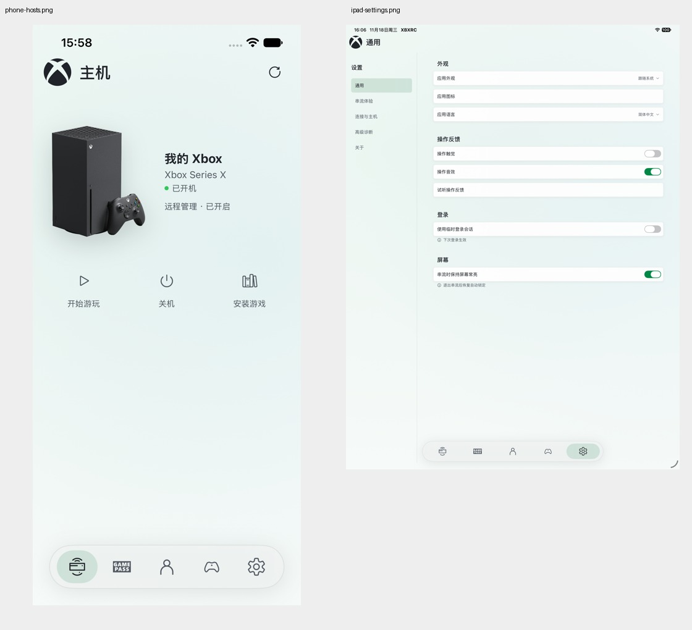

# Xbox 标志与底栏边距验收

本页记录首次品牌替换与底栏间距验收；后续图形尺寸调整为 28pt，当前比例与复验见 [顶部 Xbox 标志比例验收](../2026-11-18-ios-brand-logo-scale/README.md)。

2026-11-18：底栏下沿距屏幕 **24pt**，与页面左右留白共用同一令牌；系统安全区计入该距离。五个根页左上角复用 PC 的 Xbox 矢量标志，固定 **40pt** 槽位与 **12pt** 标题间距，按主题正文色显示。宽窗底栏居中限宽 560pt。当前规范见 [iosapp/DESIGN.md](../../../iosapp/DESIGN.md)。

手机与 iPad 各 **4 项 UI 测试通过**，覆盖根页标志与标题对齐、底栏几何、单台主机居中、云游戏滚动遮挡、末行可达及设置控件边缘交互。iPhoneOS 设备目标构建、Swift 格式、`pnpm lint:fix`、串流会话边界及暂存/未暂存 diff 检查通过。

| 证据 | 内容 |
| --- | --- |
| [手机主机页](phone-hosts.png) · [手机末行](phone-final-row.png) · [iPad 设置](ipad-settings.png) | 关键最终界面 |
| [手机结果](phone-summary.json) · [iPad 结果](ipad-summary.json) | 各 4 项通过，测试失败数为 0 |
| [手机测试摘要](phone-test-summary.txt) · [iPad 测试摘要](ipad-test-summary.txt) | 测试名称和结果 |
| [手机头部几何](phone-header-geometry.txt) · [iPad 头部几何](ipad-header-geometry.txt) | 五个根页标志位置、尺寸与标题对齐 |
| [设备构建摘要](device-build-summary.txt) · [验证清单](validation.json) | 构建通过、间距合同及图片/源码 SHA-256 |
| [临时产物清理](cleanup.json) | 本轮清理范围、磁盘释放量与共享缓存保留记录 |

保留 3 张关键 PNG 与 1 张预览，PNG 重压缩通过逐 RGBA 像素一致性核验。本轮临时目录 `/private/tmp/xbxrc-ios-brand-navigation-20261118` 已清理；清理前确认相关构建、测试和导出进程均已结束，并核验上述 3 张图片与 11 项源码哈希。目录占用 0.984GiB，磁盘可用空间增加 0.763GiB，清理后可用空间为 77.82GiB。共享 SourcePackages 缓存继续保留。
