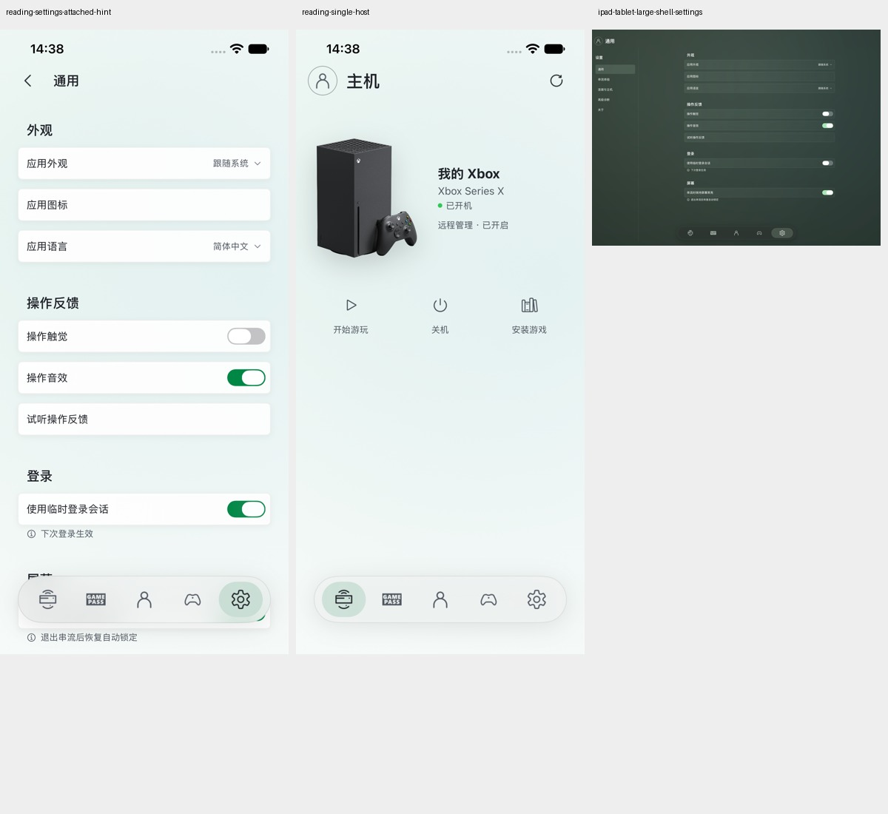

# iOS 导航与阅读最终验收

2026-11-18，PC设置迁移与最新四图批注接续验收。[交付报告](../../../docs/reports/2026-11-18-ios-navigation-reading-followups.md) · [执行RFC](../../../docs/rfcs/2026-11-18-ios-navigation-reading-followups.md) · [原始批注](../2026-11-17-ios-navigation-surface/README.md)。

[五页头部修订对照](ipad-header-before-after.jpg)记录宽窗侧栏修订前后；最终手机和iPad的头像/标题横向起点一致。原生尺寸见 `diagnostics/phone-root-header-geometry.txt` 和 `diagnostics/ipad-root-header-geometry.txt`。

| 验收 | 结果与证据 |
| --- | --- |
| 手机完整迁移回归 | 50项通过、342张布局，阶段为正文动效修订后、宽窗头部修订前；摘要为 `diagnostics/phone-migration-summary.json`。 |
| 最终手机 | 8项通过，6UI与2原生栈；`diagnostics/phone-summary.json` 与测试摘要。 |
| 最终iPad | 50项通过、342张布局；`diagnostics/ipad-summary.json` 与测试摘要。 |
| Rust/设备/边界 | Rust65项、iPhoneOS构建及串流边界通过；相应摘要位于 `diagnostics/`。 |
| 窄屏与大字号 | [320pt画面设置](ipad/ipad-narrow-accessibility-settings-picture.png)。 |
| 英文与宽窗 | [英文设置](ipad/ipad-phone-settings-english.png)、[宽窗深色设置](ipad/ipad-tablet-large-shell-settings.png)。 |
| 末项避让 | [手机末项](phone/settings-final-row.png)与整行点击回归。 |

每套布局包含200张设置/壳层、128张中英阅读页及14张主机概览。最终归档保留11张关键PNG和2张JPEG预览，完整尺寸矩阵随临时目录清理；PNG重压缩逐RGBA像素一致。`validation.json`保存保留图片、源码和验证摘要哈希，`diagnostics/`保存必要失败诊断；JSON中的临时路径表示当轮来源。

已清理 `/private/tmp/xbxrc-ios-navigation-reading-20261118`，目录占用4.93GiB，实时释放4.58GiB；目标不存在，共享SwiftPM缓存保留。清理详情见 `cleanup.json`。真实账号串流、蓝牙输入与触觉按报告中的实机清单验收。
