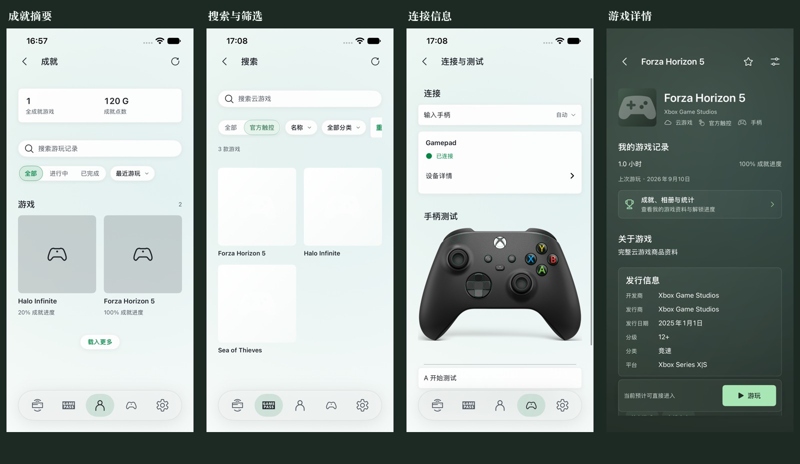

# iOS 全页面信息校准证据

2026-11-19完成。手机10项独立检查、iPad7项、iPhoneOS设备构建与静态门禁通过。两端生成756张实际原生布局截图，归档11张关键PNG、1张最终预览及5张用户原图。

## 当前规范与结果

- [iOS / iPad设计规范](../../../iosapp/DESIGN.md)
- [验收报告](../../../docs/reports/2026-11-19-ios-information-calibration.md)
- [验证摘要](validation.json)、[设备构建摘要](device-build-summary.json)
- [截图来源与SHA-256](retained-images.json)、[清理记录](cleanup.json)

## 关键界面

| 范围 | 图片 |
| --- | --- |
| 成就摘要、同行胶囊与居中分页 | [手机成就](phone-achievements.png) |
| 搜索、筛选与排序 | [手机工具区](phone-cloud-tools.png) · [iPad工具区](ipad-cloud-tools.png) |
| 连接信息与输入记录 | [连接卡片](phone-controller-card.png) · [输入条](phone-controller-input.png) |
| 游戏身份与分组卡片 | [手机详情](phone-cloud-detail-dark.png) · [iPad详情](ipad-cloud-detail-dark.png) |
| 统一导航与列表密度 | [iPad设置](ipad-settings-navigation.png) · [好友列表](ipad-friends.png) |
| 最大辅助字号 | [输入记录](accessibility-input-history.png) · [内容标签](accessibility-content-tabs.png) |

`sources/`保留五张用户批注原图与来源预览。`diagnostics/`保留首轮、复验和iPad测试摘要、Swift parse、格式/lint、边界门禁与失败历史。手机首批两项失败经修正后复验通过，最终状态见`validation.json`。

本轮r1～r4临时目录已清理，释放约4.90GiB；最终文件以本目录为准，JSON中的`/private/tmp`路径仅用于记录历史来源。共享依赖与其他任务临时目录沿各自任务保留。
