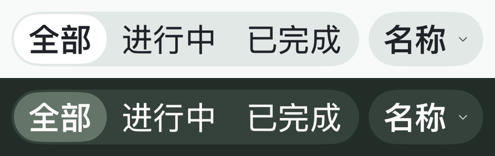
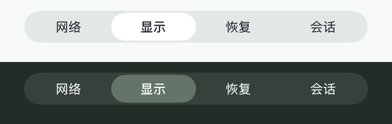

# iOS 筛选与下拉胶囊样式证据

2026-11-20。按用户参考图调整共用 `AppSegmentedFilter`：平整胶囊底槽、实色选中表面、四周 2pt 内缩与主文字色。云游戏、好友、游玩记录/成就、成就详情与相册共用同一组件；44pt操作目标、横向滚动、绑定与 VoiceOver 选中状态沿用。

## r2 下拉统一

下拉与筛选已统一背景、高度、主文字色和满圆角轮廓，当前结果见[r2验收](r2/README.md)。

## r1 原生验证

布局覆盖 320、390、1024pt × 深浅主题 × 中英文 × 常规/辅助字号（AX3），共24张 UIHostingController 原生截图。页面交互复用四项既有回归：云游戏搜索/分类/排序/筛选，成就进度/解锁筛选，相册预览/返回，资料子页/返回位置。

本轮使用临时 Xcode 工程引用正式 UI 源码，界面验收与主题组件的 SHA-256 记录见 `source-checks.json`。临时渲染与方向设置函数已移除，两份测试文件与加入函数前的 SHA-256 一致。Swift格式/lint、前端 `pnpm lint:fix` 和局部 `git diff --check`通过。

## 复验诊断

首轮模拟器处于横屏，两项竖屏宽度断言和资料返回位置断言失败；四项竖屏复验全部通过。期间并行编辑的 Metal 呈现回调在 Simulator SDK 上报编译错误；临时工程接续同步修复后的源码。首次临时工程构建的 Rust 目标错误通过沿仓库工作目录选择既有工具链修复。原始失败摘要见 `failure-diagnostics.json`，正式筛选组件与主题源码的验证范围见 `source-checks.json`。

最终截图、测试摘要、原图和清理记录在本目录归档。本轮临时根目录为 `/private/tmp/xbxrc-ios-filter-segmented-20261120`；共享 Rust/WebRTC 缓存沿仓库保留。

## r1 验收结果

四项既有页面交互、原生渲染与方向设置共6项通过。24组截图宽度与设定尺寸一致，深浅、窄屏/辅助字号及实际页面代表截图经视觉检查通过。

- [验证摘要](validation.json) · [Xcode测试摘要](test-summary.json) · [布局矩阵](layout-matrix.json)
- [云游戏](phone-cloud-filters.png) · [游玩记录](phone-history-filters.png) · [成就](phone-achievement-filters.png) · [相册](phone-album-filters.png)
- [深色](filters-dark.png) · [窄屏大字号](filters-narrow-accessibility.png) · [宽屏大字号](filters-wide-accessibility.png)
- [原图](reference.png) · [图片来源](retained-images.json) · [源码与对比度](source-checks.json) · [失败诊断](failure-diagnostics.json)

本轮临时目录已清理，释放约 1.384GiB；清理后的磁盘可用空间为 61.42GiB。共享Rust/WebRTC缓存与用户参考图保留。详情见[清理记录](cleanup.json)。
