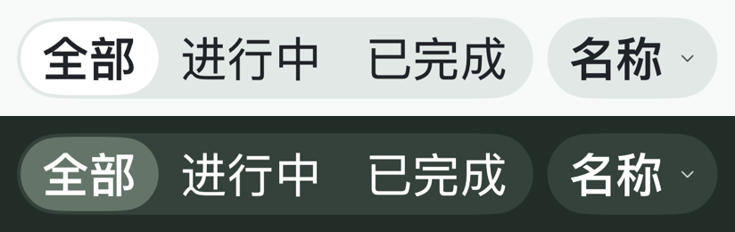

# r2：筛选与下拉胶囊一致性

2026-11-20。`AppInformationPicker`与`AppSegmentedFilter`共用`appFilterTrackSurface`，背景、满圆角和视觉留白统一；下拉补齐与筛选一致的垂直内边距和主文字色。常规点击高度同为44pt；AX3辅助字号同为约57.67pt，上沿位置一致。

8组深浅主题×常规/AX3字号×中英文原生测量全部通过。2项既有页面回归覆盖搜索、筛选、排序、分类与菜单切换。Simulator构建、Swift格式/lint、前端lint与diff检查通过；临时验证函数已移除，两份测试文件哈希与加入函数前一致。

- [原生尺寸](alignment-metrics.json) · [测试摘要](test-summary.json) · [验收摘要](validation.json)
- [浅色](dropdown-light.png) · [深色](dropdown-dark.png) · [浅色大字号](dropdown-large-light.png) · [深色大字号](dropdown-large-dark.png)
- [云游戏工具行](phone-cloud-tools.png) · [成就工具行](phone-history-tools.png)
- [原始批注](reference.png) · [截图来源](retained-images.json) · [源码与临时函数还原](source-checks.json) · [首次临时验证编译诊断](initial-build-diagnostic.json)

本轮临时根目录：`/private/tmp/xbxrc-ios-filter-segmented-20261120/r2`。共享Rust/WebRTC缓存保留，清理结果见`cleanup.json`。

本轮已清理 0.519GiB 临时产物，目标目录退出磁盘；清理后可用空间约 62.18GiB。r1与r2累计清理 1.903GiB。
