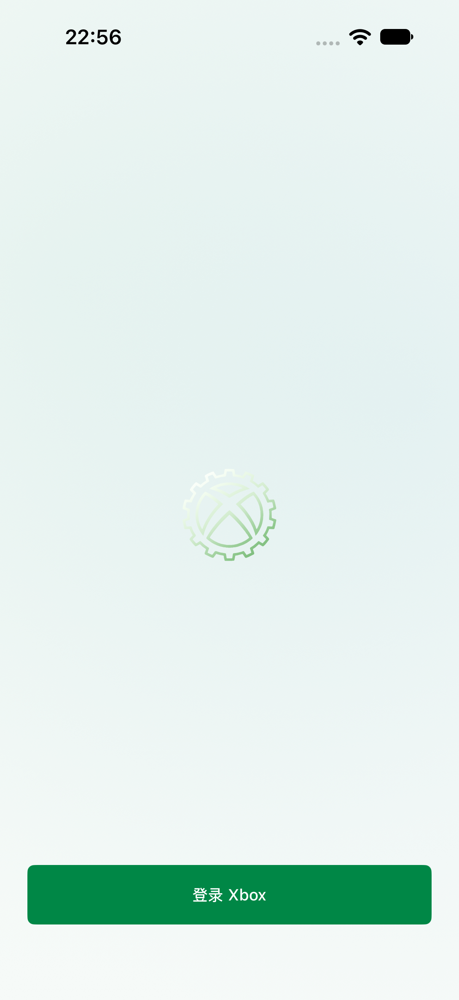
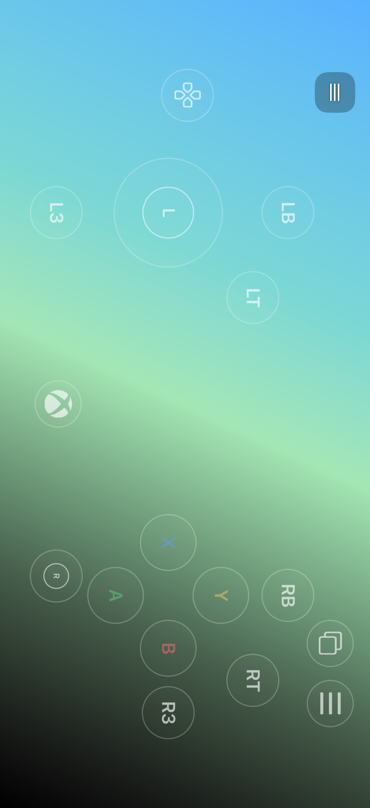

# 登录空页与串流菜单入口验收

2026-11-20，任务 `2026-11-20-ios-login-shell-menu-entry`。

登录空页由正式根视图独立展示，中部使用启动页同款 `LaunchIcon` XBXRC 品牌资源，大小 132pt。52pt 高登录长按钮位于页面下部，距底部安全区 32pt；顶部品牌与底部导航在登录后显示。

串流控制层提供左上 44pt 常驻菜单按钮，采用 28% 黑色静态透明底色，菜单收起后恢复。按钮沿正式控制状态唤出双栏，独立于触屏手柄的显示状态，双指手势及手柄/无障碍入口继续共用控制状态。

最终接受 iPhone 18 Pro 6 项、iPad Pro 11-inch (M5) 2 项 UI 回归。覆盖新品牌与下部按钮、登录页隐藏导航、登录后五个根页、设置导航、横竖屏双栏、菜单关闭后重开、画面/诊断面板及手机双指手势。两轮共执行 10 项，失败为 0；r1 两项旧登录布局由 r2 最新验收替换。详细来源见 [validation.json](validation.json) 和各轮测试摘要。

前端 `pnpm lint:fix`、7 个 Swift 文件的本轮改动格式/语法、登录视图严格格式、串流会话边界和 diff 检查通过。暂存区与既有本地化修改保持一致；源码哈希和本轮 patch 已归档。菜单操作使用正式控制视图与本地夹具，真实串流期间的点按响应接续用户实机复测。

最终截图共 11 张，来源与哈希见 [screenshot-manifest.json](screenshot-manifest.json)。本轮唯一临时根目录及产物清单见 [temporary-manifest.json](temporary-manifest.json)，清理结果见 [cleanup.json](cleanup.json)。共享 WebRTC 与 Rust 缓存保留。

