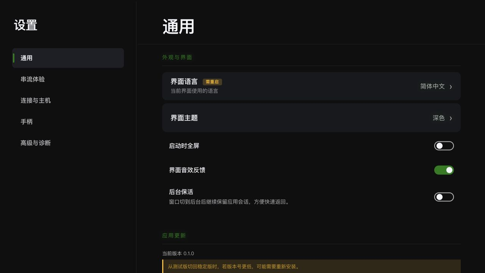
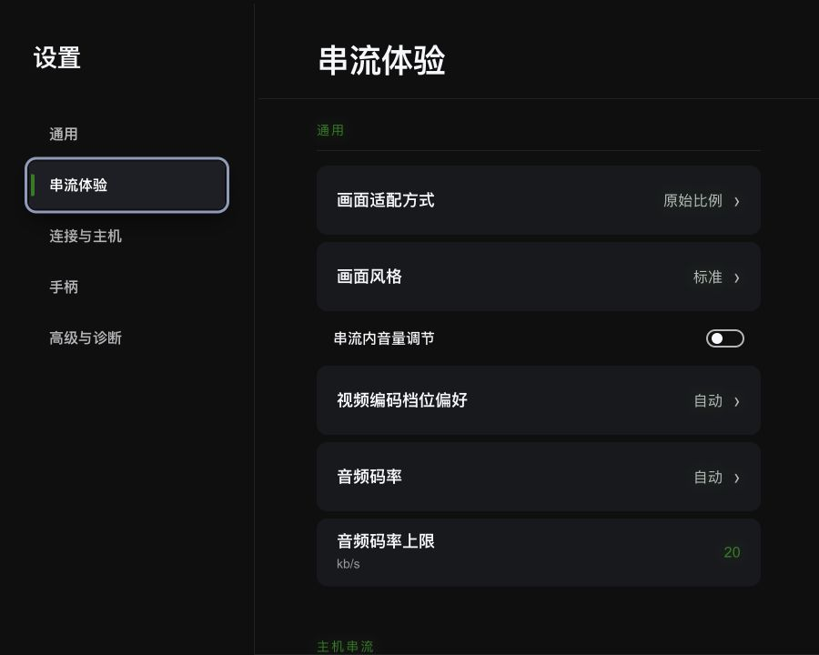
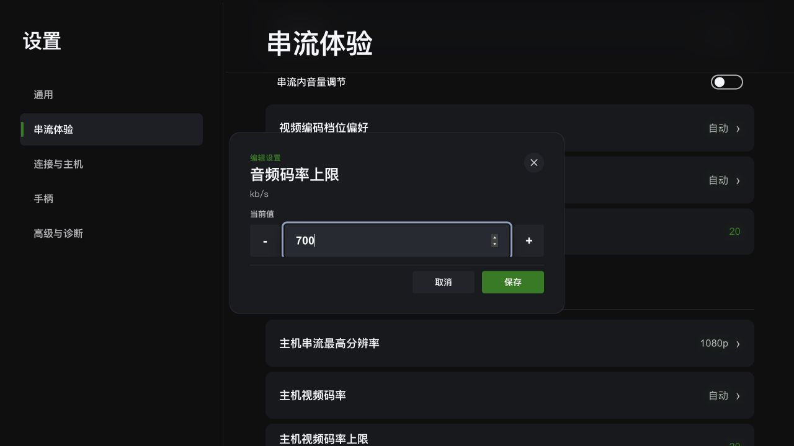

# 设置页排布与交互评估

## Problem Framing

- 日期：2026-11-03。
- 本次范围：桌面 Vue 设置页的五类导航、内容组织、窗口适配、编辑弹窗、保存反馈、生效语义与手柄入口。
- 目标：让用户更快找到常用项，准确理解当前值与修改效果，并通过鼠标、键盘、手柄完成稳定的编辑闭环。
- 结论：保留现有五类导航与展示 schema，优先修复响应式、滚动、校验、保存反馈、焦点裁切与更新状态生命周期，再统一设置行、应用更新流程和页面内的信息层级。高危区收敛为用途明确的连接高级设置。

## Current Constraints

- 页面继续使用 Vue 3 + TypeScript，配置读写继续通过现有 Rust RPC。
- 配置字段、存储协议、公共输入控制器和几何导航引擎继续作为既有合同。
- 历史基础：[设置展示 schema RFC](../rfcs/2026-05-11-settings-schema-driven-reorganization.md)已确立五类导航、展示域独立、风险分层和生效元数据的方向；当前源码已实现导航和 schema，元数据及部分交互仍待收口。该 RFC 状态仍为 planned，后续实施应同步实际进度。
- [统一手柄输入报告](../reports/2026-10-27-unified-gamepad-input.md)规定手柄设置使用设备与行为、操控、震动、测试与高级四组，设备行为即时保存，布局、摇杆和键盘映射使用草稿应用。
- 当前工作树已有串流指标改动，设置 schema 的 `performance_style` 展示移除已经纳入现状。

### 评估证据范围

- 阅读实际设置页面、展示 schema、行组件、弹窗、输入工具、更新组件、字段定义及 Rust 配置规范化逻辑。
- 使用当前 `Setting.vue`、现有样式及公共输入控制器进行本地预览；RPC、设备、配置与更新响应使用模拟数据。
- 检查 1280×720、1000×720、900×720 三种窗口尺寸和五个分类。
- 预览验证覆盖布局、分类切换、自动模式编辑入口和输入框校验；真实持久化、系统确认框、设备操作与应用重启效果依据源码分析，最终由桌面实机验收。
- 用户补充：应用更新简陋且交互奇怪、高危区缺少实际价值、元素选中与手柄焦点效果被父容器裁切。补充评估依据更新状态与挂载逻辑、TURN 配置消费链、滚动与阴影样式；边缘裁切的具体复现位置纳入后续视觉验收。

### 已确认的使用问题

| 优先级 | 问题与证据 | 用户影响 | 建议 |
| --- | --- | --- | --- |
| P0 | 用户确认选中与手柄焦点效果存在父容器裁切；设置面板、弹窗 body 和选项列表使用 overflow 裁切，焦点使用向外扩展的环与阴影。 | 导航位置辨识变弱，边缘与首末项高亮缺边。 | 统一焦点绘制和容器安全区，覆盖页头遮挡、列表四边、弹窗首末项与滚动后的焦点。 |
| P0 | 更新组件只在通用分类挂载，切分类时组件和 composable 销毁；更新检查、下载和安装仍可继续执行。 | 返回通用后状态重建为 idle，界面与实际更新任务产生分歧。 | 更新任务状态与分类组件生命周期解耦；页面重新进入时恢复当前进度、结果和可执行动作。 |
| P0 | 900px 宽度下 `data-ui-density=narrow` 已设置，设置页仍为 `280px 616px` 两列；1000px 的 compact 规则同样失效。 | 窗口缩小时侧栏与固定留白持续挤压内容。 | 修复 scoped/global 选择器，补完整的小窗口导航形态与内容留白规则。 |
| P0 | 从串流页底部切到通用后，右侧 `scrollTop` 保留约 248px，界面语言行顶部约为 -55px。 | 新分类从中间内容开始，首批设置被藏到上方。 | 首次切入分类从顶部开始；再次进入可恢复该分类自己的滚动与焦点位置。 |
| P0 | 音频码率输入 700 后，原生 input 已标记越界，页面错误提示为空，保存仍可点击；字段定义上限为 512，Rust 规范化上限为 200。 | 用户提交超范围值后可能得到静默裁剪结果。 | 范围、空值、步长使用统一合同；越界显示明确提示，保存禁用。 |
| P0 | 通用设置读取与保存使用 try/finally；页面错误与重试入口尚缺。普通数值/选择行及弹窗也缺少统一 pending 展示。 | 保存失败或保存处理中缺少可见解释；加载失败可能落入空分组状态。 | 统一加载失败、保存中、已保存和保存失败；失败保留草稿并提供重试。 |
| P1 | 1280px 下侧栏 360px，内容左右各留 64px，页头约 113px；选择行约 72–76px，开关基准为 56px，紧凑开关基准为 44px。 | 空间利用偏低，同一列表的字号、背景和节奏分叉。 | 收紧侧栏与页头，统一行容器、标签字号、值区域和间距，按设备密度调整。 |
| P1 | 串流页先展示六个通用项，再展示主机与云游戏；自动码率下仍展示可编辑上限。 | 常用分辨率进入滚动区，低频音频与编码参数占据首屏，自动模式的有效参数含义模糊。 | 常用画面与分辨率前置；编码和音频码率进入高级折叠组；手动模式展开对应上限。 |
| P1 | 界面语言保存后已立即切换界面，随后仍请求重启；后台保活触发重启确认，却通过开关行渲染而缺少重启标记。 | 修改生效时机与提示产生分歧。 | 按即时、下次连接、下次启动描述实际效果；集中展示待重启项与重启入口。 |
| P1 | “启动时全屏”字段保存后直接调用当前窗口进入/退出全屏。 | 文案表达启动偏好，操作同时改变当前窗口状态。 | 明确其产品语义，文案与即时动作保持一致。 |
| P1 | 所有单选项都打开居中弹窗；弹窗默认焦点固定在第一项。 | 两项选择也需要额外进入/退出；长列表中当前选项与初始焦点分离。 | 两三项短选择使用现有内联控件；长列表保留弹窗并定位当前项。 |
| P1 | 应用更新只有版本文字、通道选择、常驻黄色降级提示和单一动作；检查后已是最新回到初始 idle，release notes 已获取却省略展示，下载与安装中按钮仍标“检查更新”。 | 用户难以判断是否检查成功、将安装什么、当前进行到哪一步。 | 使用完整更新卡片，明确检查结果、目标版本、更新内容、进度、失败恢复和重启动作；提示按当前操作出现。 |
| P1 | 高危区只通过系统确认框展开三项自定义 TURN 字段；专家重置只清空这三项。 | 入口强调风险，用途、有效状态和配置完整性表达薄弱。 | 移除独立高危区，收进“连接与主机 → 高级 → 自定义中继”；按用途提供成组编辑与“恢复默认中继设置”。 |
| P1 | 凭据通过普通文本字段与值格式化直接输出；编辑输入为 text。 | 高级设置展开后凭据直接出现在页面、编辑器与截图中。 | 使用敏感字段元数据、掩码摘要、密码输入和显式显示控制。 |
| P2 | 手柄编辑面板的取消捕获、震动测试、结束测试使用普通 button；部分操作尚未纳入 Focusable。 | 几何导航的可达动作集合与鼠标动作集合存在差异。 | 统一操作控件注册，回归验证方向移动、A 确认、B 返回、捕获与断开流程。 |
| P2 | 普通值行的 accessible name 主要包含标签；分类缺少当前项语义，单选缺少选择状态语义，模态面板缺少 dialog 声明。 | 读屏用户获得的当前值、选择与弹窗上下文偏少。 | 补充当前值/说明关联、aria-current、单选语义、dialog 与 aria-modal。 |

### 补充重点一：应用更新需要完整的状态与操作闭环

推荐在通用页中使用独立更新卡片，按信息层次展示当前版本/通道、检查结果、目标版本/更新内容、进度与动作。通道属于辅助配置，降级提示在切换动作确实产生降级风险时出现。

| 状态 | 展示与动作 |
| --- | --- |
| 尚待检查 | 当前版本与通道，主动作“检查更新” |
| 检查中 | “正在检查”，主动作忙碌且禁用 |
| 已是最新 | 明确检查结果与检查时间，提供“重新检查” |
| 有新版本 | 目标版本、发布日期与更新内容，主动作“下载并安装” |
| 下载中 | 进度条、百分比/已下载大小，主动作显示“正在下载” |
| 安装中 | 明确安装状态与退出影响，主动作显示“正在安装” |
| 安装完成 | “重启后生效”，主动作“重启应用”，提供“稍后” |
| 失败 | 可理解的原因、保留的结果与对应重试动作 |

当前 `releaseNotes` 已进入 composable，后端检查响应也携带发布日期，可复用这些信息。状态归属需要保证切换设置分类或离开设置页后仍与实际更新任务一致；具体状态持有位置沿用应用既有架构评审。安装阶段的动作边界按 Tauri 当前能力明确，取消能力应以实际后端合同为依据。发行通道继续遵循 Browser/Native WIP 的身份与清单校验边界。

### 补充重点二：高危区收敛为用途明确的自定义中继配置

当前三个字段具有消费链：`StreamingConfigSnapshot → resolve_custom_turn → config.runtime.custom_turn → RuntimePlan.turn → Browser runtime bind`。它们实际表示自定义 TURN 中继地址、用户名和凭据。三项齐全时形成自定义配置；任一项为空时 `resolve_custom_turn` 返回空配置，因此逐行保存尤其容易制造“填了但效果仍沿用默认”的体验。

推荐取消“高危区/显示敏感设置/专家重置”这组面向风险的入口，改为“连接与主机 → 高级 → 自定义中继”。默认呈现“使用默认连接策略”，自定义配置作为按需展开的完整表单。保存前校验字段完整性与地址格式，显示配置摘要和“下次连接生效”，凭据使用遮罩与密码输入；重置明确命名为“恢复默认中继设置”。现存字段与存储继续兼容，清除值由用户显式动作触发。

后续实机验收应验证完整配置进入运行计划、默认与自定义状态准确展示、部分配置能够得到明确校验反馈，以及恢复默认后下一次连接的效果。

### 补充重点三：选中状态与焦点效果统一处理容器边界

“选中”表示当前分类或配置值，“焦点”表示键盘/手柄当前停留位置；两者拥有清晰且可叠加的视觉语义。

当前 `--shadow-xbox-focus` 包含 5px 外扩环和下方 12px 位移/24px 模糊阴影，行、侧栏按钮及弹窗选项复用这一效果。`SettingModalShell` 的 body 以裁切方式滚动，内容直接从边缘开始；选项列表虽有 16px/10px padding，滚动首末项仍需核对。侧栏同时设置 overflow-y:auto 与 overflow-x:visible，CSS 的轴向计算规则会让横向溢出也受滚动边界约束。层级值管理遮挡顺序，overflow 决定裁切边界。

推荐在控件内部绘制稳定、完整的焦点边框，并按外部阴影实际扩展量设置统一安全区。滚动容器提供四边留白、scroll-padding 和控件 scroll-margin；焦点滚动计算同时考虑 sticky 页头、弹窗底栏与可见区域。圆角裁切与内容滚动分别由合适的容器承担。

验收覆盖侧栏首末项、设置列表首末项、左右边缘、弹窗短/长列表、底部操作按钮、滚动后的焦点恢复，以及深浅主题和 900/1000/1280px 尺寸。选中状态与焦点同时存在时仍应完整可辨。

### 视觉证据

1280×720 通用页：宽侧栏、较大的页头、选择与开关行风格差异，以及进入滚动区的更新操作。

900×720 串流页：narrow 密度下仍保留两列与固定内容留白。

从串流底部切入通用：语言和主题行进入页头上方。

音频码率输入越界：输入 700 后仍显示可用保存按钮。

## Options

### Option A：以样式调整为主

- 收紧留白、标题、侧栏，统一背景与圆角。
- 优点：实现边界小，现有页面结构容易复用。
- 代价：参数联动、生效提示、错误反馈和草稿语义仍需独立处理。

### Option B：保留五类导航，统一设置交互并重组页面内信息

- 在现有 schema 上增加轻量的效果、可见性、敏感值与帮助元数据。
- 统一行与编辑状态；按用户任务组织常用项、高级项和敏感操作。
- 优点：直接覆盖本次发现的问题，现有 RPC、存储、导航和弹窗均可复用。
- 代价：需要审计每个字段的真实生效时机，并验证三个输入方式的编辑闭环。

### Option C：重建导航并加入完整搜索与快捷首页

- 建立新的设置首页、跨分类搜索和推荐入口。
- 优点：适合未来字段数量显著增长的场景。
- 代价：扩大路由、焦点和状态管理范围，当前字段规模下首轮收益偏低。

## Recommended Direction

采用 Option B，按两轮推进。

第一轮完成响应式选择器、分类滚动、输入校验、保存反馈、焦点裁切与更新状态生命周期；同时统一设置行、内容留白与页头密度。桌面侧栏建议以 220–240px 为起点，内容留白 24–40px，单行设置基准 56–64px，说明较长时自适应扩展。短窗口导航采用横向分类或分类选择器，保持内容区主要面积。应用更新按完整状态卡片重做，高危区按连接用途收敛。

第二轮保持五类导航，建议页内组织为：

| 分类 | 推荐分组 |
| --- | --- |
| 通用 | 外观与语言；启动与后台；界面反馈；应用更新 |
| 串流体验 | 常用画面；主机与云游戏分辨率；声音；高级画质与带宽 |
| 连接与主机 | 云游戏地区与语言偏好；通用网络；主机直连与中继；高级自定义中继 |
| 手柄 | 保持现有四组，补统一保存反馈、草稿状态与操作可达性 |
| 高级与诊断 | 诊断开关与日志；按实际用途组织的维护动作 |

超分辨率建议与画面增强相邻展示，保留实验标签和性能说明。“区域路由覆盖”建议使用面向用途的“云游戏地区”，并描述账号/目录路由影响与实际延迟的关系。游戏语言紧邻云游戏偏好，连接页的网络选项形成独立组。

简单偏好即时保存，当前行展示保存中；复杂输入使用草稿加“应用”。需要下次连接或下次启动生效的字段使用统一效果标记；已保存与当前已生效分别表达。应用内确认弹窗继续复用现有 FocusScope，保障手柄操作与焦点恢复。

## Open Questions

- 正式支持的最小窗口尺寸和 ROG 等掌机首屏目标需要在实施前固定；本次已取证 900px 适配问题。
- 全屏字段的最终产品语义需要明确为启动偏好或当前窗口切换。
- 语言、后台保活、地区路由及各串流字段的生效时机需要逐项核对真实消费点，作为 effect 元数据依据。
- 音频码率上限以当前 Rust 合同 200 为初始对齐目标；扩大范围需要单独验证协议与消费端。
- 手柄草稿关闭流程需要确定丢弃提示或保留草稿策略，并验证捕获期间与设备断开的退出路径。
- 更新任务状态归属与真实安装阶段的可执行动作需要结合现有 Tauri 生命周期明确，页面往返保持进度与结果一致。
- 焦点安全区数值需要按最终边框、外扩环与阴影统一确定，并通过边缘截图验收。

## Candidate Follow-On Tasks

- simple：修复设置页 scoped/global 响应式选择器，并验证 900/1000/1280px；窄窗口导航形态涉及更大调整时并入下一项。
- simple：修复分类切换滚动策略和单选当前项默认焦点。
- simple：数值 min/max/step 校验与音频码率范围对齐；增加对应提示。
- complex：设置页焦点与选中视觉边界收口，覆盖滚动容器、sticky 页头、弹窗及底部动作区，复用现有几何导航引擎。
- complex：应用更新卡片与状态生命周期完善，沿用现有 updater RFC，并明确版本信息、更新内容、进度、重试、重启和分类往返状态恢复。
- complex：统一设置页布局、行容器、编辑/保存状态、生效元数据和输入模态操作；沿用既有设置 schema RFC 更新范围与执行记录。
- complex：移除独立高危区，将自定义 TURN 按用途收进连接高级设置，提供成组校验、草稿应用、凭据遮罩和恢复默认动作，保留现有持久化合同。
- complex：按上述分组重排常用与高级项，补条件展示和草稿生命周期回归；与布局交互统一任务共同评审。

### 实施时的入口

- `src/pages/Setting.vue`：配置读写、保存副作用、分类切换、页面网格与页头。
- `src/pages/settings/setting-page-schema.ts`：分组、字段顺序、后续轻量展示元数据。
- `src/pages/settings/SettingSectionList.vue`、`src/components/settings/SettingRow.vue`、`SettingToggleRow.vue`：统一行与 pending/effect 传递。
- `src/components/settings/SettingValueSheet.vue`、`SettingSingleSelectPopupSheet.vue`、`SettingModalShell.vue`：校验、选中项焦点、保存与确认交互。
- `src/pages/settings/SettingInputToolsSection.vue`：手柄草稿、状态提示与 Focusable 操作。
- `src/pages/settings/SettingAppUpdateSection.vue`、`src/composables/useAppUpdater.ts`：更新信息、状态机展示和生命周期。
- `src/navigation/core/engine.ts`、`src/styles/tokens.css`：焦点滚动可见区、效果外扩范围与安全区对齐。
- `src-tauri/src/mods/streaming/config_policy.rs`、`crates/xbox-streaming/src/policy/runtime/compiler.rs`：自定义 TURN 配置完整性与实际运行计划消费。
- `src/shared/config/domain-definition.ts`、`src-tauri/src/mods/config/config_policy.rs`：输入范围合同。
