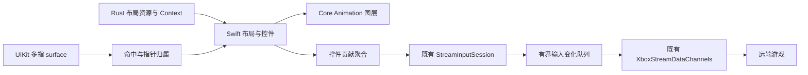

# iOS 触屏控制实现方案

推荐沿现有 **SwiftUI + UIKit + UniFFI + Rust + libwebrtc/Metal** 扩展一个原生触控兼容层：Rust 承接游戏身份、布局资源和公共协议；Swift 承接多指、控件状态、布局几何和绘制；最终输出进入现有 `StreamInputSession → XboxStreamDataChannels`。推进顺序为原生多指底座、社区专用布局、官方 TAKX 动态布局、游戏原生触点。

评估日期：2026-11-17。代码基线：`main / b7f09ec8`，结合当前工作区。本文是方案探索与候选任务；功能覆盖和性能数值以实施后的验证为依据。

依据：[引用聊天](thread://01a1ced0-9ac3-7f00-8808-b255db4b330f?hostId=local)、[布局协议](../references/better-xcloud-touch-layout-protocol.md)、[TAK/Babylon 引擎](../references/tak-babylon-touch-engine.md)、[官方触点协议](../references/official-touchscreen-protocol.md)、[PC→iOS 迁移边界](2026-11-12-pc-to-ios-app-migration-feasibility.md)。本轮源码定位与文档校验归档于[方案证据](../../dev-docs/validation/2026-11-17-ios-touch-controls-plan/README.md)。

## 1. 问题定义

iOS 需要在手机/iPad 的视频画面上提供可同时操作的触屏控件，并支持游戏专属布局、动态切换和菜单接管。主要张力在于官方格式覆盖、原生触摸响应、移动端资源成本，以及当前串流输入的稳定交付。

触控能力分成三个可独立验收的层次：

| 层次 | 用户获得的能力 | 实现依赖 |
| --- | --- | --- |
| 通用与社区手柄布局 | 任意手柄游戏可玩；赛车、射击等使用专用布局 | 原生控件、社区 JSON、虚拟手柄输入 |
| 官方 TAK 专用布局 | 消费游戏提供的布局包、动态 Context 与布局切换 | TAKX、schema/资源、五种布局消息、控件行为覆盖 |
| 游戏原生触屏 | 点击或拖动直接成为游戏触点 | 会话触控能力、ServerMetadata、多指 pointer 编码与释放 |

TAK 的 `action/axis` 生成手柄或鼠标读数，`touchForwarding` 生成 pointer 读数。Babylon 消费控件绘制流，职责集中在透明二维图形、纹理与动画。官方布局行为兼容和绘制实现可以分别验证。

## 2. 当前约束与代码基础

iOS 已采用原生平台宿主，认证/API/会话控制面复用公共 Rust，RTC 与媒体沿既有 libwebrtc/Metal。现有 UniFFI 是新增低频资源接口的入口，触摸热路径保留在 Swift；桌面 UI 持续沿 Vue/TypeScript 演进。当前 iOS 迁移 RFC 将官方 TAK 列为后续独立能力。

| 当前基础 | 已核对事实 | 对方案的影响 |
| --- | --- | --- |
| 通用触屏手柄 | SwiftUI 组合按钮与摇杆，UIKit 接收 began/moved/ended/cancelled | 基础输入与取消释放可复用；专用布局需要统一 surface |
| 输入归属 | `StreamInputSession` 管理触屏、实体手柄与 menu/lifecycle 等 suppression | 布局输出继续经过同一个输入归属入口 |
| 按键状态 | `setTouchButton` 直接设置/清除 `buttonMask` 位 | 多控件映射同一键时需要按控件保留贡献 |
| 输入交付 | MainActor 循环每次等待 8ms，发送变化后的完整手柄快照；背压期间读取当前状态 | 短按/释放和扳机峰值需要有界保留；8ms 是目标等待间隔 |
| 官方布局资源 | 公共 Rust 已有 `/v2/titles/inputconfigs` 查询 | iOS 导出、supportedTabs 与真实 TAKX 获取链仍需接通 |
| 布局消息 | iOS message 接收入口用于握手状态与 bootstrap | 需要增加 titleinfo 和 touchcontrols 的有序路由 |
| 能力声明 | 公共握手发送 `touchInputEnabled:false` 和空布局能力；iOS ClientMetadata 固定写 64 | 声明应统一由实际触控能力生成 |
| 视频坐标 | Metal 根据旋转与 fit/fill/固定比例计算绘制 scale | 原生触点需要复用同一显示变换与服务端尺寸 |

源码：[现有触控](../../iosapp/XBXRC/Platform/Streaming/TouchGamepadOverlay.swift)、[输入归属](../../iosapp/XBXRC/Platform/Streaming/StreamInputSession.swift)、[轮询与消息](../../iosapp/XBXRC/Platform/Streaming/XboxStreamDataChannels.swift)、[当前编码](../../iosapp/XBXRC/Platform/Streaming/IOSStreamInputProtocol.swift)、[公共能力消息](../../crates/xbox-streaming-protocol/src/stream_data_channel.rs)、[iOS metadata 导出](../../crates/xbox-ios-bridge/src/streaming.rs)、[视频变换](../../iosapp/XBXRC/Platform/Streaming/StreamingMetalRenderer.swift)。

## 3. 可选路径

| 路径 | 优势 | 成本与适用范围 |
| --- | --- | --- |
| 固定原生通用手柄 | 当前基础完整，交付范围集中 | 专用布局、layer 与动态状态需要进一步建设；适合作为持续可用的回退 |
| 原生 TAK 行为兼容层 | 多指与绘制融入现有 iOS 生命周期，兼容范围可分阶段验证 | 布局解析、命中与控件状态需要自行实现；推荐作为产品方向 |
| WKWebView 装配官方 TAK/Babylon | 可用于对照官方 DOM/WebGL 行为 | 发布脚本依赖内部宿主、资源与注入接口，跨 JS/Swift 输入及透明绘制增加装配成本；适合作为研究对照 |

推荐第二条路径，并沿第一条路径保留通用布局。官方源码快照与回放提供协议和行为基准；原生绘制器承担 iOS 呈现。

## 4. 推荐方向

### 4.1 布局协议：公共资源合同与原生布局模型

资源获取沿公共 Rust 数据层与现有 UniFFI 扩展。社区格式和官方格式各用一个输入适配器，输出统一、版本化的布局模型，包含控件稳定 ID、槽位、action/axis、layer、样式、资产引用与来源覆盖信息。社区的 `schema_version:1`、官方 Layout/Manifest 格式版本和 bundle 自身版本分别保存。

Rust 承接：

1. Xbox TitleId 规范化、inputconfigs 查询、supportedTabs 解析和布局下载。ProductId 用于商品展示，布局命令及社区索引使用当前游戏 TitleId；主机前台游戏变化通过 titleinfo 更新 scope。
2. TAKX 解包、Manifest、locale/DPI 资源选择、缓存和引用展开。社区包装中的 name/author 与 Layout 内容分别处理；缺省样式按明确规则补齐。
3. Context、JSON Pointer/JSON Patch 的纯数据规则，及历史 schema 转换。解析和资源处理通过粗粒度异步接口交付，Swift 消费带 revision 的已解析快照。
4. 公共消息信封、触控能力和输入 wire 合同。现有 Swift 手柄发送保留当前热路径，新增报文通过共享字节样本保持两端一致。

Swift 接收 layout/context revision 后计算实际 UI 几何与控件状态。资源更新携带 session generation、title scope、bundle revision 和请求序号；当前会话仅消费匹配的结果。

布局消息按接收顺序处理 `showlayout`、`showlayoutv2`、`showtitledefault`、`hide`、`patchstate`。`showlayoutv2` 附带的 patch 与布局选择作为一次更新提交；资源加载期间保留有界的待处理命令，完成后按原序应用。输入采集持续运行，布局在一个明确的 revision 边界换代。

每个 scope 明确表达“指定布局”“标题默认”“隐藏”三种状态。游戏指令写入 base，用户选择写入 override，Context 持续跟随当前 bundle 更新。社区布局的用户选择通过 override 保存；这是建议的产品归属规则，better-xcloud 的现有注入调用写入 base。

首版能力版本应来自已通过验证的矩阵。局部控件支持以本地布局范围发布；完整 schema 能力声明需要覆盖对应必需字段和行为。必需控件或 action 超出支持范围时整份布局回到通用手柄，并给出可理解的状态说明。

### 4.2 TAK 行为：一个 UIKit 多指 surface

用 `UIViewRepresentable` 嵌入一个 `TouchSurfaceView`，统一接收整个游戏触控区域的真实触点。`UITouch` 身份映射到稳定 pointerId，每个指针保存起点、当前位置、实际时间、控件归属和捕获状态。

命中层支持圆、扇形、环、矩形与 slot/cluster 的优先级，并显式实现 attach/detach/swap。摇杆捕获后按自身规则持续接收移动；按钮与方向区域按控件规则处理滑入、滑出和转交。这样可以支持方向盘面滑动、拖拉附加动作、临时瞄准层与多指组合。

处理一次 UIEvent 时先更新所有受影响指针，再提交控件变化，避免 Set 枚举顺序改变命中结果。速度型触摸板读取实际触点时间；可按需消费 coalescedTouches，预测触点仅用于视觉反馈。

控件首批覆盖 button、joystick、directionalPad、touchpad→摇杆、action 组合、pullAction、toggle 和基础 layer。throttle、CoreMotion 传感器、相对鼠标分别增加覆盖任务。Forza throttle 变体与 Halo 陀螺仪/鼠标变体在对应阶段加入完整样本验收。

每个控件维护自己的输入贡献 `contribution[controlId]`：按钮按贡献计数或 OR 输出，轴保留限幅前总和，最终再 clamp。控件退出、隐藏或换层时撤销自身贡献；两个按钮同时输出 A，释放其中一个后 A 继续保持。

轴映射顺序固定为控件几何、布局映射、布局参数、明确适用的玩家触控参数、聚合限幅。现有 `StreamInputSession` 的实体手柄死区设置需要与触控参数分开投影，防止两层重复改变输出。冻结 TAK 快照的 deadzone 映射与当前 iOS 常规死区各有公式；按版本记录规则差异，responseCurve 通过有限值、端点和值域检查后启用。

`visible:false` 对应退出视觉交互集合；冻结快照中普通控件的 `enabled:false` 保持 Disabled 外观，同时保留普通手柄动作。客户端布局动作和 sensor 的 enabled 规则单独实现；兼容验证使用已审计的行为样本。

### 4.3 原生绘制：Core Animation 与按需更新

首版用 UIKit/Core Animation 的 CALayer、CAShapeLayer 和图片层绘制透明控件；SwiftUI 负责配置、布局选择和无障碍宿主。控件只在位置、按下状态、图标、透明度或动画变化时更新，局部 knob 动画直接更新图层。持续动画按需启用 CADisplayLink。

视频持续由现有 Metal surface 呈现，触控 overlay 作为上层独立 UI 图层合成。控件资产在布局加载时解码和缓存；真实布局复杂度与 GPU/功耗证据决定后续绘制优化范围。

布局几何使用 UIKit points，图像选择使用屏幕 scale；socket/轮盘同时考虑窗口 bounds、安全区、方向、用户缩放与视频区域。iPad 分屏和窗口变化都触发布局重算。常用动作保留至少 44pt 的可操作目标，并提供 UIAccessibilityElement；视觉与命中区域分别建模。

菜单按钮与系统接管优先于游戏控件；控件区域、原生触摸转发区和普通画面唤出手势具有明确归属。统一 surface 和现有串流菜单手势协调，确保按摇杆或射击时仅触发目标操作。

### 4.4 输入交付与生命周期

每次真实触摸事件更新逻辑状态，同时记录源时间与按钮边沿。输入队列保留短按/释放、扳机峰值和终态；连续轴移动按明确规则合并。队列容量、最大保留年龄、背压行为与释放余量进入实施 RFC，并用回放验证。现有 8ms 循环继续承担常规发送，边沿到达和缓冲恢复可以唤醒同一个发送器。

视觉刷新与输入发送分别调度，队列只有一个消费出口。触摸时间、采样时间与发送时间使用经核对的单调时钟；诊断记录各阶段年龄与实际间隔。

实体手柄接管采用锁定的来源切换规则。接管时清理触控捕获与贡献，等待归零后恢复来源；新触屏操作通过新的触点生命周期接入。菜单、设置录入、后台、重连、布局替换和退出共用释放入口，按 session generation/layout revision 清理旧事件，并沿现有 drain 发送 neutral。

通用布局、社区布局和官方布局是同一个触控运行时的数据源。官方资源加载失败时可保留当前可用布局，适配失败时切回通用布局；每次布局替换都先撤销旧控件贡献。

### 4.5 原生触点：后续独立输入类型

游戏原生触屏沿 `touchForwarding` 输出 pointer，与布局的虚拟手柄并存。布局按钮先取得区域归属，剩余已启用转发区域消费真实触点；指针在本次触摸期间保持明确归属。

第一阶段沿现有可靠 `input` 增加传统 20 字节触点事件。输入 sender 在一次 flush 内组装手柄与 pointer 报告，统一 sequence、metadata 和背压。版本与协商采用现有公共协议，编码合同用官方回放样本验证。

坐标通过视频绘制的逆变换，从 overlay point 映射到归一化视频坐标，再映射到 `ServerMetadata.serverWidth/serverHeight`。fit 黑边、fill 裁剪、固定比例、视频旋转和窗口变化都进入坐标测试；接触直径按同一变换缩放。服务端尺寸明确后才发送触点，布局按钮也在最终区域归属中明确排除转发。

会话配置、`touchinputenabledchanged`、Layout/Manifest 能力和 ClientMetadata.maxTouchPoints 由一个能力快照生成。当前固定 64 改为实现能力，10 点可作为首个待验证目标。iPhone/iPad 普通手指压力采用平台可提供的值或合同约定默认值，接触尺寸读取 majorRadius；pressure、twist 和坐标写入前校验数值范围。

较新的 21 字节状态触点、计数器与 ACK 重发作为后续协议任务，沿公共协商决定 `unreliableinput/reliableinput` 的装配。两套触点格式分别进行字节、状态机与真实会话验收。

## 5. 待补证据与决定

| 待核对项 | 当前依据 | 需要的证据 |
| --- | --- | --- |
| 官方 TAKX 获取入口 | 已审计客户端 `getTouchAdaptationBundle(user,id)` 调用链，公共 inputconfigs 已存在 | 当前认证下的 URL、返回形式、supportedTabs 与代表性原件 |
| 官方布局覆盖 | 41 项布局/引擎隔离回放 | 真实赛车/射击/动作布局包、动态 Context 和资源清单 |
| 原生触点服务端行为 | 29 项官方编码/ACK 原方法回放 | 云游戏真实响应、多指释放、ServerMetadata 与 ACK 时序 |
| 移动端输入与资源成本 | 当前 Swift 原生触控、8ms 轮询与 Metal 视频基础 | 实际事件→发送 P50/P95/P99、MainActor 长任务、overlay GPU 时间、能耗与热状态 |
| 社区分发范围 | 固定 Forza/Halo 索引和模板样本 | 授权/署名记录、版本固定、更新来源及布局失效回退 |

验收同时覆盖：5–10 指组合与同键多控件；短按/释放、轴饱和/抵消与背压；Context/layer/布局替换；实体手柄、菜单和后台交接；iPhone/iPad 横竖屏与窄分屏；fit/fill 坐标；资源失败和长时清理。

性能验收使用同一串流配置分别测量触控 overlay 开启/关闭，并关注网络健康、恢复链、media/steady supply、submit/present 长尾及帧供给 delta。协议回放与模拟器支持客户端行为验证，真实输入响应、功耗及端到端时延由实机证据完成。

当前推荐按“专用布局可玩”启动首版；完整官方 schema 宣称、全传感器覆盖和原生 pointer 各自以支持矩阵收口。官方游戏包获取是扩大兼容范围的第一项外部证据。

## 6. 候选后续任务

| 顺序 | 类型 | 任务与完成条件 |
| --- | --- | --- |
| 1 | simple 调研 | 核对 supportedTabs/TAKX 获取链，取得代表性原件，固定来源、版本、控件/资源矩阵 |
| 2 | complex | 原生多指与输入底座 RFC：surface、指针转交、贡献聚合、边沿队列、来源与释放；当前通用布局先迁入并通过行为验收 |
| 3 | complex | 社区布局适配与编辑偏好：槽位/样式/action/axis/layer，先验证选定 Forza 基础布局，再按依赖加入 Halo/传感器 |
| 4 | complex | 官方 TAKX/Context 兼容：schema、locale/DPI、五种消息、scope 与动态状态，公布实际通过的版本/控件矩阵 |
| 5 | complex | 原生触点与状态通道：先可靠 input 的坐标/多指/释放，再新增协商后的状态/ACK 覆盖，完成真实会话验收 |

建议下一项实施聚焦原生多指与输入底座，并同步完成官方布局样本获取；这两项为社区和官方布局提供共同的验证基础。
