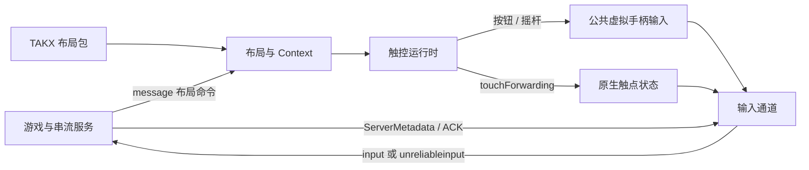

# 官方触屏协议拆解

官方触控由能力协商、布局控制、输入数据三层组成。布局控件产生虚拟手柄或鼠标读数；`touchForwarding` 产生游戏原生触点。原生触点沿两套输入格式交付：传统 `input` 发送事件序列，较新的 `unreliableinput` 发送相对已确认帧的触点状态变化。

核对日期：2026-11-13；官方公开脚本快照：2026-11-12。依据为发布脚本的原类/原方法及 29 项隔离回放。[来源与哈希](../../dev-docs/validation/2026-11-13-official-touchscreen-protocol/sources.json) · [验证说明](../../dev-docs/validation/2026-11-13-official-touchscreen-protocol/README.md)。服务端接收、游戏响应和实际丢包表现仍需真实会话验收。

## 1. 协议边界



两类输入各有终点：TAK 的 `action/axis` 最终进入手柄/鼠标报文；原生触屏最终进入 PointerReport 或 UnreliableInputReport。自有界面生成虚拟手柄即可复用普通手柄输入链；消费官方动态布局还需要布局包、Context 和控制消息。

布局文件字段详见[布局协议](better-xcloud-touch-layout-protocol.md)，控件状态机与渲染详见[TAK/Babylon 引擎实现](tak-babylon-touch-engine.md)。本篇集中描述会话消息和触点 wire 格式。

## 2. 能力与版本协商

### 2.1 触控能力

| 位置 | 字段 / target | 意义 |
| --- | --- | --- |
| 会话 `inputConfiguration` | `enableTouchInput` | 控制触控启用；官方原生触点 bridge 会检查此值 |
| 会话 `inputConfiguration` | `maxTouchPoints` | 客户端可接受的并发触点数，输入通道默认 0 |
| `message`，客户端→服务端 | `/streaming/characteristics/touchinputenabledchanged` | `content` 内部 JSON 为 `{"touchInputEnabled":true}` |
| `message`，客户端→服务端 | `/streaming/characteristics/clientdevicecapabilities` | 声明实际支持的 Layout / Manifest 版本 |
| 输入通道，客户端→服务端 | `ClientMetadata` | 二进制报告 `maxTouchPoints` |
| 输入通道，服务端→客户端 | `ServerMetadata` | 下发触点缩放使用的 `serverHeight/serverWidth` |

官方快照的最高 Layout 版本为 `4.1.0.0`，Manifest 为 `2.0.0.0`。能力示例的内部对象为：

```json
{
  "maxTouchBundleLayoutVersion": "4.1.0.0",
  "maxTouchBundleManifestVersion": "2.0.0.0"
}
```

这两个版本描述布局文件消费能力。输入通道版本独立协商。兼容客户端应按已验证的支持矩阵填写能力。

`ClientMetadata` 在输入版本 ≥3 时发送；`maxTouchPoints` 占 UInt8，官方通道将大于 255 的值截到 255。v8+ 报文共 15 字节：`UInt16(8) + UInt32(token) + Float64(timestamp) + UInt8(maxTouchPoints)`。

来源：[能力消息](../../dev-docs/validation/2026-11-12-tak-layout-and-engine/source-excerpts/touch-message-router.txt:89)、[布局版本](../../dev-docs/validation/2026-11-12-tak-layout-and-engine/source-excerpts/tak-core-protocol.txt:180)、[输入能力](../../dev-docs/validation/2026-11-13-official-touchscreen-protocol/source-excerpts/input-channels.txt)。

### 2.2 输入通道的两种装配

| 通道 | RTCDataChannel `protocol` | 输入报文版本范围 | WebRTC 设置 | 用途 |
| --- | --- | --- | --- | --- |
| `input` | `"1.0"` | 1–10 | `ordered:true`，默认可靠传输 | 传统事件、手柄及 metadata |
| `unreliableinput` | `"2.0"` | 9–10 | `ordered:false,maxRetransmits:0` | 状态变化及应用层重发 |
| `reliableinput` | `"2.0"` | 9–10 | `ordered:true`，默认可靠传输 | 配套可靠通道；客户端 metadata 沿此发送 |

信令中的版本协商片段：

```json
{
  "input": { "minVersion": 1, "maxVersion": 10 },
  "unreliableinput": { "minVersion": 9, "maxVersion": 10 },
  "reliableinput": { "minVersion": 9, "maxVersion": 10 },
  "useUnreliableInput": true
}
```

`inputChannelMaxVersion` 可覆盖各通道的 maxVersion。官方先创建两套通道，然后根据 SDP answer 选择输入实现：`useUnreliableInput` 为真、answer 返回两条新通道版本且对应通道已创建时，装配状态输入；其余情况装配传统 `input`。选择依据包含通道协议与协商结果，单看报文版本 9/10 只能确定字段版本。

来源：[通道创建、范围与选择](../../dev-docs/validation/2026-11-13-official-touchscreen-protocol/source-excerpts/channel-negotiation.txt)。

## 3. 布局控制消息

`message` DataChannel 承载 JSON 信封，普通布局命令的 `type` 为 `Message`。外层 `content` 是字符串，`showlayoutv2/patchstate` 的字符串内部再放 JSON；处理器将 Transaction 交给 cancel。

| 服务端→客户端 target | `content` 内容 | 行为 |
| --- | --- | --- |
| `/streaming/touchcontrols/showlayout` | 布局 ID 原字符串 | 选择布局 |
| `/streaming/touchcontrols/showlayoutv2` | `{"layoutId":"gameplay","patch":"Base64…"}` | 选择布局，可附状态更新 |
| `/streaming/touchcontrols/showtitledefault` | 内容可为空 | 选择标题默认布局 |
| `/streaming/touchcontrols/hide` | 内容可为空 | 隐藏布局 |
| `/streaming/touchcontrols/patchstate` | `{"patch":"Base64…"}` | 更新 Context.state |

`layoutId:""` 选择内置标准控制器。`patch` 是 UTF-8 JSON Patch 数组的 Base64；路径相对 `Context.state`，例如 `/fireVisible`。快照中的 patch 执行按项处理，成功项保留，失败项记录后继续。

下面示例展示双层 JSON 与 Base64 的实际构造：

```javascript
const operations = [{ op: "replace", path: "/fireVisible", value: false }];
const patch = Buffer.from(JSON.stringify(operations), "utf8").toString("base64");
const message = {
  type: "Message",
  target: "/streaming/touchcontrols/patchstate",
  content: JSON.stringify({ patch })
};
console.log(JSON.stringify(message));
```

这些消息引用已加载的布局 ID。资源层另行取得 `.takx` ZIP，展开 Manifest、Context、layout JSON 和 assets；五种消息消费当前 bundle 的布局与状态。

来源：[命令处理器](../../dev-docs/validation/2026-11-12-tak-layout-and-engine/source-excerpts/touch-message-router.txt:8)、[Base64 与状态处理](../../dev-docs/validation/2026-11-12-tak-layout-and-engine/source-excerpts/tak-core-protocol.txt:700)。

## 4. 客户端输入报文公共头

所有多字节字段使用 **little endian**；字段按顺序紧密排列。Float64 是 IEEE 754。

| 输入版本 | reportType | inputToken | timestamp | 头长度 |
| --- | --- | --- | --- | --- |
| ≤6 | UInt8 | UInt32 | — | 5 字节 |
| 7 | UInt8 | UInt32 | Float64 | 13 字节 |
| ≥8 | UInt16 | UInt32 | Float64 | 14 字节 |

`timestamp` 来自 `performance.now()`，单位毫秒。`inputToken` 随每次报文生成递增，最大 UInt32 后回到 0；状态输入还有独立 `frameId`。同一个状态帧的重发保留 frameId，每次序列化会递增 token 并写入当前 timestamp。

相关 reportType 位标记：

| 标记 | 值 | 含义 |
| --- | --- | --- |
| Metadata | `0x0001` | 渲染 / 帧时延反馈 |
| GamepadReport | `0x0002` | 传统手柄输入 |
| PointerReport | `0x0004` | 传统原生触点事件 |
| ClientMetadata | `0x0008` | 客户端触点能力 |
| ServerMetadata | `0x0010` | 服务端视频尺寸 |
| Mouse / Keyboard | `0x0020 / 0x0040` | 鼠标 / 键盘 |
| Vibration / SensorReport | `0x0080 / 0x0100` | 震动 / 传感器 |
| UnreliableInputReport | `0x0200` | 状态输入 |
| UnreliableInputAck | `0x0400` | 状态帧确认 |

传统输入包可以合并位标记，payload 顺序固定为 Metadata → Gamepad → Pointer → Mouse → Keyboard → Sensor。下面的触点包长度与绝对偏移均按单独 Pointer payload 计算。

来源：[公共头与序列化](../../dev-docs/validation/2026-11-13-official-touchscreen-protocol/source-excerpts/input-reporter.txt:4)、[领域枚举](../../dev-docs/validation/2026-11-13-official-touchscreen-protocol/source-excerpts/input-state-model.txt)。

## 5. 传统 PointerReport：20 字节事件

```text
公共头，reportType 包含 0x0004
UInt8 frameCount
重复 frameCount 次：
  UInt8 eventCount
  重复 eventCount 次：20 字节事件
```

frame 是一次排队的事件数组；多个触点可以进入同一 frame，多个 frame 按顺序进入同一个报文。单独触点包长度为 `headerSize + 1 + Σ(1 + 20 × eventCount)`。

| 事件内偏移 | 类型 | 字段 | 写入规则 |
| ---: | --- | --- | --- |
| 0 | UInt16 | contactHeight | `height × serverHeight / clientHeight` |
| 2 | UInt16 | contactWidth | `width × serverWidth / clientWidth` |
| 4 | UInt8 | pressure | `pressure × 255` |
| 5 | UInt16 | twist | 触点旋转值 |
| 7 | UInt32 | pointerId | 本次触摸生命周期内的身份 |
| 11 | UInt32 | x | `x × serverWidth / clientWidth` |
| 15 | UInt32 | y | `y × serverHeight / clientHeight` |
| 19 | UInt8 | eventType | down=1，up=2，move=3 |

`contactHeight/contactWidth` 表示触点接触尺寸。UInt32 坐标处于服务端视频坐标系。序列化器接收事件中的字段，任一客户端尺寸为假值时，两个尺寸同时回退到 1280×720。

示例：客户端 1280×720，服务端 1920×1080，pointerId=7，x=320，y=180，width=20，height=10，pressure=0.5，twist=45。下按事件的 20 字节为：

```text
0f 00 | 1e 00 | 7f | 2d 00 | 07 00 00 00 | e0 01 00 00 | 0e 01 00 00 | 01
  15      30     127    45          7              480             270       down
```

v8+ 加上 14 字节公共头、frameCount=1、eventCount=1，总计 **36 字节**。事件本身没有独立 timestamp。

传统输入的发送代码在收到 ServerMetadata 前清空待发送 pointer 数量；接收视频尺寸后才发送触点。

来源：[事件大小与写入](../../dev-docs/validation/2026-11-13-official-touchscreen-protocol/source-excerpts/input-reporter.txt:26)、[传统队列与发送](../../dev-docs/validation/2026-11-13-official-touchscreen-protocol/source-excerpts/input-channels.txt)。

## 6. UnreliableInputReport：21 字节触点状态

### 6.1 包结构

```text
14 字节公共头，reportType=0x0200
UInt32 frameId
UInt8 changedGamepadCount + 各手柄状态
UInt8 changedPointerCount + 各 21 字节触点状态
UInt8 keyboardPresent + 可选键盘变化
UInt8 mousePresent + 可选鼠标状态
v10：UInt8 lockKeysPresent + 可选锁定键状态
UInt8 0
```

末尾固定零字节是当前序列化器写出的尾部字段，具体服务端字段名待补证据。官方状态通道的 `sendSensorInput()` 只更新接收统计。v9 单指、其他输入为空时总计 **44 字节**；v10 的未初始化 lockKeys presence 多占 1 字节，总计 **45 字节**。

| 状态内偏移 | 类型 | 字段 |
| ---: | --- | --- |
| 0 | UInt32 | pointerId |
| 4 | UInt8 | PointerUpDown counter |
| 5 | UInt8 | PointerMove counter |
| 6 | UInt16 | contactHeight |
| 8 | UInt16 | contactWidth |
| 10 | UInt8 | pressure × 255 |
| 11 | UInt16 | twist |
| 13 | UInt32 | scaled x |
| 17 | UInt32 | scaled y |

坐标、尺寸和压力的缩放规则与传统格式一致。以第 5 节的触点为例，首次 down 的状态记录为：

```text
07 00 00 00 | 01 | 00 | 0f 00 | 1e 00 | 7f | 2d 00 | e0 01 00 00 | 0e 01 00 00
 pointerId    UD   Move   高       宽     压力    旋转          x              y
```

来源：[状态报文与触点序列化](../../dev-docs/validation/2026-11-13-official-touchscreen-protocol/source-excerpts/input-reporter.txt:60)。

### 6.2 计数器与身份

官方按 pointerId 查找状态，首次出现时创建两个计数器均为 0 的 PointerState。有效 down/up 切换增加 UpDown counter，并结束当前移动阶段；进入新的移动阶段时增加 Move counter，连续 move 保持该 counter 并更新坐标。两者都使用 Uint8，按模 256 回绕。

| 事件序列 | down | move | move | up | down | move |
| --- | ---: | ---: | ---: | ---: | ---: | ---: |
| UpDown counter | 1 | 1 | 1 | 2 | 3 | 3 |
| Move counter | 0 | 1 | 1 | 1 | 1 | 2 |
| 状态 | 按下 | 按下 | 按下 | 抬起 | 按下 | 按下 |

UpDown counter 为奇数时按下，为偶数时抬起。重复 down 或重复 up 保持 UpDown counter；每个接收事件仍更新字段，并增加本地 discriminator。

discriminator 是本地变化标识，参与差量计算和快照比较。wire 中携带的是两个 UInt8 counter 与当前字段。一次按下和抬起都发生在发送前时，最新状态可携带 UpDown=2，让中间状态转换计数随最终状态一起交付；服务端如何还原转换仍需真实会话验证。

来源：[PointerState](../../dev-docs/validation/2026-11-13-official-touchscreen-protocol/source-excerpts/input-state-model.txt:14)、[事件更新方法](../../dev-docs/validation/2026-11-13-official-touchscreen-protocol/source-excerpts/input-channels.txt:152)。

### 6.3 差量、ACK 与重发

每次发送以 `acknowledgedFrameState` 为基线计算 changedPointers。新的 pointerId、discriminator 变化或字段变化都会进入差量；up 状态保留在本地 pointers 集合，并持续参与对已确认基线的比较。

状态较上次排队快照发生变化时增加 frameId、保存完整快照，然后发送相对已确认帧的差量。状态保持相同且仍有待确认差量时，默认间隔 **16ms** 允许重发同一 frameId；触点/鼠标主动触发发送的默认最小间隔为 **8ms**，二者均可配置。实际发送频率还受外层输入循环调度影响。

ACK 推进到队列中对应帧；旧 ACK 和重复 ACK 跳过。初始 ACK 队列容量 120，填满后倍增至上限 2500；到达上限后 CircularBuffer 覆盖最旧快照。因此它保存的是有限帧状态历史。

示例：frame 1 下按，frame 2 移动；基线仍为 frame 0 时，frame 2 继续携带该触点当前状态。收到 ACK 2 后基线推进到 frame 2；随后抬起得到新帧并携带更新后的 UpDown counter。

来源：[发送、ACK 和重发](../../dev-docs/validation/2026-11-13-official-touchscreen-protocol/source-excerpts/input-channels.txt:109)、[差量模型](../../dev-docs/validation/2026-11-13-official-touchscreen-protocol/source-excerpts/input-state-model.txt:43)、[CircularBuffer](../../dev-docs/validation/2026-11-13-official-touchscreen-protocol/source-excerpts/circular-buffer.txt:10)。

## 7. 服务端回复的短头

服务端→客户端消息采用独立短头：输入版本 ≥8 使用 UInt16 reportType，早期使用 UInt8。后面直接读取 payload。

| 回复类型 | v8+ wire | 总长度 |
| --- | --- | ---: |
| ServerMetadata | `UInt16(0x0010) + UInt32(height) + UInt32(width)` | 10 字节 |
| UnreliableInputAck | `UInt16(0x0400) + UInt32(frameId)` | 6 字节 |

1920×1080 的 ServerMetadata：`10 00 38 04 00 00 80 07 00 00`。ACK frame 1：`00 04 01 00 00 00`。

状态输入实现为 reliable/unreliable 两条通道都注册接收回调，共用此解析器。以上 ACK 布局由客户端解析器确认；服务端实际选用哪条通道发送 ACK，以真实会话采样为依据。

来源：[接收解析](../../dev-docs/validation/2026-11-13-official-touchscreen-protocol/source-excerpts/input-channels.txt)。

## 8. TAK 触点到 wire 的转换

`touchForwarding` 将触点相对其区域归一化：`x=(pointerX-areaX)/areaWidth`、`y=(pointerY-areaY)/areaHeight`，并 clamp 到 [0,1]。它用内部 pointerIndex 作为身份，pressure 沿原值，diameter 除以区域高度，orientation 沿原值。

会话 bridge 用身份集合将首次 `action:"down"` 转为 pointerdown，后续 down 转为 pointermove，up 转为 pointerup；生成 `clientWidth=clientHeight=1` 的读数，把 diameter 同时赋给 width/height，再交给输入通道。

抬起的两层行为各有定义：序列化器写入收到的事件字段；TAK forwarding 在 end 时省略 position/additionalTouchData，随后 bridge 将 x/y、pressure、diameter、orientation 写成 0。自有采集器应明确自己的释放读数合同。

布局按钮/摇杆沿 `onVirtualGamepadInput()` 输出，原生触点沿 `onVirtualPointerInput()` 输出。兼容实现应覆盖取消、布局切换、隐藏、退出和重连时的释放。

来源：[归一化与 end](../../dev-docs/validation/2026-11-12-tak-layout-and-engine/source-excerpts/tak-core-input.txt:1830)、[会话转换](../../dev-docs/validation/2026-11-12-tak-layout-and-engine/source-excerpts/game-stream-bridge.txt:122)。

## 9. xbxrc 的接入起点

| 当前证据 | 兼容实现需要落实的合同 |
| --- | --- |
| InputPacketEncoder 已有传统 20 字节结构，pointerId 固定 0 | 独立触点身份及可复用的生命周期映射 |
| 编码固定 1920×1080，接触尺寸使用常数；变量名 tiltX/tiltY | 消费 ServerMetadata，以视频内容矩形和接触尺寸缩放 |
| 编码层将 up 的尺寸与坐标归零 | 采集层定义释放读数，编码层按合同写入 |
| InputService 发送调用的 pointer 队列为空 | 输入采集、排队、释放与当前传输服务连接 |
| Rust bootstrap 有 15 字节 ClientMetadata，消息握手发送 touchInputEnabled=false | 能力随实际触控与布局覆盖声明 |

源码：[传统编码](../../src/player/protocol/input/InputPacketEncoder.ts:243)、[发送服务](../../src/player/app/input/InputService.ts:289)、[Rust bootstrap](../../crates/xbox-streaming-protocol/src/stream_data_channel.rs:141)。这张表覆盖本轮读取的桌面公共链；iOS 输入与界面迁移保持其当前任务范围。

原生触点兼容有清晰的协议起点。建议先沿当前 `input` 主线完成能力声明、ServerMetadata、独立 pointerId 和多指释放验收；状态输入通道按公共协议与传输边界另行制定 RFC；TAK 布局兼容沿布局包、五种命令与 Context 建立支持矩阵。
