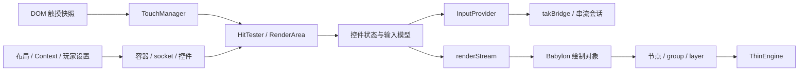

# Xbox TAK / Babylon：触控引擎具体实现

TAK 核心把布局、触摸、传感器和玩家设置转换为控件状态与虚拟输入；Babylon 将控件的 `renderStream` 转换为透明 Canvas 上的图形。better-xcloud 提供游戏索引、社区布局选择和网页补丁，实际的命中、手势、输入合并与控件绘制沿 Xbox 官方网页的这套引擎执行。

核对日期：2026-11-12。实现依据六份公开发布脚本的冻结快照，版本与 SHA-256 见[来源清单](/Users/guo.xu/Documents/code/games/xbxrc/dev-docs/validation/2026-11-12-tak-layout-and-engine/sources.json)。本文引用仓库内的原文摘录；[摘录索引](/Users/guo.xu/Documents/code/games/xbxrc/dev-docs/validation/2026-11-12-tak-layout-and-engine/source-excerpts/index.json)记录原文件行号、摘录行号和哈希。

布局字段与消息格式见[布局协议](/Users/guo.xu/Documents/code/games/xbxrc/docs/references/better-xcloud-touch-layout-protocol.md)，执行证据见[回放说明](/Users/guo.xu/Documents/code/games/xbxrc/dev-docs/validation/2026-11-12-tak-layout-and-engine/README.md)。

## 1. 装配关系与两条调用链

核心入口 `Bh` 使用依赖注入容器，将每个服务装配为单例。宿主注入 `jsonValidator`、`takBridge`、`settingsProvider`、`sensorStore`、运行时参数和日志接口。

| 服务 | 责任 |
| --- | --- |
| BundleProcessor / LayoutCoordinator | 加载转换布局、应用 Context、选择当前 scope 的布局 |
| LayerManager / UserInterface | 合并激活层、玩家设置、颜色和交互模式 |
| RenderArea | 建立 surface、区域容器、socket、控件与碰撞区 |
| TouchManager | 将触点全量快照转换为指针状态和增量更新 |
| HitTester | 在一批输入帧中执行命中、附着与转交 |
| 控件控制器 / 输入模型 | 解释按钮、拖动、摇杆、触摸板和传感器操作 |
| InputProvider | 合并控件贡献，输出手柄、相对鼠标与原生触摸 |
| BabylonRenderer / 绘制工厂 | 订阅绘制流，更新节点、纹理和 GPU 绘制对象 |



`setTouchState(surfaceKey, touches)` 进入 TouchManager；`getControlsStream(surfaceKey)` 向绘制宿主提供控件集合。`dispatchAction()` 承接布局、人体工学编辑、透明度、轮盘大小、摇杆与陀螺仪设置；`start()` 激活初始化流。

来源：[核心装配与对外接口](/Users/guo.xu/Documents/code/games/xbxrc/dev-docs/validation/2026-11-12-tak-layout-and-engine/source-excerpts/tak-core-input.txt:2449)。

## 2. DOM 事件怎样进入 TAK

网页的 `MultiTouchSurface` 创建覆盖指定区域的固定定位元素，设置 `touchAction: "none"`。它监听 `touchstart / touchmove / touchend / touchcancel`，每次读取 `event.targetTouches`，将当前全部活动触点交给核心。

一个原始触点包含：

```javascript
{
  identifier: touch.identifier,
  pageX: touch.clientX - surfaceRect.left,
  pageY: touch.clientY - surfaceRect.top,
  diameter: 2 * touch.radiusX,
  orientation: touch.rotationAngle,
  pressure: touch.force,
  pointerType: "touch"
}
```

字段 `pageX/pageY` 在此保存 surface 局部坐标，单位为 CSS 像素。宿主缓冲数组初始长度为 10，触点增加时扩容。mouse/pen 走 PointerEvents，并在开发模式、允许鼠标交互等条件满足时使用 pointer capture；触摸继续由 TouchEvents 快照处理。

宿主同时提供屏幕尺寸、DPR、方向、安全区、可用 anchor 和视频触摸转发矩形。surface 是完整的输入与布局边界。

来源：[DOM 触摸面](/Users/guo.xu/Documents/code/games/xbxrc/dev-docs/validation/2026-11-12-tak-layout-and-engine/source-excerpts/tak-browser-host.txt:80)、[surface 参数](/Users/guo.xu/Documents/code/games/xbxrc/dev-docs/validation/2026-11-12-tak-layout-and-engine/source-excerpts/tak-browser-host.txt:227)。

## 3. 指针池、附着与释放

TouchManager 按 surface 保存状态，每个 surface 固定建立 12 个内部 `Pointer` 模型。每次收到快照时，先用 DOM `identifier` 更新已存在指针，缺失的活动指针进入 End，再把新增触点分配给空闲模型。内部 `pointerIndex` 标识池槽位，DOM `identifier` 标识浏览器触点；会话配置的 `maxTouchPoints=10` 表达另一层输入能力。

| 状态/操作 | 行为 |
| --- | --- |
| Start | 保存 initialPosition，首次通知控件 |
| Move | 更新 position 与 lastPositionDelta |
| End | 通知释放并清理指针关联 |
| attach | 将指针绑定到控件；中途首次附着也以 Start 通知，delta 归零 |
| detach | 临时以 End 通知旧控件，随后恢复指针自身状态 |
| swap | 旧控件接收 End，新控件接收 Start |

指针数据更新和控件通知分别推进。TouchManager 生成待处理队列，HitTester 执行碰撞后统一 `flushNotification()`。回放核对了 `Start → Move → End`、`delta=(4,-2)`，以及移动中转入新控件时 Start/delta 的重置。

来源：[Pointer 与 TouchManager](/Users/guo.xu/Documents/code/games/xbxrc/dev-docs/validation/2026-11-12-tak-layout-and-engine/source-excerpts/tak-core-input.txt:2313)。

## 4. 布局如何形成 socket 与碰撞区

RenderArea 将 `left / center / right / upper / lower` 转换为区域容器。容器树包含 radial container、inner/outer container、cluster 和 control socket；位置 visitor 将 surface 参数与玩家轮盘设置应用到坐标、尺寸、旋转和反射属性。

socket 保存 `x/y`、`angle`、`unitSize`、`collisionRadius`、`scale` 等运行时量。属性 visitor 把 JSON 槽位映射到 socket；外轮盘遇到 cluster 数组时，为其分配连续两个物理槽位。工厂沿 socket 创建控件，同类型配置更新复用原模型，类型改变时清理旧控件并重新建立。

碰撞区采用圆、矩形、扇形和圆环，支持自定义碰撞区与 priority。Start 在所属容器内选择命中的高优先级区域；Move 维护现有附着，也可按 rollover 条件转交。按钮含 `toggle` 或 `pullAction` 时选择持续附着语义；普通按钮允许 rollover，目标碰撞区和控件还需同时允许接收。

surface 按 `left → center → right → upper → lower → touchForwarder` 的顺序尝试区域。priority 的比较发生在对应容器的候选集合中。可交互条件为 `visible` 与当前 interaction mode 匹配；人体工学调整器使用 `UserCustomization` 模式，游戏控件使用 `Gameplay` 模式。

HitTester 在处理一批指针前调用 `InputProvider.startFrame()` 和 surface 的 `startRenderFrame()`，在 finally 中关闭两者。控件输入与绘制属性因此分别得到批量提交边界。

来源：[容器和位置 visitor](/Users/guo.xu/Documents/code/games/xbxrc/dev-docs/validation/2026-11-12-tak-layout-and-engine/source-excerpts/tak-core-geometry.txt:198)、[槽位与区域更新](/Users/guo.xu/Documents/code/games/xbxrc/dev-docs/validation/2026-11-12-tak-layout-and-engine/source-excerpts/tak-core-geometry.txt:330)、[碰撞算法](/Users/guo.xu/Documents/code/games/xbxrc/dev-docs/validation/2026-11-12-tak-layout-and-engine/source-excerpts/tak-core-input.txt:681)、[HitTester](/Users/guo.xu/Documents/code/games/xbxrc/dev-docs/validation/2026-11-12-tak-layout-and-engine/source-excerpts/tak-core-input.txt:2242)。

## 5. 控件状态与输入模型

视觉控件基类 `hc` 保存状态流、指针 tracker 和 `renderStream`，订阅 props、颜色、样式变体、透明度与控件设置。状态变化先更新 render property manager；渲染帧计数归零后发出一份最终绘制属性。

| 控件 | 已核对的状态与操作 |
| --- | --- |
| button | Idle / Activated / Toggled / Pulled；支持 action 数组、保持开关、拖拉附加动作 |
| joystick | Idle / Moving / Activated；位移形成模拟值，actionThreshold 控制附加动作 |
| directionalPad | 中心 deadzone 返回 None；Exclusive 为四方向，AllowNeighboring 为八方向 |
| touchpad | 位移累计；可同时提交 action；`renderAsButton` 使用按钮绘制身份 |
| throttle | 上/下连续轴；上侧 sticky 在释放后保留值，下侧释放归零 |
| arcadeButtons | 各 punch/kick 独立状态，多指命中后组合动作贡献 |
| radialAdjuster | 内圈拖移、外圈旋转/缩放，释放时提交玩家设置 |
| gyroscope / accelerometer | 订阅传感器流，经方向转换和 axis 管线输出 |
| touchForwarding | 视频矩形内的触摸转换为归一化原生触摸 |

输入模型 `xc` 将模拟输入、普通 action、layer action 分别保存为流，再组合当前控件输入。普通 action 生成按钮或轴贡献，layer action 发布目标层的激活状态，layout action 在激活时转交 LayoutCoordinator。action 数组在同一控件模型中合并。

本快照保存视觉状态和非视觉操作状态：button、joystick、touchpad 的 `enabled=false` 保持 Disabled 外观，普通手柄动作仍按非视觉状态执行；button 的 layer/layout action 在 Disabled 状态释放。`visible=false` 使视觉控件退出可交互集合。sensor 的 `enabled=false` 切换为空订阅流。

来源：[控件基类](/Users/guo.xu/Documents/code/games/xbxrc/dev-docs/validation/2026-11-12-tak-layout-and-engine/source-excerpts/tak-core-input.txt:264)、[输入模型与 action](/Users/guo.xu/Documents/code/games/xbxrc/dev-docs/validation/2026-11-12-tak-layout-and-engine/source-excerpts/tak-core-input.txt:475)、[按钮状态](/Users/guo.xu/Documents/code/games/xbxrc/dev-docs/validation/2026-11-12-tak-layout-and-engine/source-excerpts/tak-core-input.txt:821)、[方向键](/Users/guo.xu/Documents/code/games/xbxrc/dev-docs/validation/2026-11-12-tak-layout-and-engine/source-excerpts/tak-core-input.txt:1037)、[调整器](/Users/guo.xu/Documents/code/games/xbxrc/dev-docs/validation/2026-11-12-tak-layout-and-engine/source-excerpts/tak-core-input.txt:2616)、[格斗按钮](/Users/guo.xu/Documents/code/games/xbxrc/dev-docs/validation/2026-11-12-tak-layout-and-engine/source-excerpts/tak-core-input.txt:2710)。

## 6. 摇杆：相对位移、绝对坐标和单位圆

`relative` 与 `expand` 的缺省值均为 true。玩家设置的 relativity mode 可以覆盖布局声明。令 `R` 为有效半径，socket 中心为 `c`，上一值为 `v`：

```text
相对模式：next = v + pointer.lastPositionDelta / R
绝对模式：next = (pointer.position - c) / R

o = socket.unitSize / 2
expand=true 或 o>collisionRadius：R = clamp(collisionRadius-o, o, collisionRadius)
其余配置：R = o
```

双轴摇杆在发送映射前将向量限制到单位圆；水平/垂直摇杆仅保留对应轴并限制在 `[-1,1]`。例如 `(3,4)` 变为 `(0.6,0.8)`。相对模式首次接触以零 delta 建立操作起点，绝对模式首次接触根据 socket 中心确定值。

附加 action 根据 `actionThreshold` 激活。源码检查 `x >= threshold || y >= threshold || length(value) >= threshold`，随后进入 Moving 或 Activated；释放将值归零并撤销动作。

来源：[模式与半径](/Users/guo.xu/Documents/code/games/xbxrc/dev-docs/validation/2026-11-12-tak-layout-and-engine/source-excerpts/tak-core-input.txt:2836)、[摇杆控制器](/Users/guo.xu/Documents/code/games/xbxrc/dev-docs/validation/2026-11-12-tak-layout-and-engine/source-excerpts/tak-core-input.txt:1493)。

## 7. Axis 管线与两项版本观察

axis 分类为双轴、单轴、极向输入，各自可以映射手柄或相对鼠标。手柄映射依序应用 `deadzone → responseCurve → sensitivity → 控件/玩家灵敏度`；鼠标映射路径应用 sensitivity。各映射的贡献相加后，摇杆轴限制在 `[-1,1]`，扳机限制在 `[0,1]`。

### deadzone 的实际公式

本快照的单轴函数在单位幅值下为：

```text
x>0：x' = x*(1-d)+d
x<0：x' = x*(1-d)-d
x=0：x' = 0
```

径向配置对向量长度应用对应映射，再恢复原方向。回放结果：`d=0.1, x=0.5 → 0.55`，`x=0.01 → 0.109`；向量 `(0.3,0.4) → (0.33,0.44)`。该参数在这里给非零输出添加偏移；directionalPad 的中心 deadzone 另有几何判定。

手柄 sensitivity 使用围绕偏移值 `d` 的分段缩放：正数 `(x-d)*s+d`，负数 `(x+d)*s-d`，零保持零；鼠标 sensitivity 直接乘 `s`。

### responseCurve 的隔离回放异常

冻结脚本的 `Hu()` 使用 `Eu(range[1], 0).y` 作为归一化分母。`Eu()` 在第二参数为 0 时得到角度 0，分母为 0。提取原方法并执行后观察到：

| range=[0,1] | curve(0) | curve(0.5) |
| --- | --- | --- |
| circular | NaN | -Infinity |
| circular-inverse | NaN | Infinity |

这两项记录标为 `axis-observation`，含义是成功复现该版本方法的异常行为。结论适用于这份发布快照的隔离方法；真实网页中该配置的覆盖范围和后续宿主行为仍待端到端测量。移植时应为曲线建立有限值、端点与值域校验。

来源：[axis 分类、变换和累加](/Users/guo.xu/Documents/code/games/xbxrc/dev-docs/validation/2026-11-12-tak-layout-and-engine/source-excerpts/tak-core-input.txt:1200)、[实际回放结果](/Users/guo.xu/Documents/code/games/xbxrc/dev-docs/validation/2026-11-12-tak-layout-and-engine/replay-results.json)。

## 8. 触摸板、节流杆和传感器

touchpad 映射相对鼠标时使用累计位移；映射摇杆时，驱动器 `wd` 计算 `velocity = delta / elapsedMs`。零时间差采用 1ms；连续 20ms 没有新位移后将速度归零。驱动器沿 animation-frame 时钟发布速度，控件再经过 axis 管线生成摇杆值。joystick 映射鼠标则使用当前值作为速度，每次循环乘时间差形成相对位移。

throttle 的相对值为 `oldValue-deltaY/collisionRadius`，绝对值为 `(socketY-pointerY)/collisionRadius`。上拖产生正 value，映射前转为负 Y，再由 `axisUp` 转换为正扳机幅值。sticky 保留上侧值；下侧释放回到零。

传感器控制器订阅 `gyroscope$` 或 `accelerometer$`，与 `orientation$` 合并后按横竖屏旋转/翻转坐标。`axisZY` 路径可以将 Z 分量引入二维映射。之后复用 axis 管线，输出模拟手柄或相对鼠标；启用状态、卸载和属性更新分别控制订阅与映射。

来源：[触摸板与速度驱动](/Users/guo.xu/Documents/code/games/xbxrc/dev-docs/validation/2026-11-12-tak-layout-and-engine/source-excerpts/tak-core-input.txt:1882)、[循环时钟](/Users/guo.xu/Documents/code/games/xbxrc/dev-docs/validation/2026-11-12-tak-layout-and-engine/source-excerpts/tak-core-input.txt:2876)、[throttle](/Users/guo.xu/Documents/code/games/xbxrc/dev-docs/validation/2026-11-12-tak-layout-and-engine/source-excerpts/tak-core-input.txt:1684)、[sensor](/Users/guo.xu/Documents/code/games/xbxrc/dev-docs/validation/2026-11-12-tak-layout-and-engine/source-excerpts/tak-core-input.txt:2090)。

## 9. InputProvider：按控件贡献合并

InputProvider 根据每个控件的前后状态计算 delta，保存全局 accumulator。其核心行为可以写成：

```text
accumulator[key] += currentControlValue[key] - previousControlValue[key]
按钮输出 = accumulator[key] > 0
模拟轴输出 = clamp(accumulator[key], min, max)
幅值 <= 1e-5 的模拟输出归零
```

按钮因此具有按贡献计数的释放语义：两个控件同时按 A，释放其中一个后 A 继续保持，第二个释放后归零。模拟轴 accumulator 保留限幅前的总和；两个 `0.8` 贡献输出 `1.0`，释放一个后恢复 `0.8`。

`startFrame/endFrame` 支持嵌套，最外层 frame 计数归零时提交一次手柄快照。dirty 标记记录批次中间的变化；同批 `+1/-1` 最终归零也可能产生一次 neutral 提交。

相对鼠标累加器保留小数余量，向零截取整数后输出。例如三次 `(0.4,-0.4)` 输出一次 `(1,-1)`，余量为 `(0.2,-0.2)`。布局动作、触摸和可选触觉反馈分别通过对应 bridge 接口发送。

来源：[InputProvider](/Users/guo.xu/Documents/code/games/xbxrc/dev-docs/validation/2026-11-12-tak-layout-and-engine/source-excerpts/tak-core-input.txt:8)。

## 10. Babylon 怎样绘制控件

宿主创建透明 Canvas 与 Babylon `ThinEngine`，设置 alpha、premultipliedAlpha，关闭 depth、stencil 和 audio engine。本快照按 GPU renderer 是否含 Intel 选择抗锯齿。渲染器再设置二维正交投影、alpha 混合和完整 viewport。

逻辑坐标使用 CSS 像素：`engine.setSize(width*DPR,height*DPR)` 设置 framebuffer，`orthoOffCenterLH(0,width,height,0,-100,100)` 保持布局坐标。控件视觉以平面图形与 sprite 为主。

绘制工厂 `je()` 按控件类型创建 button、joystick、directionalPad、touchpad、throttle、arcadeButtons 和 radialAdjuster 绘制对象。包装器 `Xe` 订阅控件 `renderStream`，更新位置、旋转、透明度、图标、轮廓与摇杆 knob，并标记需要绘制。宿主 Map 按控件 `identifier` 复用对象；touchpad 切换 `renderAsButton` 时使用独立绘制身份。

节点树维护局部变换、世界矩阵、可见性、透明度和子树权重。图形按 `renderingGroup → layer` 分组，shapes 与 sprites 各自排序绘制。sprite 使用四顶点、两三角形的 quad，按图集 UV 采样，世界矩阵与正交投影参与顶点变换。sprite 使用 2048×2048 图集：首次遇到图标时通过 FBO 绘入图集，缓存偏移和尺寸；该快照的 `updateTexture()` 方法为空，实际填充发生于首次收集。

来源：[ThinEngine 装配](/Users/guo.xu/Documents/code/games/xbxrc/dev-docs/validation/2026-11-12-tak-layout-and-engine/source-excerpts/tak-browser-host.txt:227)、[绘制工厂](/Users/guo.xu/Documents/code/games/xbxrc/dev-docs/validation/2026-11-12-tak-layout-and-engine/source-excerpts/babylon-renderer.txt:382)、[对象复用](/Users/guo.xu/Documents/code/games/xbxrc/dev-docs/validation/2026-11-12-tak-layout-and-engine/source-excerpts/tak-browser-host.txt:8)、[节点树](/Users/guo.xu/Documents/code/games/xbxrc/dev-docs/validation/2026-11-12-tak-layout-and-engine/source-excerpts/babylon-renderer.txt:8)、[sprite 图集](/Users/guo.xu/Documents/code/games/xbxrc/dev-docs/validation/2026-11-12-tak-layout-and-engine/source-excerpts/babylon-renderer.txt:281)。

## 11. 脏更新、绘制循环和生命周期

宿主持续以 requestAnimationFrame 调用 `renderer.render()`。每次调用设置 viewport；`_shouldUpdate` 控制节点更新，`_shouldRender` 控制实际 group 绘制。无脏更新和待绘制状态时，本方法保留循环调用与 viewport 设置。

脏节点数组初始长度为 128。`shouldUpdate(node)` 累计待更新子树权重；权重超过 root 权重、根节点更新或队列条件满足时，改用全树更新。完成更新后清空节点队列、权重和脏标记；存在更新时进入绘制阶段。绘制集合为空或 group 没有输出时清除透明画布。

动画会持续更新节点并触发绘制。渲染器每五秒记录的 render 次数包含空闲调用；GPU draw 次数和真实功耗需要独立测量。回放核对了空闲、局部脏节点、根节点更新和空集合清屏四种分支。

控件移出集合时先 `beginDispose()` 淡出，动画完成后释放节点和订阅。整个宿主卸载时取消 rAF、控件集合订阅，移除 Canvas 并释放图标、资产、纹理、effects、groups 和 ThinEngine。TAK 核心的 `unmount()` 关闭 initializer、BundleProcessor、TouchManager、HitTester 和 RenderArea。

better-xcloud 的 WebGL 包装为 TAK context 设置 `antialias=false` 与 `powerPreference="low-power"`；键鼠接入时的 TAK 停止补丁调用绘制资源的 dispose。其性能影响应分别测量循环、GPU draw 和资源释放。

来源：[渲染循环与脏标记](/Users/guo.xu/Documents/code/games/xbxrc/dev-docs/validation/2026-11-12-tak-layout-and-engine/source-excerpts/babylon-renderer.txt:635)、[宿主清理](/Users/guo.xu/Documents/code/games/xbxrc/dev-docs/validation/2026-11-12-tak-layout-and-engine/source-excerpts/tak-browser-host.txt:8)、[核心卸载](/Users/guo.xu/Documents/code/games/xbxrc/dev-docs/validation/2026-11-12-tak-layout-and-engine/source-excerpts/tak-core-input.txt:2449)、[低功耗补丁](/Users/guo.xu/Documents/code/games/better-xcloud/src/utils/monkey-patches.ts:224)、[停止绘制补丁](/Users/guo.xu/Documents/code/games/better-xcloud/src/modules/patcher/patcher.ts:293)。

## 12. 最终输入怎样接入串流

会话 bridge 将 TAK 字段转换为 Xbox 虚拟手柄 mapping：按钮布尔值转为 0/1，摇杆与扳机保留模拟值，计算 `VirtualPhysicality`，随后调用 `session.onVirtualGamepadInput("tak", performance.now(), mappings)`。相对鼠标调用 `onVirtualMouseInput()`，填入 X/Y 与 Relative 类型。

原生触摸沿 touchForwarding 控件处理：视频矩形内的位置归一化到 `[0,1]`，直径按矩形高度归一化，pointerIndex 作为内部 pointerId。bridge 用 pointerId Set 将首个 down 转为 pointerdown，后续 down 转为 pointermove，释放转为 pointerup，再调用 `onVirtualPointerInput()`。该路径受会话触摸与鼠标配置条件控制。

这两类触控能力各有输出合同：布局控件生成虚拟手柄/鼠标读数，视频触摸区域生成原生 pointer 读数。串流会话承担最终输入传输。

来源：[touchForwarding](/Users/guo.xu/Documents/code/games/xbxrc/dev-docs/validation/2026-11-12-tak-layout-and-engine/source-excerpts/tak-core-input.txt:1830)、[会话虚拟输入桥](/Users/guo.xu/Documents/code/games/xbxrc/dev-docs/validation/2026-11-12-tak-layout-and-engine/source-excerpts/game-stream-bridge.txt:122)。

## 13. 证据与参考顺序

本次核对包含六份发布原件哈希、36 段原文摘录、社区模板与官方最小文件，以及 41 个隔离回放场景。回放直接提取发布脚本中的方法与编译校验器，覆盖协议、指针/几何、输入合并、轴变换和绘制分支；其中两项专门记录 responseCurve 异常。

DOM 事件、真实 WebGL/GPU、触摸到远端输入时延、触觉效果与长时资源行为的证据仍限于静态源码；端到端验收需要浏览器和实机测量。

用于理解和后续设计时，建议按 `TouchManager / HitTester → 控件状态机 → InputProvider → LayoutCoordinator / LayerManager → 绘制宿主` 阅读。xbxrc 的后续方案沿现有 Vue 触控 UI、公共输入合同与 Tauri/Rust 会话边界制定。
