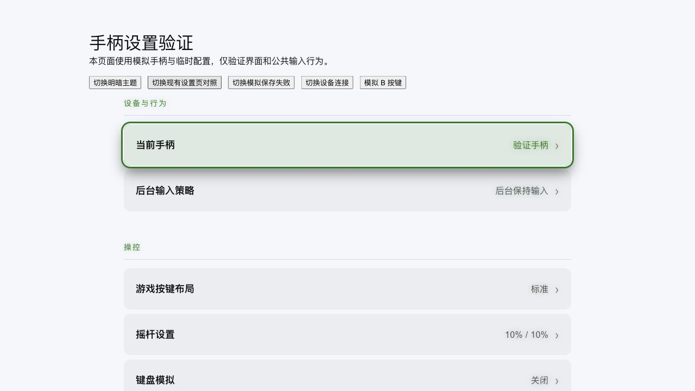
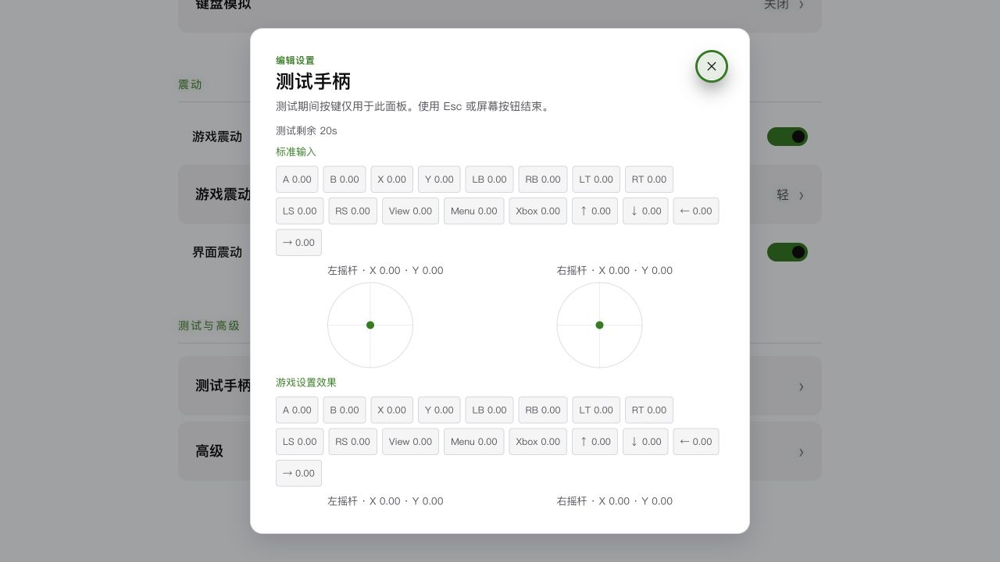
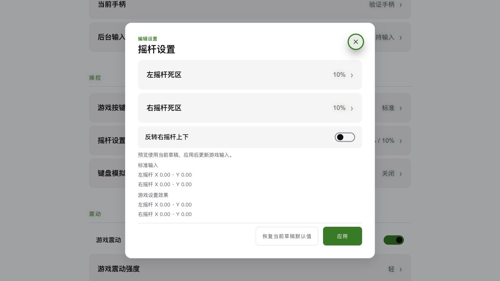
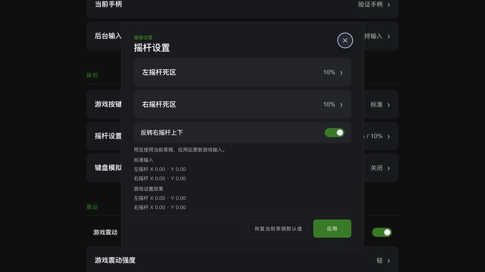

# 统一手柄接入与设置改造报告

## 状态与范围

- 日期：2026-10-27；三项复杂度收口：2026-10-30
- 实施依据：[RFC](../rfcs/2026-10-27-unified-gamepad-input.md)、[手柄与设置设计](../isu/2026-10-27-browser-gamepad-rog-fse-design.md)
- 状态：改造与本机验证完成。
- 交付范围：桌面公共手柄接入、两种后端、输入路由、串流接线、触觉、四组设置、迁移、合同测试与架构文档。
- Windows / ROG Xbox Ally X FSE 实机验收按已确认范围单独待验。浏览器 WebRTC 媒体主线、WebGL 后处理与 Rust 媒体瘦身继续属于后续媒体任务。

## 最终结构

应用启动时在 Browser / Native 中装配一个 `GamepadBackend`，默认 Browser。公共 `InputController` 决定活动设备、后台策略、UI/串流归属和逐控件释放。Browser 使用标准 Gamepad API；Native 按需启动现有 SDL3 service，提供每台设备的未过滤标准状态和同一设备句柄上的触觉。

游戏布局、左右死区、右 Y 反转在公共游戏分支应用一次；UI 导航保持标准语义与几何寻路。Menu+View 和软 Home 集中处理。浏览器串流发送初始 metadata 后消费公共状态；Rust 媒体消费应用输入端口，校验会话及序号，有界队列保留按键释放并在传输成功后确认出队。IPC 失败后的下一次样本先归零同步。

`keep-active` 默认允许应用层输入消费，菜单、独占录入、设备断开、会话结束继续执行释放。`follow-app` 消费 Tauri 主窗口 `onFocusChanged` 和一次 `isFocused` 初态；未知状态放行。这一来源表达窗口焦点，FSE可靠性等待平台验证。

桌面移除原生 route 镜像、forwarding RPC、全槽归零等待、焦点恢复扫描、触屏恢复动作、重复 overlay gate、旧映射/诊断弹层与 `ohmygamepad-host` 依赖。通用 ohmygamepad 的槽位、profile 和平台 haptics crate 保留库级用途，桌面使用设备标准态。当前 Native 触觉采用 SDL3 实际能力，Windows 专用 provider 保留在库中。

## 设置与生效规则

| 分组 | 内容 | 生效方式 |
| --- | --- | --- |
| 设备与行为 | 当前手柄、后台输入策略 | 设备为连接期间选择；策略保存成功后立即生效 |
| 操控 | 游戏按键布局、左右摇杆死区、反转右 Y、键盘模拟及绑定 | 面板草稿，应用后统一保存；关闭丢弃草稿 |
| 震动 | 游戏震动、轻/标准/强、界面震动 | 保存成功后立即生效；能力不足时保留偏好并显示状态 |
| 测试与高级 | 标准/游戏输入对照、200ms震动测试、接入方式、诊断导出、恢复偏好 | 测试20秒、录入10秒自动结束；后端下次启动装配 |

新安装默认 Browser、keep-active、物理手柄控制游戏、10%左右死区、关闭右 Y反转、游戏震动开启且轻、界面震动关闭。旧 profiles 作为历史存储保留；桌面已退出读取和导入。恢复偏好覆盖后台策略、游戏操控、键盘和震动，当前后端配置、连接和旧 profiles 保留。每个编辑器的恢复草稿仅影响自身类别。

保存使用既有配置服务的一次 patch，公共层应用服务端归一化结果。失败时保留当前配置并反馈错误。配置初次读取失败时启动 Browser 默认输入，高级诊断记录错误。

## 要求与证据

| 要求 | 实现 / 验证证据 |
| --- | --- |
| Browser/Native统一合同、单次装配 | `backend.ts`、`runtime.ts`；`browser-backend.test.ts`、`native-backend.test.ts`、`runtime.test.ts` |
| 初态、空洞/index复用、设备断开、迟到输出 | 两个后端合同测试；Native启停竞争与触觉排队测试 |
| keep-active / follow-app / unknown、单设备锁定 | `input-controller.test.ts` 的策略、设备替换与交接案例 |
| 菜单/独占capture、逐控件释放、组合键、软Home | 公共控制器测试；多capture保留和游戏触觉停止案例 |
| UI标准布局、游戏映射和轴编码 | 公共控制器测试；`InputService.test.ts`、`InputPacketEncoder.test.ts`；Rust raw standard/profile隔离断言 |
| 浏览器 metadata先发、菜单/断开释放、停止后无发送 | `InputService.test.ts` 通过真实Driver与Encoder的集成案例 |
| Rust会话/序号隔离、释放保持、有界积压 | `api::input::tests` 3项；`rust-stream-input.test.ts` 的顺序、退出和失败后归零案例 |
| 统一触觉、legacy/V8、全零停止 | `RumbleService.test.ts`、控制器强度与owner案例、Native停止次序案例 |
| 默认值、旧存储保留、公共布局交换 | Rust `config_policy::tests`；`settings-model.test.ts`；运行时配置测试 |
| 保存失败与后端下次启动生效 | `runtime.test.ts` 和隔离设置页面操作 |
| 草稿取消、应用、录入/测试退出与能力反馈 | 下述实际浏览器界面验收记录；设置组件退出清理与重置范围代码核对 |
| 删除桌面旧链路 | 源码检索与类型检查；桌面和xbxengine依赖已移除ohmygamepad-host |

## 界面验收

使用真实 Vue 设置组件、FocusScope、几何导航引擎和公共 InputController，设备与配置RPC为本页内存模拟。页面位于本机Vite开发服务器；所有保存均隔离于实际用户配置。初次验收视口约646px宽；精简修订追加1280×720明暗主题与公共设置页对照检查，截图已更新。

- 左死区草稿10%改15%后取消，主页面保持10%；重新编辑并应用后显示15%，焦点回到来源行。
- 模拟保存失败显示具体错误，游戏震动仍保持开启。
- 保存接入方式Native后，当前后端仍显示Browser，并显示下次启动生效。
- 键盘A动作录入Q后草稿更新；关闭面板保留已保存布局。
- 游戏A录入模拟B后，草稿显示A→B、B→A。录入期间独占输入；10秒超时后恢复控件与焦点。
- 测试面板呈现标准状态与游戏设置效果；模拟B显示1.00，测试保持打开。模拟设备断开后退出测试，设备与震动控件更新为不可用。
- 测试20秒超时后返回设置页；200ms模拟震动命令显示完成反馈。实际触觉强度与设备反馈属于实机验收。
- Esc取消草稿，选择框取消与层级焦点恢复已检查。

## 精简修订验收（2026-10-27）

删除旧布局导入函数与 DTO、相关国际化文案、额外 profile 请求、旧设置 schema 工具分支和公开入口，以及无效输入配置、控制通道透传与 UI 重置别名。Native 后端直接消费当前标准样本合同；逐设备缺样本时的中性状态保护继续生效。

SettingSectionList 和手柄页共用提取出的 SettingRow、setting-layout.css；布尔项复用 SettingToggleRow，并补齐 disabled、switch/aria-checked 语义。测试面板采用主题颜色，草稿恢复和应用位于固定底栏。当前变更仅涉及前端与文档，Rust 检查沿用上一阶段记录。

- 188项前端测试通过；lint、类型检查、生产构建、diff检查通过。
- 明暗主题、1280×720摇杆弹层与现有设置行对照通过。
- 改动反转开关后模拟手柄B返回，焦点恢复来源行；重新打开保持原值。应用后重新打开显示已保存值。
- 测试面板完整渲染并支持内部滚动，结束后回到来源行；真实设备触觉继续单列实机验收。

## 首次交付的本机检查

| 检查 | 最终结果 |
| --- | --- |
| `pnpm lint:fix` | 通过 |
| `pnpm exec vue-tsc --noEmit` | 通过 |
| `pnpm test` | 24个文件、188项通过（退役1项旧布局导入测试） |
| `pnpm build` | 通过 |
| `cargo fmt` | 完成 |
| `cargo test -p ohmygamepad-core -p ohmygamepad-protocol` | 36项通过，含未过滤标准态及profile隔离 |
| `node scripts/with-ffmpeg-sdk.mjs -- cargo test -p xbxengine api::input::tests` | 3项通过：会话/序号隔离、释放确认、有界积压 |
| `node scripts/with-ffmpeg-sdk.mjs -- cargo test -p xbxrc config_policy::tests` | 5项通过 |
| `node scripts/with-ffmpeg-sdk.mjs -- cargo check -p xbxrc` | 通过 |
| `git diff --check` | 通过 |

补充回归确认键盘模拟的已按状态跨菜单保留，公共barrier等待真实keyup，DOM输入源blur时释放。

已知基线告警：xbxengine中两处未使用metadata helper；lib test另外存在既有fixture未使用告警。

## 2026-10-30 三项复杂度收口与验收

| 修复 | 完成结果 |
| --- | --- |
| Native 桌面路径 | 启动配置使用 `StandardDevices`；跳过活动设备选择、槽位/profile映射、绑定同步和槽位状态发布。RPC初态和事件只投影连接设备的 `deviceId/name/supportsRumble/state`，保留未过滤小幅模拟值和原设备触觉 |
| 设置生命周期 | `useGamepadPanelSession` 持有面板、录入与测试期限；关闭、切换、设备变化、卸载共用清理。草稿按编辑器打开时初始化；保存、触觉与延迟焦点恢复仅提交给当前会话 |
| 遗留与重复逻辑 | 删除快照查询RPC及provider方法、Rust旧profile DTO、旧配置默认键/分组/归一化。键盘桥复用公共中性态，配置按变更应用，来源/映射改变先释放持键，完整回收DOM及配置监听 |

通用 ohmygamepad 默认 `LogicalPads` 模式继续保留库级槽位与profile能力。旧存储通过既有patch写入方式保留，桌面活动配置集合已退出旧profile键。

| 本轮检查 | 结果 |
| --- | --- |
| `pnpm lint:fix`、`pnpm exec vue-tsc --noEmit`、`pnpm build` | 通过 |
| `pnpm test` | 全量46文件、373项通过 |
| `cargo fmt` | 完成 |
| `cargo test -p ohmygamepad-core -p ohmygamepad-sdl3 -p ohmygamepad-host --lib` | 41项通过，含标准态模式、热插拔、状态变化广播、槽位发布隔离与默认库模式回归 |
| FFmpeg wrapper 下 `cargo test -p xbxrc --lib mods::gamepad` / `mods::config` | 1项桥接投影 + 6项配置测试通过 |
| FFmpeg wrapper 下 `cargo check -p xbxrc` | 通过；保留2条既有metadata helper未使用告警 |
| `git diff --check` | 通过 |

新增自动回归覆盖：10秒录入与20秒测试独立期限、切换与卸载清理、物理设备更换/断连、键盘录入独立于物理设备、同类面板重开后的焦点/异步身份隔离，以及键盘持键变更配置、页面隐藏、重复安装和卸载后的监听释放。串流持键repeat继续抑制浏览器默认动作。

真实设置组件使用既有 `.codex-tmp/gamepad-preview.html` 的内存RPC与模拟设备验证：取消反转草稿后重开保持关闭；应用后重开显示开启；A录入模拟B后草稿完成交换并聚焦A；测试中断连自动退出并更新控件可用性。保存均留在验证页面内存，真实设备与Windows/ROG范围继续按平台待验项执行。

## 平台待验与交付边界

- Windows / ROG FSE：Browser设备暴露、触屏和系统覆盖层后的实际采样、WebView后台调度、震动API支持；Native SDL3采样与触觉。
- `keep-active` 保证应用层持续允许输入；系统冻结页面期间的采样和发送受WebView调度约束。切至其他应用时，后台游戏可能继续响应手柄。
- `follow-app` 的Windows应用活动来源可靠性仍需实机证据。当前稳定默认继续使用keep-active。
- 本机验证覆盖合同、模拟输入集成、浏览器设置界面、类型与构建。真实远端游戏会话和Windows掌机体验留待具备环境时验收。

推荐以Browser + keep-active作为稳定版默认，按本报告平台项完成Windows/ROG实机验收后再扩大默认策略。
