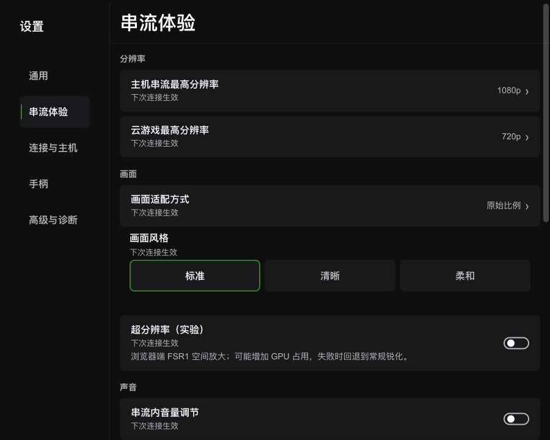
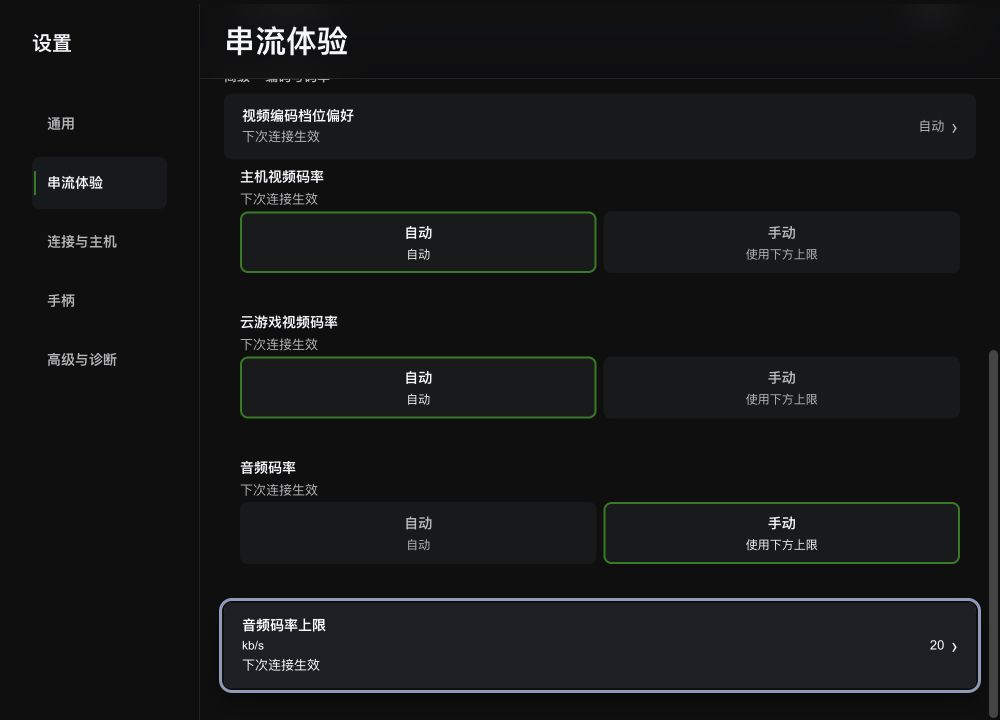
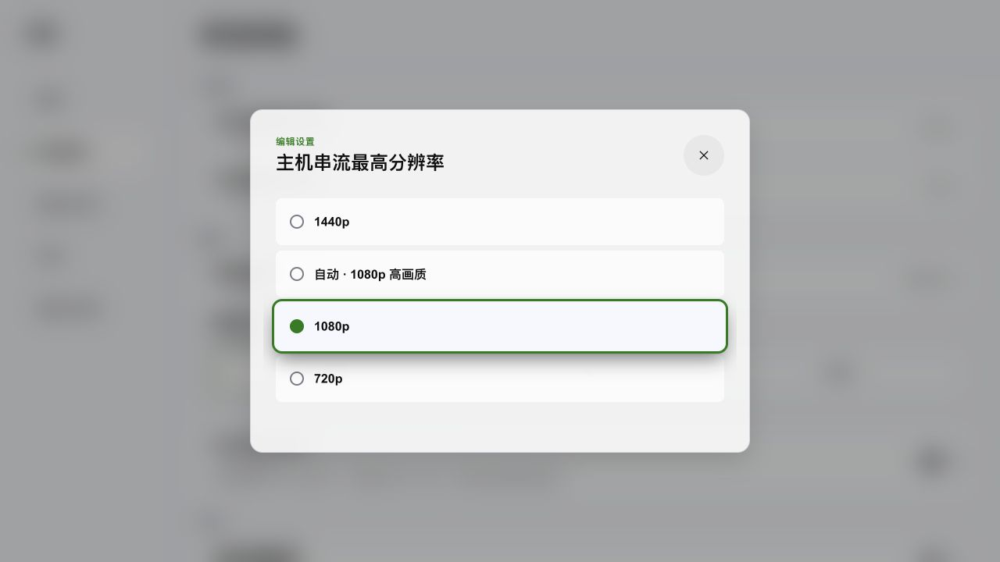
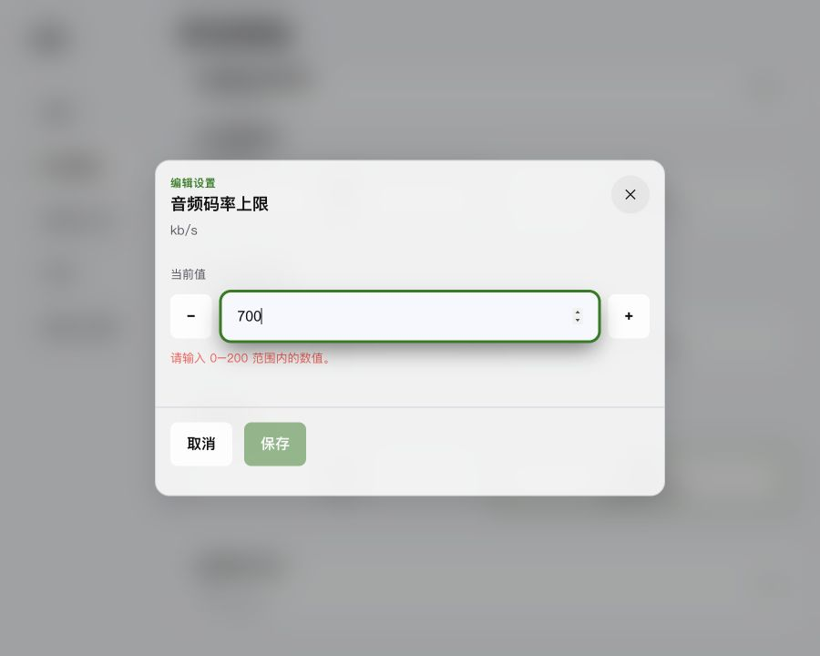
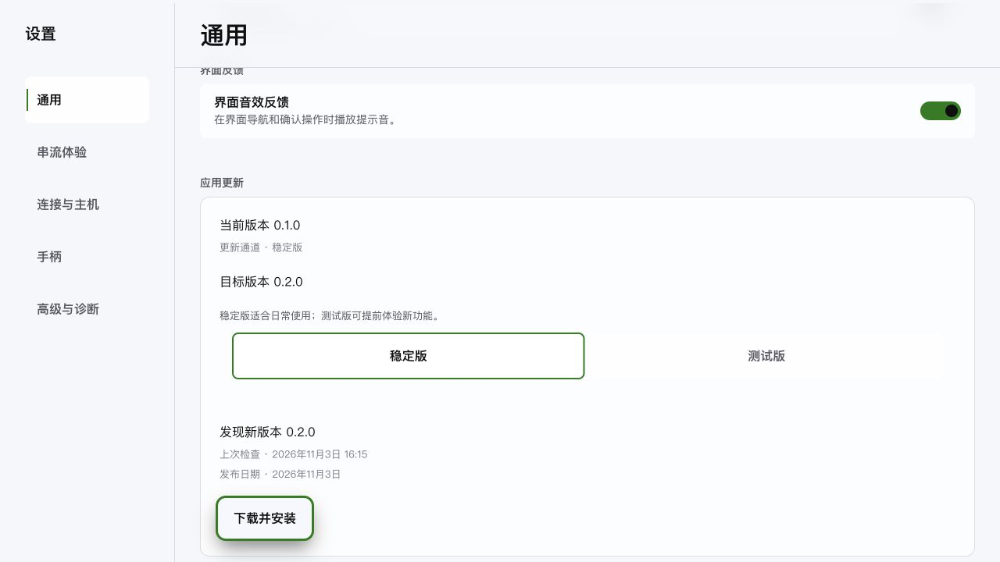
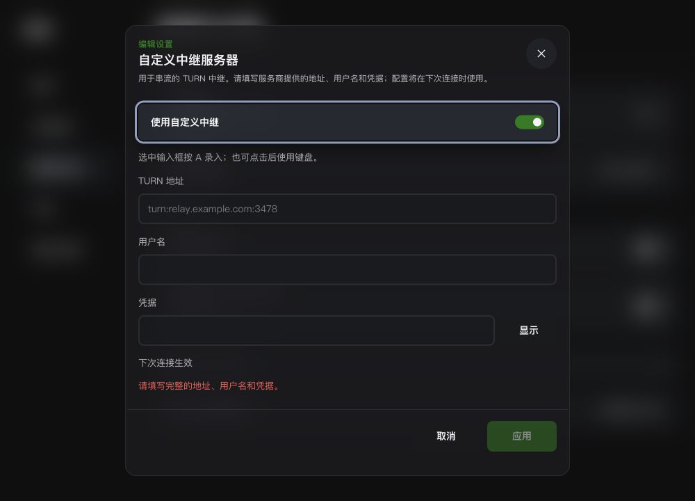
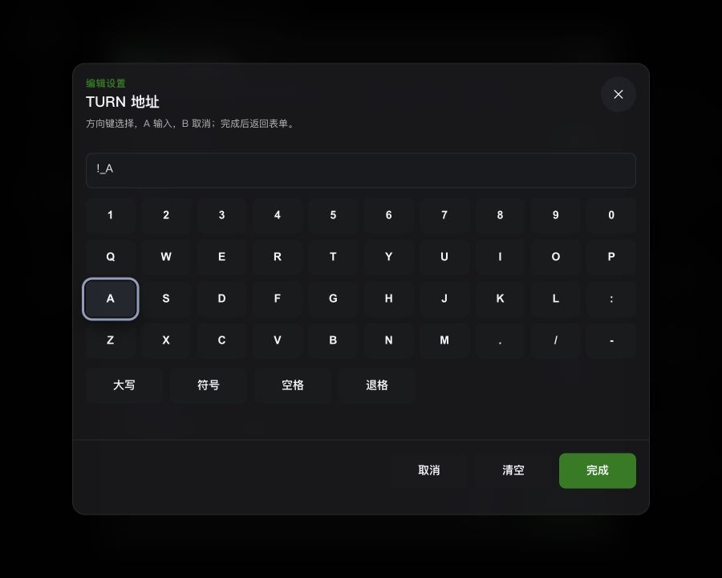
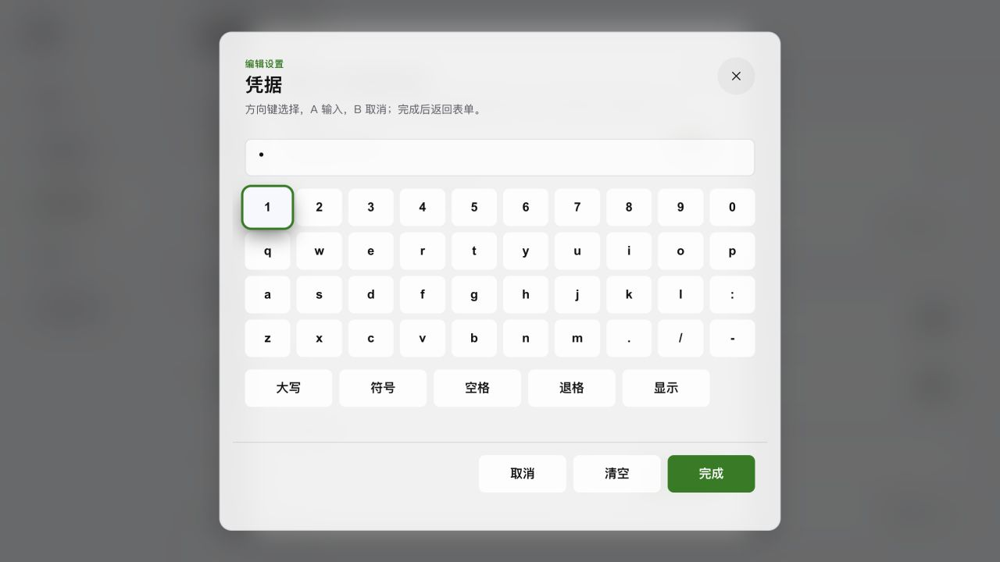
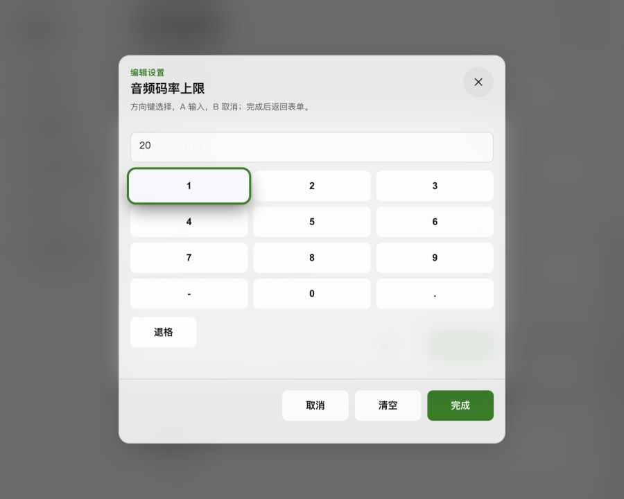
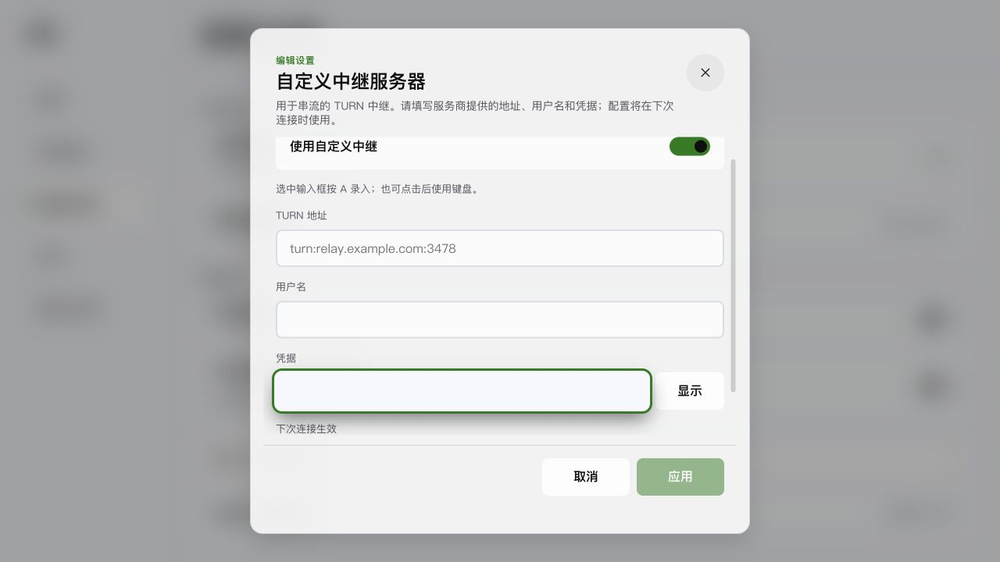

# 设置页完整体验改造 Report

## Delivered

- Related RFC：[设置页完整改造](../rfcs/2026-11-03-settings-experience-completion.md)。用户已授权完成评估中的全部问题，按 `xbx-design` 单窗口实施。
- 五类纵向导航保持现有展示 schema 与左右分栏；分辨率前置，编码与全部码率直接展示，自定义 TURN 进入连接高级。移除缺少运行消费的后台保活入口，既有存储字段继续兼容。
- 统一设置行、开关、选择、编辑器、状态和动作的 XBX tokens；密度规则集中在 `_theme-semantic.scss`。标准侧栏 224px、紧凑侧栏 200px、narrow 侧栏 180px；侧栏、sticky 页头、更新卡片与弹层恢复透明表面和 16px 毛玻璃。
- 更新卡片展示当前/目标版本、通道、检查时间、发布日期、下载大小/百分比、安装状态与重启动作。共享 composable 持有应用级状态和一次进度订阅，分类组件重建后继续展示相同任务；失败可重试，安装后保留待重启状态，通道读取失败可重新读取。更新说明按清单提供时展示，当前发行脚本的 `notes` 为空，整个说明区块隐藏。
- 自定义 TURN 地址、用户名、凭据成组校验和一次保存；凭据遮罩，恢复默认与放弃草稿使用应用内确认。数值按 Rust 范围/步长校验，音频上限与 Rust 的 0–200 一致。
- 语言/主题立即应用；全屏作为启动偏好，保存后显示下次启动生效与重启入口；串流参数统一描述下次连接生效。保存处理中禁用重复提交，失败保留编辑草稿。
- 手柄编辑补齐 Focusable 取消捕获、震动测试、结束测试、取消/应用；未应用修改退出需确认，保存失败保留编辑器，沿用既有捕获期限、断开释放和会话代次保护。
- 所有新操作沿用 Focusable/FocusScope 与几何导航。保留 `--shadow-xbox-focus`，滚动留白与最小滚动计算避让 sticky 页头，弹窗标题和 footer 允许完整阴影，底部 scroll-padding 使用阴影尾部安全区。
- 单选弹窗聚焦当前值，鼠标/键盘焦点同步导航；异步操作重新可用后恢复原焦点与可见位置。嵌套确认与父弹窗同时退出时沿来源链恢复页面焦点。
- 焦点仅由签名外圈绘制，聚焦边框透明，消除选中边框与外圈叠加。数值编辑由 Scope 记录来源并聚焦，首次聚焦只选择文本，关闭恢复原码率行。
- 键盘桥同时提交自定义游戏绑定与固定菜单布局；公共控制器合并物理与键盘 UI 输入，来源各自等待持键释放。WASD/方向键移动、J 确认、K 返回、1/2 页面与 3/4 分类切换恢复；编辑输入、IME、原生 Tab/Enter/Esc 与独占录入继续独立消费。
- 原生输入统一使用 `SettingInputControl`：A 打开文字/数字键盘，方向键选择、完成回填草稿并恢复来源输入，B 取消；点击后实体键盘直接录入，B/Esc 结束直接编辑。键盘模拟来源默认 readonly，聚焦输入仍可用 J/K 导航。文字键盘提供大小写、符号、空格、退格、清空；凭据默认遮罩。
- 手柄测试以 Menu 在观察/操作区切换，操作区暂停剩余预算并释放独占 capture，A 结束、B 返回。映射录入保留 B 绑定，Menu+View 取消；从控制器最新物理帧建立释放屏障，吸收打开录入的 A，避免同帧自录入。
- 标准单行控件高 48px，紧凑/窄窗口高 44px；输入、按键、关闭、增减等高，增减为正方形，显隐固定短按钮宽度，底部操作右对齐。文字键盘宽 720px，数字键盘宽 560px；字号、间距、操作最小宽度由统一密度 tokens 驱动。

## 问题闭环

| 评估问题 | 实现与证据 |
| --- | --- |
| 窄窗口两列挤压、密度失效 | token 驱动左右分栏；实测 900px 为 `180px 720px`，1000px 为 `200px 800px`，1280px 为 `224px 1056px` |
| 分类继承另一页滚动 | 按分类缓存 scrollTop；实测通用首次进入为 0，串流往返为 869.5 → 869.5，高级组保持展开 |
| 留白、行高、字号与表面分叉 | 统一共享行 CSS、布局 CSS 与密度 tokens；深浅主题/紧凑截图 |
| 常用项埋藏、自动码率仍开放无效输入 | 分辨率前置，编码和码率直接展示；仅 Custom 模式显示对应数值 |
| 空值、越界、步长及 Rust 上限不一致 | 校验回归；实际输入 700 显示 0–200 错误且保存禁用 |
| 加载/保存失败缺少状态 | 页面读取失败与重试、保存中/成功/失败；模拟失败后编辑值保持、重试成功 |
| 生效语义混乱 | 即时/下次连接/下次启动标签；启动全屏使用集中重启入口 |
| 当前画面值缺少摘要 | 未匹配预设显示“自定义”，保存预设仍沿用现有画面合同 |
| 单选初始焦点与当前值分离 | 1080p 当前项为 option.2，弹窗默认聚焦 option.2；Escape 恢复分辨率来源行 |
| 更新卡片简陋、任务状态丢失 | 版本/内容/进度/错误/重启全流程；下载跨分类返回仍为 20%，安装完成仍可重启 |
| 高危区用途薄弱、部分配置无效 | 改为连接高级的自定义中继，一次校验/保存三字段，提供恢复默认 |
| 凭据明文、草稿关闭丢失 | 密码输入与显隐动作，完整性校验；中继保存失败保留值，退出/重置需确认 |
| 手柄动作缺少导航节点与退出保护 | Focusable 操作、草稿确认、busy/error；实际摇杆草稿取消触发丢弃确认 |
| 高亮被容器裁切与页头遮挡 | 四边留白、32px 底部滚动安全区、sticky 避让、标题/footer 外扩阴影；边缘焦点截图 |
| 双层焦点光圈 | 聚焦边框透明，选中标记与签名外圈独立；深浅主题实测焦点边框均为透明 |
| 毛玻璃消失 | 透明主题语义表面与局部 backdrop-filter；侧栏/页头/更新卡片/弹层实测为 `blur(16px)` |
| 键盘模拟无法导航 | 原 uiState 只消费 physical，keyboard 仅进入 gameState；现按公共 owner 合并标准键盘 UI，持键屏障/编辑/独占回归 |
| 数值弹窗关闭后焦点跳到左栏 | 移除 Scope 建立前的直接 focus；实测 Tab → K 与 Esc 均恢复音频码率来源行 |
| 当前分类、选择、模态语义缺少 | aria-current、radio/switch 状态、dialog/aria-modal、输入说明/错误与忙碌语义 |
| 原生输入仅可聚焦，A 无法录入 | nav-action/nav-back 由控件消费；数字/文字屏幕键盘、实体键盘直接输入、完成/B取消和来源焦点实际验证 |
| 独占测试与录入期间手柄退出受阻 | Menu 切测试操作区，暂停/恢复 20 秒预算；Menu+View 取消录入，B 可绑定，A 开启录入的当前帧释放屏障 |
| 按钮、输入与旧画面面板尺寸分叉 | 统一 48/44px 控件高度、密度字号/间距；关闭/增减/显隐/footer 实测一致，深浅主题截图 |

## Validation

- `pnpm lint:fix`：通过。
- `pnpm typecheck`：通过。
- `pnpm test`：53 个文件、549 项通过。覆盖数值范围/步长/空值、TURN URI/完整性、模式显示/生效标签、更新共享状态/进度/错误/防重复/通道竞态、嵌套弹窗来源恢复，以及键盘 UI 导航/450ms 延迟与 140ms 连发/确认返回/自定义游戏绑定/独立来源持键交接/独占录入/编辑输入；补充字符编辑/Unicode退格/数字首次替换、控件动作消费/点击回退、readonly 导航/直接编辑、测试预算暂停与迟到焦点、B绑定/Menu+View取消/录入初始化释放屏障。
- `pnpm build`：通过。
- `git diff --check`：通过。
- 使用实际 `Setting.vue` 与公共输入控制器进行本地 Vue 预览；配置、更新、进度、保存失败与重启失败使用模拟 RPC。验证 900/1000/1280px、深浅主题、分类往返、当前单选焦点、数值越界、TURN 表单、手柄草稿、更新下载/安装跨分类持续与重启失败。
- 用户复核预览安装实际 keyboard bridge 并开启键盘模拟：WASD 导航、J 打开分辨率与码率弹窗、K 返回、4 切换分类、Tab 在编辑器内移动、Esc 返回；录入期间 K 绑定 A，退出草稿确认后回到键盘模拟来源行。更新响应 `notes: ''` 时说明区块数量为 0。
- 进一步预览使用模拟物理后端标准态，经公共 InputController → gamepad-listener → 几何导航验证：A 开启数值输入，方向+A录入15，完成返回，加减16→15，B取消新键盘草稿并保存15；文字录入、符号/大写、凭据遮罩/显隐；点击后实体键盘录入并B退出编辑，再用方向+A进入下个输入；测试20秒→操作区暂停→恢复15秒→A结束；A打开映射录入保持捕获、B绑定交换、Menu+View取消保留草稿。
- 控件实测：900px输入/关闭/增减/底部操作均44px，底部操作宽96px；1000px中继输入/关闭/显隐/底部操作均44px，显隐宽80px、底部操作宽100px；1280px对应控件均48px，显隐宽88px、底部操作宽112px。多行设置行继续自然增长；底部凭据焦点自动滚动至安全区。
- 屏幕文字键盘覆盖 ASCII 字母、数字与凭据常用符号，Unicode 通过实体键盘直接录入。系统安装/重启、真实 TURN 连接及真实物理手柄/震动/断开按仓库约定由用户实机验收。
- 原有暂存串流指标变更保留；本次复用其 locale/schema/token 修改，继续使用 Tauri + Vue 3 + TypeScript + Rust 及既有 RPC/导航主线。

## 视觉证据

窄窗口左右分栏（900×720，深色）：

码率直接展示与底部单层焦点（1000×720，深色）：

当前选项、单层焦点与毛玻璃（1280×720，浅色）：

数值越界、保存禁用与毛玻璃（900×720，浅色）：

空说明更新卡片（1280×720，浅色；版本与检查时间为模拟响应）：

统一原生输入与操作尺寸（1000×720，深色）：

文字键盘与几何导航（900×720，深色；测试草稿）：

凭据键盘遮罩与统一控件（1280×720，浅色）：

数字键盘与单层焦点（900×720，浅色）：

底部凭据输入聚焦安全区（1280×720，浅色）：

## Follow-up

- 历史 [设置展示 schema RFC](../rfcs/2026-05-11-settings-schema-driven-reorganization.md) 的页面组织与交互收口由本次实现承接，字段路线随 Browser 主线约束演进。
- 推荐实机验收顺序：设置分类/焦点 → 保存/重启偏好 → 手柄草稿/捕获 → 自定义中继连接 → 实际更新下载安装与重启。

## 更新说明证据修正（2026-11-03）

- 用户指出当前发行没有更新说明。核对 `scripts/release-write-latest-json.mjs`：生成的清单固定 `notes: ''`；GitHub release 的来源描述属于另一份发布信息。
- 前一版更新截图填入了模拟说明文案，现用 `notes: ''` 重新生成深浅主题截图；截图中的版本/进度仍为模拟数据，说明状态与当前正式清单一致。
- 页面按实际返回值展示说明；空字符串、空白与 null 均归为空内容并隐藏说明标题/区块。新增三种空值回归，updater 的 10 项测试、lint 和 typecheck 通过。
