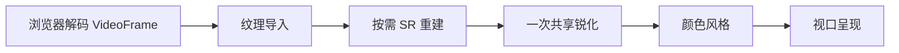

# 默认直通渲染引擎与兼容降级 RFC

## Status

- Completion: 实施与局部检查完成；ROG / Windows 实机验收待用户
- Current State: validation-pending
- Owner: 主窗口，单窗口执行
- Last Updated: 2026-11-10
- Design Direction: 用户要求默认直通引擎、渲染降级开关、SR / 锐化 / 风格可组合。
- Execution Authorization: 用户在设计落定后要求“继续”，主窗口按本 RFC 实施。

## Background

用户在 ROG 掌机上报告原生 video 掉帧、开启锐化或 SR 后流畅。本轮变更前，原画选择浏览器原生 video 合成，增强路径使用现有 WebRTC 视频轨 clone 的独立 VideoFrame 供给。主线程/Worker 能力适配和零时间戳修正已交付，详见 [供给 RFC](2026-11-09-browser-decoded-frame-supply.md) 与 [Report](../reports/2026-11-09-browser-decoded-frame-supply.md)。

当前 `render_mode = video | sharpen | sr` 把引擎和效果合在一个选择中。Rust `config_policy.rs` 与前端 `projectRenderControls()` 将 video 明确投影为原生 video；Browser policy 对中性 auto 也选择 video。因此默认原画迁移同时覆盖设置投影、启动与会话更新。仅调整 Browser auto 分支只能覆盖部分入口。

本 RFC 承接 [方向设计](../isu/2026-11-10-default-passthrough-render-engine.md)，更新 [11/9 控制 RFC](2026-11-09-render-controls-clarity.md) 的互斥模式合同。既有全局默认、本次覆盖、取消恢复、几何导航和资源生命周期继续复用。

## Goal

1. 默认原画与各种效果共用逐解码帧 WebGL 引擎，所有后处理关闭时使用最小直通路径。
2. SR、锐化、色彩风格独立设置，可同时生效。
3. 提供默认关闭的渲染降级开关，原生 video 在兼容模式中承担基础显示。
4. 降级保留用户画面配置；恢复直通重新应用配置，实际状态与原因可见。

## Scope

覆盖 Rust 配置归一化与领域/RPC投影、共享 TypeScript 控制值、画面设置面板、Browser 显示计划、现有 WebGL shader 装配、实际状态和截图临时覆盖。保持 Tauri + Vue + TypeScript + Rust、现有接收/解码链、输入路由、网络与恢复监督。

## 引擎与用户能力

| 项目 | 默认直通 | 兼容降级 |
| --- | --- | --- |
| 呈现 | VideoFrame 到帧上传，现有 WebGL 提交 | 浏览器 HTMLVideoElement 直接呈现 |
| 原画 | 效果全部关闭时单次纹理采样与输出 | 基础视频画面 |
| SR | 独立开关，按尺寸执行重建 | 暂停并禁用控件 |
| 锐化 | 关闭 / 柔和 / 清晰，可与 SR 组合 | 暂停并禁用控件 |
| 风格 | 标准 / 鲜明 / 柔和，可与 SR、锐化组合 | 暂停并禁用控件，实际输出标准颜色 |
| 画幅、音量、输入 | 沿现有配置执行 | 沿现有配置执行 |

引擎为执行基础，效果为独立配置。关闭 SR 或锐化只更新处理计划，正常直通期间继续使用同一个帧源与 WebGL context。

## 画面处理计划



- 全部关闭：纹理导入后直接显示；锐化强度为 0，中性色彩跳过运算，临时处理纹理按需分配。
- SR：使用现有 FSR1 EASU 在目标大于真实源时重建。处理图像尺寸取既有 SR 输出计划；真实源达到目标时复用源图像。界面显示“SR · 源分辨率已达目标”以说明实际状态。
- 锐化：在当前处理图像的 1:1 像素网格执行。SR 开启时使用重建后的图像；SR 关闭时使用真实源图像。复用现有 USM/CAS 的力度、噪声门限与振铃约束。
- 现有 SR RCAS 的细节处理归入共享锐化阶段。推荐由用户锐化选择统一决定一次处理；锐化关闭时强度为 0。SR 负责重建，用户明确掌握最终锐化力度。
- 风格：复用当前饱和度、对比度、亮度参数，在重建与锐化后执行，尽量合入最终输出 pass。
- 处理分辨率保持当前真实源尺寸下限，视口负责最终画幅和显示映射；源尺寸变化沿当前代际和显示计划更新。

在现有 renderer 中收敛共同的帧源、上传、时钟、截图与 shader pass 装配；现有 SR shader 按处理计划接入同一 WebGL 引擎。稳态切换效果更新 pass，兼容切换执行 renderer 首帧交接。

## 画面面板与文案

保持当前“渲染与画面”面板和两个入口，内容从上到下为：

| 控件 | 行为 / 文案 |
| --- | --- |
| 实际状态 | `原画`、`SR · 锐化柔和 · 鲜明`、`渲染降级已开启`；以已提交引擎和效果为准 |
| SR（实验性） | 独立开关；“提升低分辨率画面的细节，可与锐化和风格同时使用。” |
| 锐化 | 关闭 / 柔和 / 清晰；“调整画面轮廓，可与 SR 和风格同时使用。” |
| 色彩风格 | 标准 / 鲜明 / 柔和；仅修改当前颜色参数 |
| 恢复原画 | 关闭 SR、关闭锐化、颜色恢复标准；兼容开关保持当前选择 |
| 兼容设置：渲染降级 | 默认关闭；“仅在黑屏、闪烁、画面异常或持续渲染掉帧时开启。开启后暂停 SR、锐化和风格处理；关闭后恢复原设置。” |

降级时后处理控件显示原选择并置灰，说明“渲染降级已暂停画面处理，原设置保留”。恢复入口、兼容开关和保存/取消按钮继续可操作。当前面板的几何导航跳过禁用控件，降级切换前把位于失效控件上的焦点移到兼容开关；兼容呈现时默认焦点也采用该开关。

全局设置使用“保存默认”；串流面板使用“应用本次”，显式“保存为默认并应用”才持久化。预览取消恢复完整配置。移除当前三模式切换按钮，提供“恢复原画”操作。

## 配置合同与迁移

采用现有显示值和两个独立开关作为权威：

```ts
interface RenderControlsValue {
  compatibilityMode: boolean
  superResolution: boolean
  displayOptions: {
    sharpness: 0 | 1 | 3 // 关闭 / 柔和 / 清晰
    brightness: number
    contrast: number
    saturation: number
  }
}
```

持久化新增 `render_compatibility_mode`，默认 false；`super_resolution_experimental` 承担独立 SR 意图；`display_options.sharpness` 为当前有效锐化选择，默认 0。风格继续由三个颜色值派生，手动颜色沿当前参数保存。

旧 `render_mode` 作为迁移输入。配置归一化先按原始键存在性识别新合同，再应用默认值；新配置保存与启动投影共用同一合同：

| 旧配置 | 新配置 |
| --- | --- |
| video | 直通，SR 关闭，锐化关闭，保留颜色 |
| sharpen | 直通，SR 关闭，锐化映射柔和 / 清晰，保留颜色 |
| sr | 直通，SR 开启，独立锐化关闭，保留颜色 |
| 更早的配置 | 沿既有 SR 优先迁移判据恢复原生效效果，再转换为独立设置 |

旧模式中的记忆锐度只在原锐化模式中启用；旧默认 video 迁移为新默认直通。首次迁移后的全局默认兼容开关为关闭。新配置依独立值解释，Rust 与前端同步移除从单一模式重写其他效果的派生逻辑。

正常执行投影采用 WebGL 直通计划；手动兼容投影采用 video、中性色彩和零锐化的有效配置。用户意图保持原值，effective plan 负责暂停效果。

## 故障与 Windows 兼容

| 触发 | 执行行为 | 用户状态 |
| --- | --- | --- |
| 手动渲染降级开启 | 切原生 video，暂停全部后处理 | 兼容渲染 · 手动降级 |
| WebGL2 能力缺省 | 自动使用原生 video | 兼容渲染 · 设备限制 |
| context loss、shader / 纹理失败、首帧超时 | 有界失败处理后使用原生 video，保留故障原因 | 兼容渲染 · 渲染异常 |
| 逐解码帧接口缺省 / reader 失败、初始化或首帧超时 | 通过既有 renderer 故障通道直接切原生 video，暂停后处理并保留配置与具体原因 | 兼容渲染 · 供给异常 |
| 持续渲染吞吐不足 | 记录供给与提交缺口，提示降低效果或使用渲染降级 | 设置保持用户选择 |

Windows 按 WebView2 的主线程 processor、Worker processor 顺序接入；初始化期限、队列 1、帧关闭、迟到结果和 GPU 能力守卫继续复用。默认 WebGL 只接受独立 VideoFrame；初始化期间保持解码帧等待，RVFC / 播放计数承担呈现诊断与媒体进展观测。接口与供给故障直接触发 video 标签降级，显式重试重新建立独立供给。

把 `requestedCompatibility` 和已提交 `actualEngine / activeEffects / fallbackReason` 分开记录。自动故障仅影响当前实际运行；持久化兼容设置仅由用户保存修改。自动兼容时面板显示原因并暂停效果控件；GPU 故障保留用户主动“重试画面处理”操作，旧 renderer 继续显示到新 renderer 首帧成功。

现有按吞吐自动降级及健康窗口自动试探改为诊断与提示；帧率测量保留真实口径。显式帧率预算、后台暂停、网络拥塞控制与媒体恢复监督继续沿当前机制执行。

## 实际状态、截图与代际

- 页面读取已提交引擎与实际生效效果；候选准备显示“切换中”。诊断继续记录供给来源、renderer 身份、decode/receive、提交、时间与失败原因。
- 参数预览、保存失败、重连与取消恢复沿当前完整配置覆盖；兼容切换保留首帧交接与旧资源释放。
- SR A/B 对照仅切换 SR 开关，保持锐化、风格、兼容意图及来源；恢复受当前会话与编辑代际约束。
- 兼容呈现时 SR 对照按钮禁用并显示原因；正常截图继续采用实际引擎捕获路径。
- 全部效果关闭的状态显示“原画”；组合状态从 activeEffects 生成，当前单一 `mode` 状态合同迁移为引擎与效果事实。

## Plan

1. Rust 配置与 RPC、共享控制值、迁移、会话覆盖和画面面板同步独立设置。
2. 原画启动接逐解码帧直通，现有 shader 收敛为可组合处理计划；零效果使用最小 pass。
3. 兼容降级、故障状态、吞吐提示、A/B 恢复和资源交接完成收口。

## Validation

沿用户要求采用必要的局部验证：

- [x] 旧配置迁移、新默认、三类效果组合和降级恢复的定向回归。
- [x] 同一引擎内效果切换、零效果直通、单次锐化、兼容首帧交接与资源关闭。
- [x] 实际 Vue 控件禁用与焦点、预览取消、本次/全局保存和 A/B 恢复。
- [x] 前端 lint:fix / 类型检查 / build、相关 Rust 配置验证和 cargo fmt。
- [ ] 用户 ROG 实机对照原画直通与兼容模式；其他 Windows 设备按实际能力与异常回退验收。

网络健康、恢复链能力、media supply、steady supply、submit/present 长尾和帧供给 delta 继续沿现有 trace 口径分析。此次 ROG 反馈为体感对照；量化 Windows 上屏与 GPU 结果接续实施后实机日志。

## Risks

- SR 与锐化组合增加 GPU 工作量；共享一次锐化、按需临时资源和零效果直通控制成本。
- SR 的旧 RCAS 固定增强改为用户锐化选择，SR 单独开启时采用重建画面；力度与观感在组合局部验收中确认。
- 原生 video 的低成本与设备合成兼容性适用于故障退路；具体 ROG 合成原因保持待证，默认直通收益以用户实机对照验收。

## Progress

- 2026-11-10 用户明确供给合同：默认 WebRTC 视频轨独立解码帧直通 WebGL；供给或渲染异常直接降级为 video 标签呈现。按既有“优化修复 / 继续”授权修正实现，并保留 latest-only、单帧在途、配置与资源生命周期合同。
- 2026-11-10：单窗口核对设置到 Rust/前端投影、Browser auto、VideoFrame 供给、SR RCAS、实际状态及 A/B 对照合同，完成设计后获用户“继续”授权实施。

- 2026-11-10 用户补充：产品界面只表达画面效果与异常时的渲染降级；内部渲染方式留在诊断。所有关闭的后处理跳过对应环节，全部关闭直接显示原画。
- 2026-11-10：完成 Rust/前端独立配置、旧模式迁移、默认逐帧直通和共享处理引擎。EASU 重建按需执行；旧固定 RCAS 收敛为用户控制的 USM/CAS，SR 关闭或目标已达时跳过重建，零锐化与标准风格跳过对应计算。
- 2026-11-10：完成降级暂停效果与配置保留、故障恢复首帧交接、焦点路由、实际效果标签及只切换 SR 的 A/B 对照。吞吐监督输出建议，手动兼容与能力/硬故障驱动引擎切换。
- 2026-11-10：13 个相关前端文件的 272 项回归最终通过（首次 271/272，修正后局部 107/107 与播放资源 14/14）；Rust 配置 8/8 与领域投影 1/1 通过。lint:fix、typecheck、build、cargo fmt 与 diff check 通过。实施交付见 [Report](../reports/2026-11-10-default-passthrough-render-engine.md)，实机指标保持待验。

- 2026-11-10：默认与增强 WebGL 的输入限定为独立 VideoFrame，供给故障接入 video 降级；连接阶段首帧等待、真实播放降级与重试、资源释放及统计健康 9 文件199项通过，lint:fix/typecheck/build/diff check通过。实机稳定供给、新鲜度与上屏长尾接续新设备日志，详见[修复报告](../reports/2026-11-10-decoded-frame-startup-deadline-fix.md)。

- 2026-11-10 采样优化：用户在审计后授权“优化一下”。EASU兼容gather按位置读取完整RGB并保留12空间tap及通道顺序；USM复用已有采样建立邻域边界，加入亮度噪声软门限、色度保护与过冲约束。保持现有pass、采样预算、逐解码帧供给与故障降级合同；数学与实际shader像素等价/细节验收接续局部验证。

- 2026-11-10：采样优化完成，7文件184项及实际软件GPU像素对照通过。四组EASU输出逐像素一致，USM复用原读取预算完成抑噪/过冲保护，非整数缩放与SR组合验证通过。目标设备GPU吞吐与上屏长尾接续新样本，见[验证](../../dev-docs/validation/2026-11-10-sr-sharpen-sampling-optimization/README.md)。
