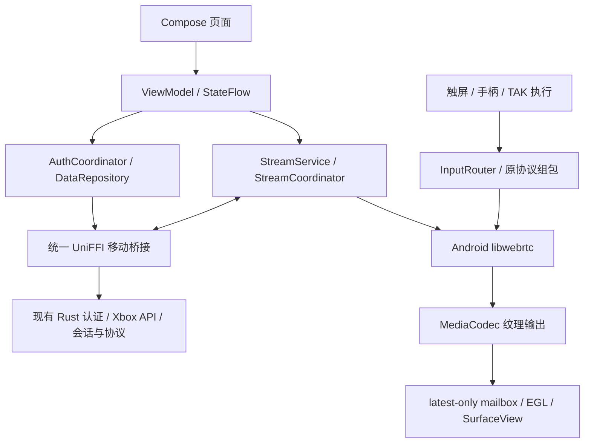

# Android 原生端基础技术方案 RFC

## Status

- Completion: 基础技术方案完成
- Current State: completed（方案交付）
- Implementation State: planned
- Owner: 主窗口，单窗口直接执行
- Last Updated: 2026-11-26
- 本轮范围：技术选型、模块边界、接口接线、状态与生命周期、构建和验收计划。工程实施按下列里程碑进入后续任务。

## Background

[可行性评估](../isu/2026-11-26-ios-to-android-feasibility.md)已确认共享 Rust 与 Android 原生适配的方向。本方案将 iOS 当前功能和行为合同映射为一套可直接分阶段实施的 Android 结构。

本轮源码基线为 `main` / `37e4fb434039`。iOS 已有原生界面、公共 Rust 会话与认证、libwebrtc/Metal、触屏/实体手柄和 TAK 编译 IR。Android 在相同公共业务层上增加平台宿主，桌面继续现有 Tauri + Vue + TypeScript + Rust 路线。

## Goal

1. Android 与 iOS 共用账户、游戏身份、数据请求、访问资格、session/signaling、恢复和 wire 合同。
2. Android 使用原生界面、硬解/显示、音频和设备输入，实现可诊断的低延迟 xCloud/xHome 串流。
3. 串流由唯一宿主持有；页面重建、Surface 变化和后台音频沿同一会话管理。
4. 先完成依赖、登录和双目标串流闭环，再扩展五根页、设置、TAK 和平板布局。

## Scope

### 首版基线

| 项目 | 决策 |
| --- | --- |
| 平台 | Android 12+，`minSdk = 31`；首批交付 `arm64-v8a` 手机 |
| 应用 | Kotlin + Jetpack Compose；单 App module，按包划分功能与平台适配 |
| 身份 | `applicationId = com.xuasir.xbxrc.android`；开发包使用 `.debug` 后缀 |
| 公共核心 | 现有 Rust crates 与 UniFFI 0.32；Swift/Kotlin 消费同一份移动桥接 |
| 串流 | Android libwebrtc AAR；MediaCodec 硬解、纹理输出、EGL/SurfaceView 显示 |
| 输入 | 标准触屏与实体手柄；TAK 优先保持 iOS 当前手柄 profile 能力 |
| 画面 | H.264/Opus；1080p60 作为设备验证目标，720p 沿公共配置提供回退 |
| 存储 | Keystore 密钥 + 本机加密凭据；DataStore 保存版本化非敏感偏好 |
| 构建 | JDK 17+、NDK r28+；Gradle/AGP/Kotlin/Compose 兼容组合在 M0 固定 |
| SDK 与分发 | compile/target SDK 在 M0 按当期规则固定；先提供本地签名测试 APK，正式发行独立管理 |

后续阶段覆盖 iOS 五根页与相关子页、完整设置、保存/编辑布局、诊断和 Android 平板。高级超分、TAK 鼠标/键盘/传感器沿各自能力与既有范围进入后续阶段。

桌面公共协议与发行规则继续生效，`main` 开发构建保持暂停。Android 初期通过独立本地构建脚本交付；自动化构建与商店发行按对应阶段定义。

## Plan

### 1. 分层与所有权



| 模块 | 职责与所有权 |
| --- | --- |
| App/Navigation | 根页、系统返回、主题/语言、窗口和前台可见性 |
| Features/ViewModel | 页面状态投影与用户操作；通过业务适配访问 Rust |
| AuthCoordinator | 应用级唯一凭据 owner；登录、续期 checkpoint 和账户切换 |
| DataRepository | DTO 投影、账户/语言范围缓存、分页与请求代次 |
| StreamService | 同一应用进程中的唯一活动串流宿主，管理前台服务和通知 |
| StreamCoordinator | 服务范围的串行命令入口；Peer、代次、恢复、关闭与输入接管 |
| Native media/input | libwebrtc、MediaCodec、EGL、Android 音频与 InputDevice 的实际执行和事实 |
| Shared Rust | 认证、API、访问租约、session/signaling、ICE/TURN、监督决策、协议与 TAK 编译 |

页面使用 `ViewModel + StateFlow`。串流命令和回调归入单一串行协调入口；SDK 回调只投递带代次的事实。EGL 绘制使用独立线程；文件落盘与有界诊断使用 IO 调度。纹理和视频像素保留在原生热路径，UniFFI 承接业务与会话调用。

### 2. 拟定目录

```text
androidapp/
  settings.gradle.kts
  build.gradle.kts
  gradle/libs.versions.toml
  app/src/main/
    AndroidManifest.xml
    kotlin/com/xuasir/xbxrc/android/
      app/
      features/{authentication,hosts,cloud,profile,controllers,settings}/
      platform/rustbridge/{generated,adapters}/
      platform/streaming/
      platform/input/
      platform/security/
      platform/storage/
      platform/diagnostics/
      shared/{models,ui}/
  scripts/{build-rust-android,generate-rust-bindings,check-streaming-boundary}
crates/xbox-ios-bridge/       # 原有统一移动业务桥接的演进入口
crates/xbox-*/               # 现有公共业务与协议
```

第一阶段保留 `xbox-ios-bridge` 名称与 Swift ABI，补 Kotlin 生成入口和 Android 装配。代码实现与接口契约共用；Android 原生库由构建任务生成到专用输出目录，生成绑定集中管理。

Android 构建脚本使用 `cargo rustc --lib --crate-type cdylib` 配合 NDK linker 与 `aarch64-linux-android` 目标输出 `.so`，Apple 构建继续消费现有静态库。构建缓存按 `target/android` 隔离，Gradle 依赖版本写入版本目录。

### 3. 共享桥接接线

表中使用当前 Rust 导出名；Kotlin 命名以生成绑定为准。

| 操作 | 共用入口 | Android 适配 |
| --- | --- | --- |
| 登录与续期 | `start_login`、`complete_login`、`refresh_login`、`XboxAuthObserver` | Custom Tabs、Intent 回调、凭据事务与 checkpoint |
| 数据 | `fetch_hosts`、`fetch_cloud_catalog`、`hydrate_cloud_catalog_page`、现有个人查询 | 页面 DTO、缓存范围、分页和局部错误 |
| 访问资格 | `prepare_cloud_access`、`prepare_home_access`、`release_stream_access` | 当前账户与启动 owner，目标准入和访问租约释放 |
| 启动 | `create_stream_startup`、`create_scoped_stream_session`、`start` | 游戏/主机身份、设置快照、进度与取消 |
| 信令 | `exchange_offer`、`exchange_media_offer` | 同 Peer 的 offer/answer 与麦克风协商 |
| ICE | `submit_ice`、`next_remote_ice_batch` | SDK 候选格式、EOC 与配置绑定 |
| 监督与恢复 | `supervise_runtime`、`validate_resume`、凭据更新接口 | 真实网络/媒体/显示事实和串行动作执行 |
| 握手与反馈 | 现有 channel profiles、bootstrap、handshake 与 frame feedback payload | 四通道创建、Ack、幂等 replay、Metadata 发送 |
| TAK | `compile_touch_layout_json`、`resolve_touch_layout_runtime_json`、`XboxTouchLayoutLibrary` | 同源 IR、资源读取、预览、保存与原生执行 |
| 结束 | `cancel`、`close`、`release_stream_access` | 输入归零、媒体资源释放和唯一终态 |

M0 核对 Kotlin 对异步方法、foreign callback、typed error、可空字段和对象释放的支持。生成绑定所用的 JNA 等运行依赖按实际版本固定，原生依赖统一进入 ABI/16KB 检查。

登录使用系统浏览器，Manifest 接收现有 `ms-xal-000000004c20a908://auth` 回调，由 Rust 校验 URI、PKCE 与 state。M1 覆盖官方 Xbox App、开发/正式包共存时的回调归属与取消；pending/state 保持当前登录流程内存归属，进程重建后开启新的登录事务。

共享 API 的能力与错误投影在原 crate 内演进。Android 会话与 HTTP 调度消费公共 scheduler，SDK 接线负责执行收到的命令和返回事实。

### 4. 串流生命周期

`StreamCoordinator` 持有 `accountScope / ownerGeneration / attemptId / generation / peerEpoch`；显示资源另有 `presentationRevision`。每次异步回调都核对所属上下文，终态先使当前上下文失效，再释放资源。

启动顺序为：

1. 固定当前账户、目标身份与设置快照，创建可取消 startup。
2. 通过公共认证和目标准入取得 scoped access，创建同一 `XboxStreamSession`。
3. `start` 返回 `XboxPreparedSignaling/XboxWebRtcPlan`，Android 按实际能力消费 codec、码率、方向及 ICE/TURN。
4. 服务创建唯一 Peer，按 Rust profiles 创建 `input/control/chat/message` 四通道并准备显示 Surface。
5. 同 Peer 生成 offer，Rust 交换 answer；Android 应用描述与远端 ICE batch。
6. 通道就绪后发送 Rust bootstrap，Handshake Ack 后执行幂等补发。
7. `peerConnected + controlReady + 首个有效显示观测` 进入 playing，观测来源写入 Trace。
8. 周期采集有界运行事实，公共监督产生恢复决策，由同一协调入口执行。
9. 退出/取消时先处理输入中立释放，再关闭 Peer、显示与音频、Rust 会话和访问租约，最后结束服务通知。

UI 状态投影为 `idle/preparing/waiting/connecting/playing/recovering/stopping/ended/failed`。可见性、音频和显示资源状态分别保存；页面旋转与返回栈变化由 Activity/View 重新绑定现有服务。

| 系统事件 | 行为 |
| --- | --- |
| Surface/窗口重建 | 增加显示 revision、释放旧显示资源、绑定新 Surface；保留有效 Peer 与会话 |
| 进入后台/锁屏 | 输入归零、暂停画面与麦克风；已启用的连续播放由 mediaPlayback 前台服务持有 |
| 回前台 | 核对公共 resume/终态与凭据，重绑 Surface，沿有效连接续接画面 |
| 音频焦点/耳机变化 | 更新播放和路由事实，沿唯一音频 owner 恢复 |
| 网络故障/切换 | 用实际 ICE/媒体事实进入公共监督与恢复 |
| 系统回收进程 | 本机持久数据恢复；用户重新启动游玩时创建新的访问租约与串流代次 |
| 主动退出/认证撤销 | 统一终态、输入释放、媒体关闭与访问租约回收 |

前台服务由前台用户动作启动，并及时进入带持续通知的服务状态。麦克风采用用户操作、运行时权限与实际 sender 的一致合同，相关服务类型按 SDK 规则配置。通知结束操作也进入同一关闭入口。

### 5. 媒体与输入

视频固定为 `libwebrtc -> MediaCodec -> TextureBuffer -> latest-only mailbox -> EGL -> SurfaceView`。mailbox 容量为一帧，新帧替换时释放旧帧引用；纹理所有权、GPU 使用和资源回收按同一 EGL 完成语义处理。硬解选择与软件回退记录实际 decoder，回退分辨率由公共设置和恢复策略决定。

原画、比例、颜色和锐化使用同一显示链。统计分别记录接收/解码输出、mailbox 合并、绘制提交和可观察呈现；`eglSwapBuffers`、GPU 完成与实际屏幕呈现保存各自来源。帧率比较以串流实际供给和帧身份为准。

音频使用 libwebrtc 的 Android AudioDeviceModule；平台层集中管理播放、静音、焦点、耳机和麦克风。接收音频采用游戏/媒体播放路径，采集权限在实际启用麦克风时申请。

实体手柄由 `InputDevice + KeyEvent/MotionEvent` 提供，触屏/TAK 在 Kotlin 执行；输入共同进入 `InputRouter`。路由保留 UI/stream/blocked 归属、菜单接管、设备切换、中立释放和发送背压。高频组包沿 iOS 平台适配消费原 wire 合同，Rust/iOS/PC 的共用字节夹具固定编码行为。

TAK 解析、版本、Context/JSON Patch、能力诊断和编译 IR 留在 Rust。Kotlin 负责安全区几何、多指执行、连发、输入贡献合并、图集与绘制；切换/隐藏/取消统一释放。震动按设备真实暴露的电机能力映射，UI 触觉独立控制。页面手柄导航沿几何寻路合同适配。

### 6. 页面、存储与诊断

五根页延续 iOS 的主机、云游戏、我的、控制器和设置。Compose 使用同一品牌、信息层级、请求状态和操作语义；Android 系统返回、48dp 触屏目标、sp 字号与窗口安全区决定具体布局。平板按有效宽度显示侧栏与详情。

- 凭据：Keystore 保存 AES-GCM 密钥，加密文件保存凭据；AuthCoordinator 按账户/凭据 revision 原子提交，安全数据按本机备份边界管理。
- 偏好与缓存：DataStore 保存非敏感版本化偏好；目录、个人数据、图片按账户/语言/请求代次和现有预算管理。布局库由 Rust 在应用私有绝对路径下管理。
- 诊断：延续 schema v3、operation/attempt/generation/peerEpoch 与脱敏合同；生产默认 4×8MiB、开发 6×32MiB，轻量采样和硬队列保持有界，通过系统分享导出。

### 7. 构建与供应链

WebRTC AAR 在 M0 固定来源、libwebrtc commit、ABI、SHA-256 和许可证。优先用与 iOS 有明确协议对照的 Android SDK；需要自建 AAR 时由对应 Linux 构建环境提供产物，应用开发消费固定 AAR。

Gradle 构建接入 Rust/NDK 和 Kotlin 绑定生成。APK 核验覆盖 Rust `.so`、WebRTC 与绑定运行依赖的 ELF/ZIP 16KB 对齐、实际库加载和签名身份。正式 APK/AAB 使用独立 Android 版本号、证书与发行入口，来源与桌面/iOS 分发分别记录。

### 8. 实施里程碑

| 阶段 | 交付 | 进入下一阶段的最小门槛 |
| --- | --- | --- |
| M0 依赖与工程 | Android 单模块、固定工具链/AAR、Rust 动态库与 Kotlin 生成 | arm64 APK 构建/安装/加载，异步/错误/回调往返，原生库 ABI/16KB 检查 |
| M1 登录与数据 | Custom Tabs、凭据事务、主机/目录查询和根导航 | 登录、重启凭据恢复、退出与账户切换，一条完整数据页面操作 |
| M2 双目标串流 | 共用 cloud/home 启动、硬解/显示、声音、标准触屏/手柄、退出与后台续接 | Snapdragon/MediaTek 各一台代表设备，分别完成 Home/Cloud 短冒烟和系统恢复 |
| M3 功能对齐 | 五根页与子页、设置消费、TAK 保存/编辑、麦克风、诊断导出 | 关键设置有真实消费者，同源 IR/输入样本，菜单接管和导出操作 |
| M4 平板与发行 | 自适应侧栏、设备能力回退、版本/签名和发布验证 | 一台平板代表操作流、固定能力矩阵与发行检查 |

## Validation

### 本轮方案验收

- [x] 核对既有公共导出、crate 产物、Kotlin 生成与 Android 独立动态库路线。
- [x] 明确平台/业务所有权、会话代次、Surface/音频/输入释放和共享 TAK 边界。
- [x] 完成一次文档结构、链接、差异与既有工作区/暂存状态冒烟，证据归档。
- [x] 本轮临时产物创建数量为零，最终方案与证据保留。

### 后续实施验收

- [ ] 自动检查按阶段执行一次：目标构建、接口往返及直接受影响的状态/输入/IR 用例。
- [ ] 真机短冒烟由用户执行：Home/Cloud 各一次声音/画面/输入/退出，覆盖后台前台与一次断开恢复。
- [ ] 性能记录同时覆盖网络健康、恢复链、media supply、steady supply、submit/present P95/P99 与帧供给 delta。
- [ ] 本地显示预算按实际刷新周期和观测来源冻结；60fps 是设备验证目标，供给与输出按实际帧事实评估。
- [ ] 每阶段保留必要最终截图、摘要与失败诊断，按任务清单清理临时目录和构建/导出产物。

## Risks

- 固定 Android AAR、生成绑定运行依赖的 16KB 兼容与原生库加载是 M0 的首个门槛。
- Android 芯片/驱动、音频路由、服务调度和手柄电机差异通过实际能力声明与代表设备证据管理。
- 当前 iOS 最新音频/后台续接仍在实机验收阶段；两端共享行为合同，各自提供平台证据。
- compile/target SDK、工具链精确版本和正式分发规则在 M0/发行阶段按实际来源固定。

## Progress

- [x] 基础技术方案与当前公共接线核对完成。
- [x] 方案交付记录、任务追踪与最小证据完成。
- [ ] M0～M4 工程实施按后续任务执行。

## Execution Notes

- Date: 2026-11-26 | Status: completed（方案）
- Update: 明确 Android 原生分层、独立动态库产物、统一移动桥接和双目标串流的实施顺序。
- Decision: 首版 Android 12+/arm64 手机，Kotlin/Compose + 共享 Rust + libwebrtc/MediaCodec/EGL；唯一服务持有串流。
- Evidence: [方案验收](../../dev-docs/validation/2026-11-26-android-native-technical-plan/README.md)。
- Closure: [基础方案交付报告](../reports/2026-11-26-android-native-technical-plan.md)；报告覆盖本轮方案交付，工程进展后续回写对应任务。

## References

- [iOS 规格](../../iosapp/DESIGN.md)、[iOS 运行边界](../../iosapp/README.md)、[当前移动桥接](../../crates/xbox-ios-bridge/Cargo.toml)。
- [公共 bridge 导出](../../crates/xbox-ios-bridge/src/lib.rs)、[会话接线](../../crates/xbox-ios-bridge/src/streaming.rs)、[四通道合同](../../crates/xbox-streaming-protocol/src/stream_data_channel.rs)。
- [TAK 编译入口](../../crates/xbox-ios-bridge/src/touch_layouts/runtime.rs)、[协议实施报告](../reports/2026-11-26-ios-tak-protocol-engine.md)。
