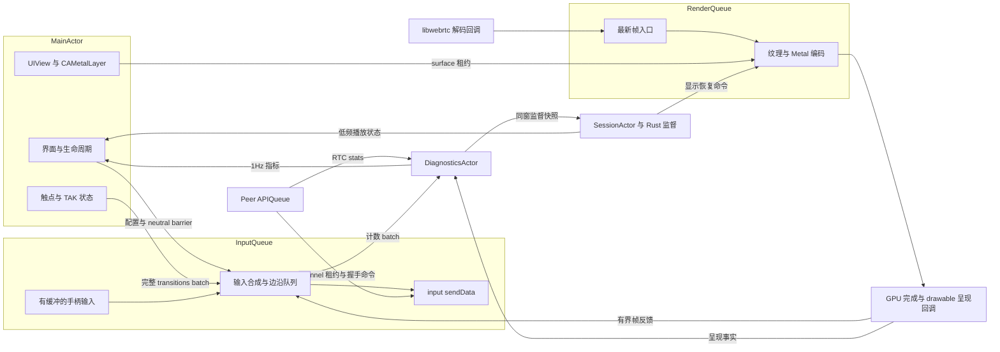

# iOS 串流输入、渲染与显示恢复执行域 RFC

## Status

- Completion: 未完成
- Current State: awaiting_validation
- Owner: Codex 主窗口，单窗口分阶段执行
- Last Updated: 2026-11-26
- 本轮成果：用户已于引用对话确认直接实施；主窗口接续 M0–M3 工程实现与定向验收。

## Background

本方案依据现行 Swift / Rust 源码，以及本会话的[代码审查](/Users/guo.xu/Documents/code/games/xbxrc/dev-docs/validation/2026-11-26-ios-streaming-code-audit/README.md)。分析范围为触控边沿、主线程热路径成本和显示恢复。

1. 触控采集器保存每批 `transitions`，串流绑定消费最终 `gamepad`，8ms 轮询可将按下/释放合并为 neutral。
2. 入帧、Metal 纹理导入与编码、GPU 完成处理、输入轮询共用 MainActor；统计排序和诊断构造增加每帧固定工作。
3. 解码增长刷新视频活跃时间；恢复动作依赖该时间门槛。真机 drawable 呈现已被观测，监督与主要 FPS 指标使用 GPU completion 计数。

现有基础继续承担各自职责：libwebrtc 接收、恢复与硬件解码；CVPixelBuffer→Metal 零拷贝；latest-only 帧选择；公共 Rust 会话、监督与信令；现有输入 wire、TAK 引擎与音频生命周期。

## Goal

- 每个有效数字按键边沿从采集到 `sendData` 接受都具有可追踪顺序；同批短按输出独立的按下与释放状态。
- 输入发送与视频渲染分别具备独立串行调度；正常画面推进和已采集输入的发送可独立于 UI 更新执行。
- 真机显示健康由实际 drawable 呈现事实支持；解码与显示分别提供活跃时间、计数和恢复资格。
- 跨域传递值、快照、帧引用和作用域租约，每份可变状态有明确的执行归属。
- 解码实例、不可变 GPU 能力、帧纹理引用、参数计算和临时容器按寿命分层复用；稳定阶段以资源创建与分配计数验证收益。
- 每阶段以对应的小范围验证收口，最终比较输入延迟、帧供给与上屏长尾。

## Scope

本轮工程范围包括 Swift 输入核心与发送调度、Metal surface 与渲染执行域、解码/渲染资源复用、诊断聚合，以及公共 Rust 的可选显示观察与恢复判定。

UIKit / SwiftUI、既有 TAK 语义、libwebrtc 解码、音频设备处理、Rust 会话权威、Browser 宿主的现行监督行为继续沿既有职责演进。画质参数、色彩矩阵与音频路由由各自现行配置进入快照，本 RFC 的开发范围聚焦上述三项。

## Execution Ownership

### 执行域与状态归属

线程规划以串行 Queue 和 Actor 的执行归属表达。GCD 调度 Queue 的工作，Swift executor 调度 Actor；SDK 管理编解码与音频设备线程。输入、渲染各使用一个独立的高频串行 Queue。

| 执行域 | 调度 | 唯一持有的可变状态 | 对外输出 |
| --- | --- | --- | --- |
| MainActor | 系统主线程 | SwiftUI/UIKit、触点转换、TAK 命中与状态计算、触控视觉、图层树/尺寸配置、菜单/权限、UI 可观察状态、CHHapticEngine 与播放对象 | 有序触控 batch、配置快照、生命周期命令、surface 租约 |
| InputQueue | 新增串行 `DispatchQueue`，`.userInteractive` | 设备采样租约、缓存映射、源状态合成、快捷键捕获、数字边沿 FIFO、最新模拟轴、输入序号、发送节拍、背压与 neutral barrier | input DataChannel 包、菜单/震动命令、低频输入诊断 |
| RenderQueue | 新增串行 `DispatchQueue`，`.userInteractive` | 渲染配置、Metal pipeline/command queue、CVMetalTextureCache、MetalFX 资源、帧选择与渲染调度、surface/render epoch | GPU 提交、完成事实、实际呈现事实、渲染反馈 |
| Peer APIQueue | 现有串行 Queue，`.userInitiated` | RTCPeerConnection、SDP/ICE/transceiver、轨道挂接、DataChannel 创建与关闭、控制握手状态、RTC stats 请求代次 | input channel 租约、控制事件、RTC 统计快照 |
| StreamSessionActor | 现有 Swift Actor | 会话与 peer 代次、启动/停止/协商、恢复单飞、预算、公共 Rust 监督调用 | 播放状态、恢复命令、低频会话诊断 |
| StreamingDiagnosticsActor | 低优先级 `.utility` 入口任务 | 有界指标 batch、延迟样本环形缓存、同窗 delta、分位数与 trace payload 聚合 | 监督快照、1Hz UI 指标、异步 trace draft |
| Trace I/O Queue | 现有 writer `.utility` Queue | 编码、脱敏、文件缓冲与落盘 | trace 文件与存储状态 |
| Audio Lifecycle Queue / SDK | 现有音频生命周期 Queue；libwebrtc/AudioUnit 内部线程 | AVAudioSession 状态；SDK PCM 接收、处理与播放 | 音频生命周期事件 |

`StreamingDiagnosticsActor` 将计数事实写入可快速读取的作用域快照；SessionActor 的监督读取独立于 trace 文件 I/O。主线程 UI 接收低频指标和必要的状态变化。

### 数据流

### 跨域协议

| 值 / 句柄 | 内容与规则 |
| --- | --- |
| `StreamExecutionScope` | 复用 attempt/session/peer/video 代次，增加 `inputEpoch`、`renderEpoch`、`surfaceRevision`、`configurationRevision`；每个输入包、帧、命令和回调明确所属作用域。 |
| `InputConfigurationSnapshot` | 预先归一化的映射、死区、反转、快捷键、设备选择与振动配置；MainActor 按配置变更推送，InputQueue 按 revision 原子切换。 |
| `InputSampleBatch` | 来源身份、来源序号、作用域、采集时间、每个 transition 的状态/时间/sourceActive、最终源快照；批内顺序完整保留。 |
| `InputChannelLease` | 指向当前 input DataChannel 的窄句柄、peer/input epoch 与有效性 fence；`sendData` 由 InputQueue 统一执行，涵盖 bootstrap、游戏输入与结束 neutral。 |
| `PresentationSurfaceLease` | 强引用的 CAMetalLayer 窄句柄、图层 revision、不可变像素尺寸和渲染配置、有效性 fence；图层树与配置由 MainActor 管理，drawable 获取/呈现由 RenderQueue 执行。 |
| `RenderFrame` | 当前 RTCVideoFrame/CVPixelBuffer 或既有 simulator I420 强引用、frameId、解码时间、作用域；保留原始解码存储。 |
| `RenderCompletionFact` / `DrawablePresentedFact` | frameId、作用域、结果与单调时钟；GPU 完成和实际呈现分别记账。 |
| `RuntimeObservationSnapshot` | 同一 peer/render 作用域的累计计数、时间、同窗 delta、样本 ID、时间来源与新鲜度；窗口计算使用一致的采样边界。 |

所有跨域命令采用异步投递与异步 ack。短锁只保护租约 fence、最新帧槽、完成票据和有界事实入口；锁内执行有界内存操作。SDK 调用、drawable 等待、GPU 等待、trace 构造与文件操作各自在所属执行域完成。

应用自有状态优先使用值类型与执行域封闭。框架对象的 `@unchecked Sendable` 限定在 frame/channel/surface 租约包装，逐项注明访问归属与寿命。

## Input Plan

### 输入采集与 UI 分工

- `TouchInputAccumulator` 继续承接 UIKit 触点及现有 TAK 命中/状态计算，输出整个 transitions batch 给 InputQueue。触控绘制按显示帧合并，仅刷新发生变化的控件，复用图标、几何与 accessibility elements。
- `StreamInputSession` 保留 MainActor 可观察门面；输入合成、源优先级、映射、快捷键捕获、neutral 条件移入 `StreamInputCore`，配置按 revision 更新。
- 设备连接/断开和采样由 `StreamingControllerInputDriver` 管理。UI 消费不可变设备描述，设备选择经命令进入 InputQueue；切换/断开产生输入 barrier。

现行 iOS deployment target 为 26.0。首选 `controller.input` 的系统映射视图，接续现有应用映射语义；将其 `queue` 设置为 InputQueue，配置 `inputStateQueueDepth = 20`，使用 `inputStateAvailableHandler` 按序读取 `nextInputState()`。SDK 头文件明确：默认深度为 1，队列满会覆盖旧状态；diff 的 changed-elements 缺失可指示连续性丢失。

设备 profile、别名与扩展控件表在设备/布局变化时建立缓存。采样只更新值。连续性丢失走 neutral barrier 并记录原因。

### 顺序、节拍与背压

1. InputQueue 按来源 batch 顺序更新源状态，沿现有“实体输入优先、触屏次之”的选择规则生成输出 transition；被当前源选择抑制的变化更新源快照。
   触控参与资格按每个 transition 的 `sourceActive` 和该时点状态判定；批末 `pointerCount` 用于最后源快照。生产端为 transition 补齐该时点的参与信息，同批按下/释放因此各自进入输出合成。
2. 数字按键状态按 FIFO 交付，模拟轴按最新值合并。数字边沿之间保留独立输出节拍，同批 `[A down, A up]` 在相邻有效节拍发送。
3. 延续 8ms 输出节拍，采用单调时钟的绝对 deadline；事件、pending feedback 与背压状态按需唤醒。每个节拍最多发送一个 gamepad 状态，idle keepalive 延续 250ms。
4. 首版应用 FIFO 上限为 128 个状态，待发数字状态年龄预算为 64ms；这两个值属于规划初值。容量/年龄超限产生明确诊断，清空旧队列并进入 neutral barrier，随后按现有中立条件恢复采集。
5. 背压水位延续 1024/512 bytes。发送预算优先保证 neutral、数字状态和模拟轴；帧反馈继续在同一 wire 包中利用剩余预算。
6. 只有 `sendData` 接受后才确认数字状态交付和反馈出队。失败重试保留待交付状态；显式的过期/关闭归属可从计数与 trace 复盘。

该合同保证本地网络出口的顺序与节拍。远端游戏对短按的识别效果进入实机验收。

### 生命周期与关闭

- 菜单、布局切换、后台与设备切换产生带新 `inputEpoch` 的 neutral barrier：先使旧租约 fence 失效，再在 InputQueue 清理待发状态、发送 neutral、建立新的中立条件。
- 接收端持续解码与帧反馈使用 peer/video 作用域；游戏输入抑制单独管理。
- 前后台延续当前 peer、远端会话与接收音频，呈现和游戏输入按当前生命周期切换。
- 结束会话采用 `invalidate → InputQueue stop/drain ack → Peer APIQueue close`；结束 neutral 延续 64ms 等待和 16ms grace 的当前预算。
- input bootstrap 也通过 InputQueue 发送；Peer APIQueue 用单个在途 action 与 revision 接收 ack、推进现有握手状态机。
- 震动包解析在 InputQueue，CHHapticEngine 与 player 的操作留在 MainActor；命令携带作用域，停止命令具有清晰顺序。

## Render Plan

### 主线程 surface 与渲染 worker

`StreamingMetalVideoSurfaceView` 保留现有播放器接入身份，内部重构为 MainActor 的 `UIView + CAMetalLayer` 生命周期适配器。`StreamingRenderWorker` 承接现有 Metal shader、零拷贝纹理导入、MetalFX、渲染队列与资源管理。

MainActor 管理图层树、初始 device/pixel format 配置、窗口挂接、像素尺寸和画面偏好；通过 surface/configuration 租约与 RenderQueue 交接。尺寸变化使用异步 `quiesce → configure → resume` 握手，合并 pending 配置为最新 revision，UIKit 布局继续正常执行。

libwebrtc 解码回调只保存强引用、时间与作用域到最新帧槽，并合并唤醒 RenderQueue。pipeline 编译/预热、纹理导入和命令编码在 RenderQueue 完成。首帧里程碑和终态作为低频事件直接交给 SessionActor。

### drawable、帧选择与资源寿命

- `CAMetalLayer.nextDrawable()` 由 RenderQueue 调用，使用 `allowsNextDrawableTimeout = true`。本机 SDK 文档明确其可能等待约 1 秒；等待期间 InputQueue、SessionActor 与 MainActor 各自执行。
- 首版沿用三 drawable 的平台默认容量、异步 transaction 呈现和既有像素格式。
- 在 drawable 可用后选取最新候选帧；获取 drawable 的等待期间，入口槽持续覆盖为最新解码帧，减少长等待后的旧帧提交。
- 应用层保持 `1 inflight + 1 latest`。RenderQueue 每次启动一个渲染 drain，持续到一帧提交或本轮预算结束；新帧与 GPU 完成合并唤醒。
- drawable 失败由 RenderQueue 的按需 timer 重试，节拍按源帧间隔和背压状态推导；正常到帧立即尝试提交。
- 每个 GPU completion 直接完成受短锁保护的帧槽票据、记下时间与有界反馈，再唤醒所属执行域。实际 drawable callback 直接记录实际呈现事实。
- frame、CVPixelBuffer、CVMetalTexture 引用与相应 GPU 资源保持到 GPU completion；所有完成路径释放各自票据。旧代次回调完成资源清理，当前作用域筛选决定指标与反馈接纳。
- surface/render epoch 的失效在跨域 fence 上即时生效；drawable 获取返回后、编码前与提交前都核对作用域。

### 解码、渲染与提交资源复用

现行应用层已具备多项复用：默认 decoder 包装持续转发同一个 base decoder；command queue 与 NV12/I420/BGRA pipeline 在 surface 内复用；CVMetalTextureCache 持续映射解码 pixel buffer；MetalFX scaler 与两张中间纹理按尺寸缓存；当前工作树还有按视频色彩配置缓存的 uniform。

SDK 的 VideoToolbox 解码与输出缓冲池由预编译 libwebrtc 封装。应用侧可核验 decoder/factory 生命周期、帧存储交接与资源创建边界。此项规划保持 libwebrtc 对解码器与输出 buffer 的管理，补强应用层复用与观测。

| 资源 | 当前源码事实 | M2 复用与寿命合同 |
| --- | --- | --- |
| Peer / decoder / feedback factory | 同一 peer 的常规解码由既有 decoder 包装转发；反馈 factory 按 peer 创建并在 transport close 释放 | Peer APIQueue / SDK 按 peer、codec 与解码配置维护实例；本地显示重置继续接收当前 peer 的解码帧；记录 decoder 创建、release、implementationName 与配置变化。 |
| Metal device / command queue / library / pipeline | command queue 与三组 pipeline 在 surface 初始化时创建；新 surface 会重新走 library/pipeline 创建入口 | 新增 RenderQueue 所有的 `StreamingRenderResourceCache`，随 StreamingFeatureStore 存活；surface 和 session 的动态资源分别退役。缓存 key 为 device.registryID、shader 版本、输出 pixel format/variant，最多保留 4 组能力资源，尺寸和色彩参数独立更新。 |
| Shader 编译产物 | 当前以 `makeLibrary(source:)` 创建 library | M2 将现有 shader 原样迁入工程内 `Shaders/Streaming.metal` 并由 Xcode 编译，RenderQueue 加载默认 library、单次预热 pipeline；能力查询与播放共享该结果。普通 surface 重绑复用已就绪能力，实际 device/shader/格式变化触发对应 key 重建。 |
| CVMetalTextureCache | 当前持续复用一个 cache，每个新帧仍映射对应 pixel buffer 平面 | cache 由 RenderQueue 持有，按低频空闲维护及内存警告执行 housekeeping；格式切换记录维护原因与耗时。新帧按自己的 pixel buffer 映射，保留零拷贝路径。 |
| 当帧导入纹理 | 当前每次渲染创建 CVMetalTexture view，返回 MTLTexture | 新增 `ImportedFrameResources`，保存当帧 pixel buffer、CVMetalTexture refs、平面 MTLTexture、frameId 和 resource epoch；同帧有效重试复用这一组资源。应用保留范围限定在 `1 inflight + 1 latest` 与受控退役票据，GPU completion 后释放当帧引用。 |
| MetalFX scaler / input / output texture | 当前按输入/输出尺寸复用 scaler 与两张纹理 | cache key 补齐 device、输入/输出尺寸、pixel format 和效果 revision；关闭效果、内存警告或有效 key 变化后退役闲置资源。每组资源在 GPU completion 后可再次写入，活跃组与待退役组各最多 1 组，配置请求继续合并为最新 revision。 |
| Vertex / fragment uniform | 当前色彩转换已有单配置缓存，布局/旋转/画面效果继续逐帧计算 | 几何 key 包含源/输出尺寸、旋转、content mode 和配置 revision；色彩/效果 key 包含视频色彩配置与 picture revision。RenderQueue 缓存计算结果，当前小结构继续用 setVertexBytes/setFragmentBytes 传参。 |
| Render pass descriptor / 提交对象 | 超分 pass descriptor 当前逐帧创建；command buffer 与 encoder 按帧创建 | RenderQueue 复用最终 pass 与超分 pass 的 descriptor 模板，每帧更新附件并在编码结束后清理模板的帧引用；command buffer 与 encoder 遵循每帧单次生命周期。每帧 CPU 编码使用 autoreleasepool，GPU 所需强引用继续由完成票据持有。 |
| Decoder timing / feedback / latency 样本 | 现有队列有容量上限；decode expire 重建 Dictionary，延迟窗口使用 Array 首部删除 | 解码 timing 使用容量 128 的槽位和预留索引，原位回收过期项；feedback 使用容量 32 的 ring，诊断延迟使用容量 240 的 ring；InputQueue 使用预留 scratch 容器构造单次发送 batch。 |
| Simulator I420 上传纹理 | simulator 分支每帧为 Y/U/V 分配纹理并按 stride 上传 | simulator 兼容路径复用 Y/U/V 纹理组，key 为平面尺寸和格式；每帧上传消费当前真实 stride，slot 在 GPU completion 后复用。真机仍通过 CVPixelBuffer 平面映射。 |

该复用层缓存长期能力与配置，帧像素归属由 frameId、pixel buffer 与 GPU 完成共同确定。长生命周期缓存持有 shader/pipeline 能力，当帧导入引用按票据释放。显示恢复优先退役动态资源，具体的能力资源错误再使相应静态 cache key 失效。

缓存收缩经 MainActor 内存事件异步投递到 RenderQueue；清理释放空闲 cache 引用，活跃 GPU 票据完成自己的寿命。所有采集/渲染代次切换与 reuse/reset/trim 原因进入既有 trace。

M0 基线和 M2 对比新增以下低频累计计数及 delta：`decoderCreateCount`、`pipelineLoadCount`、`pipelineCreateCount`、`textureImportCount`、`sameFrameTextureReuseCount`、`intermediateTextureCreateCount`、`uniformBuildCount`、`renderPassDescriptorCreateCount`、`cacheResetCount`、`cacheTrimCount`、`applicationHeldFrameCount` 与活跃 GPU 纹理字节。SDK 内部 buffer 池复用作为可观测能力记录，性能结论以当前 SDK 能提供的事实为界。

稳定尺寸/配置热身后的预期：pipeline 和 MetalFX/Simulator 中间纹理创建 delta 为 0；pass descriptor 创建 delta 为 0；uniform 仅在其 key 变化时重算；新渲染帧正确映射本帧 pixel buffer；command buffer 继续按每帧生命周期产生。M2 以这些计数、峰值资源引用和 import/encode/submit-to-present P95/P99 判断复用效果。

## Diagnostics Plan

- 逐帧路径只更新累计计数、时间和有界样本入口。事实合并投递给 DiagnosticsActor，降低每个成功事件生成 Task 的成本。
- 延迟样本使用容量 240 的环形缓存；分位数按 1Hz 计算。显示活跃时间、提交状态和最新计数按 100ms 聚合，支持监督观察。
- trace 先判断 profile/capture 的记录资格，再在低优先级执行域构造 payload；现有脱敏、预算与完整采集策略继续由 writer 承担。
- 真机 UI 的呈现 FPS 和上屏 P95/P99使用 drawable presented；GPU completion 另列计数。Simulator 的 GPU proxy 标记明确的 timestamp source。
- `superviseTick` 完成异步依赖后捕获 `now` 与一致的最新样本，再生成 freshness/age，保护 3s/15s 连续覆盖窗口。

## Display Recovery Plan

### 可选公共显示观察

共享 `RuntimeSupervisionSample` 增加可选 `displayObservation`，包含 `source`、`active`、`surfaceReady`、`renderEpoch`、sample 时间，submitted/gpuCompleted/displayed 累计值与 delta，last submit/completed/displayed 时间，drawable 获取与 inflight age，以及同窗上屏长尾。

接收/解码窗口按 peer 代次维护，新增显示窗口按 render 代次维护；本地显示重置仅重建对应显示基线。兼容计数继续保持其 peer 作用域内的单调性，重置点携带明确的窗口归属。

现有 `counters.presented` 保留现行宿主含义；新的显示判据消费显式 displayObservation。Browser producer 可沿当前合同提供原有事实；具有实际呈现能力的宿主提供对应 source。JSON 的可选字段与 serde default 保证合同渐进接入。

Rust 增加 `displayRecoveryEligible` 与单飞的显示恢复 action，SessionActor 执行前验证 peer/render/surface 作用域并再次读取新鲜显示事实。网络、解码、显示的活跃时间分别保留。

### 判定与动作初值

| 场景 | 事实组合 | 路径 |
| --- | --- | --- |
| 稳态显示停滞 | 前台 surface 已就绪，接收/解码供给连续，实际呈现 age 持续超阈值，display delta 停止 | 公共监督允许一次本地显示恢复 |
| GPU / drawable 等待 | 解码供给继续，inflight/acquire age 增长，GPU completion 或实际呈现停滞 | 记录具体阶段，执行同一个有界显示恢复 action |
| 解码供给异常 | 接收推进、解码下降或失效 | 现有关键帧与解码恢复路径 |
| 网络供给异常 | 网络/连接与包供给满足公共恢复资格 | 现有连接恢复路径 |
| 后台 / 旧代次 | presentation inactive 或 scope 已变更 | 生命周期等待与旧代次清理 |

稳态显示告警初值为 250ms，恢复观察门槛为 `max(500ms, 8 × 正常呈现帧间隔)`，要求至少两个有效显示样本覆盖异常区间。正常帧间隔取最近健康窗口的基准，异常观察期间冻结该基准。启动首帧与前台续接仍由现有首帧 guard 管理，稳态观察在新呈现事实后建立。

每个健康 episode 的本地显示恢复预算为 1，执行单飞，效果观察为 3s，冷却与健康预算补充沿 15s 连续观察。数值为待小范围验收的规划初值。

### resetPresentation 执行协议

1. SessionActor 选择 action，保留原 peer，发出带作用域的 `resetPresentation`。
2. render fence 增加 epoch，使旧候选与回调归属清晰；RenderQueue 退役旧 GPU 资源票据，重建同一 worker 的纹理缓存/必要资源并等待新鲜解码帧。
3. surface 状态需要恢复时，通过 MainActor 执行同一 surface 适配器的租约重绑；该低频操作使用异步 ack。
4. 以重置后的实际 drawable 呈现、新 frameId 和连续供给判断成功，记录恢复前后的上屏长尾与 delta。
5. `nextDrawable` 的 1 秒超时进入执行 ack 预算；显示恢复 ack 初值为 1500ms。超时 action 的租约失效，迟到执行继续核对 scope/action ID。
6. 显示恢复失败记录 `displayRecoveryFailed` 及阶段诊断，进入现有可重试终态；连接动作仍消费公共网络/连接资格。

## Impacted Modules

| 模块 | 实施职责 |
| --- | --- |
| `StreamInputSession.swift`、`StreamingTouchLayoutController.swift`、`TouchInputAccumulator.swift` | UI 门面、完整 transitions 接入、输入配置与生命周期 barrier |
| 新增 `StreamInputCore.swift`、`StreamingInputWorker.swift`、`StreamingControllerInputDriver.swift` | 纯状态合成、有界发送队列、节拍与设备缓冲采样 |
| `XboxStreamDataChannels.swift`、`LibWebRtcRuntime.swift` | Peer API 归属、握手异步 ack、input 租约、SDK 回调投递 |
| `StreamingMetalRenderer.swift`、`StreamingPlayerView.swift` | 拆分 MainActor surface 与唯一渲染 worker，保留播放器接入身份 |
| 新增 `StreamingRenderWorker.swift`、`StreamingSurfaceLease.swift` | 资源、drawable、latest-only 调度与跨域寿命 |
| 新增 `StreamingRenderResourceCache.swift`、`ImportedFrameResources.swift`、`Shaders/Streaming.metal` 与 Xcode build source 注册 | 跨 surface 能力复用、预编译 shader、当帧导入引用与 descriptor/uniform 缓存 |
| `StreamingFrameFeedback.swift` | GPU 回调中的有界反馈接入、timing/feedback 固定容量存储，当前 rendered wire 时间继续采用 GPU completion |
| 新增 `StreamingExecutionScope.swift`、`StreamingDiagnosticsActor.swift` | 代次/fence、跨域值协议、诊断聚合与样本快照 |
| `StreamingContracts.swift`、`StreamSessionActor.swift`、`StreamingRuntime.swift`、`StreamingDiagnosticsModel.swift` | 可选显示观察、直接监督接入、恢复 action 与 UI 指标来源 |
| `crates/xbox-streaming/src/session/recovery/*` | 公共显示资格、单飞、预算、效果与宿主兼容测试 |
| `iosapp/XBXRCTests/*`、`iosapp/scripts/check-streaming-session-boundary.sh` | 定向合同测试、并发归属和唯一运行时边界验证 |

## Plan

| 阶段 | 交付 | 进入下一阶段的条件 |
| --- | --- | --- |
| M0 | 跨域值协议、epoch/fence、输入与渲染测试适配点、分配/复用与最小成本/延迟基线 | 作用域与单写者合同明确；基线采样口径固定 |
| M1 | 输入 Core/Queue、设备缓冲采样、触控边沿 FIFO、背压与 neutral、控制 bootstrap 异步交接 | 短按/快速滑过/抑制/旧代次的出口顺序正确；已有输入协议验收通过 |
| M2 | MainActor surface + RenderQueue、独立 drawable 获取、帧选择、能力/纹理/descriptor/uniform 复用、完成回调与诊断聚合 | 主线程忙时 worker 保持推进；drawable 等待后取最新帧；稳定期创建计数收敛；资源寿命与退出可复盘 |
| M3 | 可选 displayObservation、真机呈现指标、公共显示恢复与生命周期接续 | 解码持续而显示停滞能触发单次本地恢复；网络与解码恢复归属清晰 |

主窗口按 M0 → M1 → M2 → M3 直接执行，每阶段在最新工作树基础上接续，局部修改与现行同文件实现对齐。

## Validation

本轮规划及资源复用补充以最小文档/API 冒烟验收，摘要归档于[规划证据目录](/Users/guo.xu/Documents/code/games/xbxrc/dev-docs/validation/2026-11-26-ios-streaming-latency-threading/README.md)。以下条目为后续工程验收。

- [ ] M1：同批 down/up、coalesced 滑过、源切换、背压、barrier、旧租约各一个定向场景，核对实际编码包顺序与最终 neutral。
- [ ] M2：一次受控 MainActor 繁忙、一次 drawable 等待后更新候选、一次 GPU 失败/旧 callback；核对 worker 进度、最新 frameId 与资源释放。
- [ ] M2 复用：一个定向资源序列覆盖稳定尺寸、同帧重试、新帧、尺寸/颜色变化、surface 重绑与停止；核对创建/reuse/reset delta、画面归属和 GPU 完成前后的引用数；simulator 另核对 I420 stride 上传与纹理组复用。
- [ ] M3：显示停滞、解码停滞、网络供给异常、后台/代次变化四类公共监督场景，核对动作类型、单飞和预算。
- [ ] 对改动模块执行 Swift 6 严格并发编译、必要的定向 Swift / Rust 测试与会话边界检查；Rust 改动执行 cargo fmt。
- [ ] 每阶段一次 Home/Cloud 必要短冒烟；实机画面、外接手柄/触控、前后台续接由用户验收。
- [ ] 最终用同档短测比较 input event→send、decode→submit、GPU completion 与 actual presented 的 P95/P99；目标值以 M0 基线和有效 delta 判断。

最终证据同时覆盖网络健康、SDK 恢复链、media supply、3s/15s steady supply、submit/present 长尾和 received/decoded/submitted/gpuCompleted/displayed/localDrop 同窗 delta。负载隔离场景分别核对实体输入与已采集触控；UIKit 新触点仍按主线程事件交付。

## Risks

1. SDK 对象与 Swift 6 的并发标注需要窄包装、队列归属检查与资源寿命验证；对象租约和真实回调代次是主要审核点。
2. 数字边沿过期/容量和网络背压需要明确 neutral 退化规则；同批短按的远端游戏识别依赖实机节拍验收。
3. drawable 等待、GPU 失败、旋转和退出可能并发发生；fence、独立完成票据与异步配置握手共同维护清理和状态归属。
4. 共享显示字段与计数来源需要兼容测试；恢复阈值、健康 episode 和动作冷却通过小范围验证固定。

## Progress

- [x] 现行代码与本机 iOS SDK 边界核对，线程划分与分阶段方案完成。
- [x] M0 跨域合同与基线实施。
- [x] M1 输入边沿与 InputQueue 实施。
- [x] M2 RenderQueue、分层资源复用与诊断聚合实施。
- [x] M3 实际呈现与公共显示恢复实施。

## Execution Notes

- Date: 2026-11-26 | Status: planned
- Update: 用户要求规划三个高优先级问题，重点明确线程划分，随后要求纳入解码/渲染/提交的缓存复用；本轮交付 RFC、任务登记与规划验收摘要。
- Decision: 输入与渲染独立串行 Queue，UIKit/TAK 采集与图层生命周期留在 MainActor，监督直接消费可选实际显示事实，诊断低频聚合。
- Resource Decision: M2 同步交付跨 surface 的 shader/pipeline 能力缓存、帧纹理引用、MetalFX/Simulator 中间纹理、descriptor/uniform 与有界 timing/feedback 存储；资源失效与 GPU 寿命归入 RenderQueue。
- Validation Boundary: 本轮验收范围为规划文档和 API 依据；工程实现与实机性能结果列入上述里程碑。
- Cleanup: 本轮临时产物清单为空，保留 RFC 与规划验收摘要。

### 继续执行记录

- 用户已在引用对话确认直接落地 RFC；本轮完成 M0–M3 代码实施。
- 输入出口接入完整触控 transitions、数字 FIFO、失败重试、背压、neutral barrier 和系统缓冲手柄采样；输入/控制发送分别归 InputQueue / Peer APIQueue。
- 渲染重构为 MainActor 的 CAMetalLayer surface 与串行 RenderQueue；预编译 shader、pipeline 能力、CVMetalTexture refs、MetalFX/Simulator 纹理和 pass/uniform 缓存完成。
- 100ms 事实快照与 1Hz 统计聚合接入 SessionActor；真机使用实际 drawable 呈现，Simulator 使用明确标记的 GPU proxy。公共 Rust 接入可选显示观察、单飞动作和恢复预算。
- 最终 iPhoneOS Swift 6 严格并发编译通过；27 项公共监督定向测试通过。定向 XCTest 包已编译通过，运行等待模拟器启动授权。
- 构建依赖补齐 Metal Toolchain 27B47（838.9MB），作为持续使用的开发依赖保留。
- 本轮临时根目录：`/private/tmp/xbxrc-ios-threading-20261126-ra23942o`；构建、测试摘要及必要失败诊断归档后统一清理。

- 中间产物已归档并清理；待运行 XCTest 的 `DerivedData/Build/Products`、重建基线及命令清单暂存，完成运行后继续清理。
