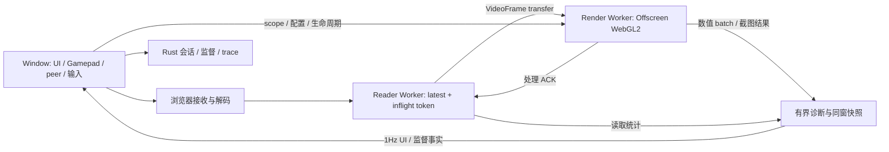

# PC Browser 串流执行域隔离与直接帧交接 RFC

## Status

- Completion: M0–M4 工程完成；统一实机回归待验
- Current State: validation-pending
- Owner: Codex 主窗口，单窗口分阶段执行
- Last Updated: 2026-11-26，Asia/Shanghai
- 本轮交付：共享渲染核心、直接 Reader/Render 帧链、观察与局部恢复、按宿主能力迁移输入发送及最小工程冒烟。
- 用户于 2026-11-26 明确授权完成整个优化计划，复用最近日志基线；工程完成后统一由用户实机回归一次。

## Background

当前PC使用Browser WebRTC、浏览器解码、Worker VideoFrame读取、主线程WebGL绘制以及主线程Gamepad采集/输入发送。`onWorkerMessage → accept → consume → notify → renderFrame → ACK` 将绘制成本放在读帧交付的确认链内。Reader目前已经连续读取，并维护一个待发送latest及一个在途token；该基础适合接续执行域隔离。

依据包括[iOS执行域RFC](2026-11-26-ios-streaming-latency-threading.md)、[PC源码评估](../../dev-docs/validation/2026-11-26-pc-ios-threading-assessment/README.md)、[历史上传基线](../../dev-docs/validation/2026-11-26-pc-upload-historical-comparison/README.md)与[texImage2D策略恢复](../../dev-docs/validation/2026-11-26-pc-teximage-frame-reuse/README.md)。本轮复用[最新实机基线](../../dev-docs/validation/2026-11-26-pc-latest-log-1795692428673/README.md)：1440p60、USM3、SR关闭；11249次完整导入、平均0.439ms，最后保留窗上传P95/P99均1ms、read→submit P95 2ms/P99 3ms。

同时接续[PC局部恢复、反馈与音频RFC](2026-11-26-pc-streaming-latency-recovery-audio.md)：该任务代码及自动冒烟已完成，包含8ms反馈短批次、16ms可调度发送预算、Rust局部计数判定和renderer局部恢复。线程计划复用这些合同，网络、音频和输入wire按各自现有职责执行。

## Goal And Scope

- 将每帧GL导入/绘制与Main输入/UI调度隔离，保留Reader持续获取最新帧的能力；以同档安静场景和繁忙场景的成本门衡量收益。
- 保持颜色、USM/SR、尺寸、限帧截图、同帧纹理复用、现行wire和恢复事实；跨域所有权与关闭结果可复盘。
- 工程范围为src的Browser renderer、帧源/Worker适配、数值观察和现行局部恢复接续。Rust公共合同仅在M3按当前共享实现补充可选事实，Tauri壳层和系统生命周期继续由现行模块承担。
- 首批目标为macOS 26+ WKWebView和Windows WebView2；Gamepad几何导航、认证/会话/信令、浏览器WebRTC/音频与Rust Native WIP分别按现行职责演进。

## Feasibility

结论：执行域隔离在现有Browser架构内具备清晰实现路径；默认启用资格取决于WKWebView/WebView2的M0组合验证。推荐独立Reader与Render两个Worker，直接传递原生VideoFrame；独立输入发送Worker作为后置、按宿主能力接入的增量。

| 项目 | 现有证据 | 可行性与进入条件 |
| --- | --- | --- |
| Reader持续读取及VideoFrame transfer | 既有WKWebView实机日志与夹具已运行Worker processor、轨道transfer及VideoFrame交接 | 可复用；M0验证Reader→Render组合及停止/重绑 |
| MessageChannel直连两个Worker | 标准MessagePort可转移，当前帧链已有一次帧转移和一次ACK | 结构可行；原生帧交接成本与消息队列峰值纳入M0 |
| OffscreenCanvas / Worker WebGL2 | 当前TypeScript Worker库具备OffscreenCanvas声明；主renderer使用DOM canvas | 条件可行；必须验证目标宿主的真实context、shader、VideoFrame导入、恢复和截图 |
| DOM无关渲染核心 | GL资源、uniform、FBO、FramePacer、RenderObservation集中于现有渲染模块 | 可分步提取，主线程适配器先复用同一核心保持行为基线 |
| 主线程Gamepad与peer | 现行BrowserGamepadBackend使用Window Navigator，RTCPeerConnection在Window装配 | 保留现有采集、几何导航、peer/轨道及控制通道归属 |
| 独立Input Worker发送 | Worker类型库声明RTCDataChannel；现行DataChannelHub持有同步send、事件、writable及关闭 | 条件可行；M4验证实际channel转移、bootstrap与同步发送语义 |
| 诊断聚合 | 数字累计、有界窗口、profile准入与Rust writer已存在 | 高可行；先合并快照，独立Diagnostics Worker由测得的聚合成本决定 |
| 本地显示恢复 | 当前Rust localCounters和renderer提交判定已落代码 | 复用现有action/所有者，增加Worker执行事实与renderEpoch适配 |

WKWebView和WebView2分别产生能力结果；其他Tauri宿主沿相同探测与现行可用路径接入。类型声明与实际宿主结果各自留证。

## Recommended Architecture

| 执行域 | 单一持有的状态 | 对外交接 |
| --- | --- | --- |
| Window/Main | Vue/DOM、HTMLVideoElement与音频、Gamepad采集和几何导航、RTCPeerConnection与控制/输入通道、renderer门面、父代次/布局/配置revision、RPC调用 | clone轨道、canvas转移、配置/生命周期命令、低频RTC事实 |
| Reader Worker | MediaStreamTrackProcessor/read循环、源clone、read序号、pending latest、在途token、端口link及读取统计 | VideoFrame transfer、低频读取/失败/停止事实 |
| Render Worker | OffscreenCanvas与唯一WebGL context、共享渲染核心、FramePacer、候选帧/上传缓存、shader/uniform/FBO/SR资源、renderEpoch、截图队列、GPU代理观察 | 帧处理ACK、100ms数值事实、1Hz指标、ready/failure、截图结果 |
| Diagnostics执行域 | 有界数值batch、分位数、同窗delta、trace投影与编码 | 不可变观察快照与现有trace入口；独立Worker按M3成本门接入 |
| Rust公共层 | 会话/协商、网络/恢复资格和预算、配置及trace writer | 当前RPC与可选观察合同 |
| 浏览器内部线程 | WebRTC网络、接收缓冲、硬件解码、音频与GPU实现 | 原生媒体对象及公开统计 |

独立Reader可以在Render的同步GL调用占用事件循环时继续更新latest。合并读帧/渲染到同一Worker会让这些工作共享JS事件循环；该方案作为M0对照项，推荐路径保留独立读帧。



## MessageChannel Cost Contract

| 每帧路径 | 原生VideoFrame交接 | 应用确认 |
| --- | --- | --- |
| 当前Reader Worker→Window绘制 | 1次transfer | Window→Reader 1次ACK |
| 计划Reader Worker→Render Worker绘制 | 1次transfer | Render→Reader 1次ACK |

帧路径通过转移对象所有权交接；引擎内部的句柄、跨进程和驱动成本按实际平台测量。新增控制/统计、快照请求和必要反馈batch也纳入消息数量、字节、CPU成本账。

```ts
// framePort由Window的globalThis.MessageChannel创建并交给Reader。
framePort.postMessage({ type: 'frame', token, frame, timing }, [frame])
```

- 创建端口使用 `globalThis.MessageChannel`，与现有Xbox协议的同名MessageChannel类明确区分。
- 帧链传递VideoFrame及小型token/timing；尺寸、shader和完整配置按revision交接。RGBA buffer、ImageBitmap和readback用于截图或现有显式诊断。
- Reader维持1个pending latest及1个已转移token，Render保留1个候选/当前帧。端口待处理帧上限为1，应用持有或排队的原生帧峰值按至多3个核验；SDK/GPU内部缓冲另作能力观察。
- Render完成CPU提交、限帧/过期丢弃或失效清理后ACK，包含token与outcome。ACK表达应用交接，GPU完成代理和物理呈现分别记账。
- Reader收到同link、同代次token的ACK后发送当时latest。旧ACK、关闭端口和重绑分别有明确结果；端口失效时通过控制面撤销旧token并建立新link。
- 统计事实100ms合并，分位数/trace按1Hz聚合。配置采用一个在途revision及一个pending latest；现有帧反馈沿8ms短批次与16ms可调度预算，新增跨域反馈成本纳入M0。

M0同时记录Reader→Render单向时间、ACK往返、read→submit、消息/字节率、主线程/WorkerCPU与资源峰值。M0通过后才扩大迁移，采样口径与现有完整导入路径一致。

## Public Facade And Platform Selection

`WebGL2VideoRenderer`、`SuperResolutionWebGL2Renderer`和PlaybackService保留当前入口与用户画质语义。共享WebGL核心分别由主线程适配器或Render Worker持有；同一已提交generation只有一个活动context与一套渲染状态。

内部执行模式为 `main`、`worker-direct`、`window-read-worker-render`，由当前renderer计划及能力结果选择。开发诊断可覆盖执行模式；产品菜单继续表达现有画质选择。macOS已验证的Reader Worker优先进入direct组合；具备Window processor的宿主可以使用轻量Window读取再transfer到Render Worker的兼容组合，其采集调度边界在指标中明确记录。

主线程创建并挂接HTMLCanvasElement，在创建其context前转移OffscreenCanvas。DOM/CSS/布局归Main；像素backing尺寸、viewport和GL资源归Render。已转移canvas的像素属性更新通过Worker命令完成，Main按ack使用实际尺寸快照。

按用户本轮授权，M0复用最近实机基线，M1–M4一次完成。内部renderExecution=auto通过实际Worker context、当前shader/VideoFrame导入与截图像素探测后进入Worker执行；M4输入资格独立验证Worker RTCDataChannel、时钟和真实channel转移。各宿主的成本与真实画面由工程完成后的一次实机回归确认。运行时能力变化、Worker启动失败及硬故障沿同一renderer选择/失败合同回到该宿主可用路径。main开发构建保持暂停，校验采用本地入口，发行沿现有独立流程执行。

硬故障沿现有renderer失败/重试所有者接入。回到Main执行需要新的DOM canvas/context和renderer generation；旧Worker/端口先失效并退役。连续吞吐压力继续使用现有告警与资格，执行模式通过能力、验证和用户既有意图选择。

## Scope And Ownership Protocol

- Main持有runtime/client/peer/video/renderer父代次、reader generation、frameLinkEpoch、surfaceRevision与configurationRevision。
- Reader持有其作用域内read sequence，frameId由reader generation与sequence组成；VideoFrame timestamp持续为0时仍以frameId判断身份。
- Render持有renderEpoch及context/cached-frame状态。Main的reset命令携带expected epoch，Render作为单一写者增加epoch并返回结果；旧完成只清理其自身资源。
- 控制与帧消息分别携带可核验link/scope。Main发布失效时先撤销旧surface展示及事实接纳，再异步发送停止；各Worker收到命令后更新本地fence并清理。消息到达延迟和跨端口顺序通过代次过滤处理。
- 全部可变GL状态由所属context执行域持有。DOM对象、函数回调和WebGL对象分别保留在原执行域；RendererRuntimeConfig拆成可序列化数值配置与本地通知适配器。

帧转移成功后由Render负责close；转移失败时由Reader关闭仍持有的帧。替换、暂停、截图、失效、context恢复和stop路径各自完成一次资源释放。WebGL返回后的图像/GPU引用由浏览器实现管理，应用记录自己的Frame引用和低频GPU代理事实。

## Frame, Resource And Capture Plan

1. 新帧持续使用 `texImage2D(VideoFrame)`；同frameId、同renderEpoch复用已上传纹理，源尺寸/context变化清空缓存。输出尺寸变化按既有USM/SR语义处理。
2. 稳定期复用shader/program、uniform参数、FBO/SR中间纹理和有界统计存储；缓存key分别包含context、source/output尺寸、格式和配置revision。
3. 截图沿当前“绘制与读回同一同步turn”的合同执行，保留 `preserveDrawingBuffer=false`。Render接到请求后重绘当前/较新限帧候选并在该turn读回，返回带requestId/scope/frameId的ImageBitmap；宿主能力不足时返回转移的RGBA结果。
4. Main将截图结果适配为既有HTMLCanvasElement接口，按生命周期关闭ImageBitmap。截图请求上限沿当前队列核对，旧scope请求明确取消。
5. context丢失、恢复和同帧重新上传在Render内完成，父门面接收低频事实。Shader等GL资源绑定具体context，重新创建context时建立新资源。
6. 暂停展示沿现有生命周期停止/暂停读取并保留可用上传纹理；前台恢复重建有效Reader/link。原peer、轨道与音频生命周期按现有合同推进。
7. 停止顺序为Main失效展示/接纳→Reader停止供帧→Render清理帧/GL/截图→有界ACK→端口/Worker退役。复用当前2s初始化/首帧预算；新增Render stop ACK初值250ms、强制退役观察上限1s，M0核验后固定。

## Observation, Clock And Recovery Plan

复用DecodedFrameClock校准Reader↔Render及Render↔Main的时间关系，保留offset、uncertainty、sample age及unknown原因。已有VideoFrame时间戳保持诊断用途，read完成→submit采用可校准的应用时间。

Worker输出累计数字与有界样本；Main发布同sampleId的RTC与renderer观察，同时记录各自observedAt和最大skew。累计计数在各自peer/video/reader/render范围内单调；重绑、context重建与backend替换携带reset原因。接收/解码与renderer观察各自维护窗口，局部显示重建重置对应显示基线。

M3复用当前 `buildLocalSupervisionFacts`、Rust `localCounters`和presentation局部恢复。Renderer Worker的reset由当前renderer所有者执行并等待同scope新帧/提交效果；窗口、动作单飞、冷却和预算继续沿既有PC恢复合同。iOS引入的可选displayObservation字段在共享合同稳定后接入，Browser source明确为renderer提交或GPU代理。

RTC统计、DOM样式和Gamepad事实在Window采集；数字聚合、分位数与trace编码按测得成本移入对应执行域。先合并1Hz快照，独立Diagnostics Worker的加入以聚合CPU/长尾收益为条件，Rust writer继续负责落盘。WebGL fence保留现行采样/超预算关闭规则，物理canvas scanout记录为能力不足。

## Input Plan

M0–M3保留现有Window采集与InputService发送，直接受益于绘制退出主线程。Browser采样周期沿当前4ms，数字FIFO、轴合并、128状态/250ms年龄、动态字节与50ms缓冲年龄预算、8ms反馈短批次及100ms idle heartbeat继续作为基线。

M4首先验证DataChannel转移与全部bootstrap/事件/关闭语义。通过后提取同一个InputCore到Input Worker，Window传递已采集的有序状态与配置revision，Worker持有实际input channel及同步send/accepted出队逻辑；peer与其他通道由Window管理。转移准备在首轮发送前完成，并与当前Message/Control握手ack衔接。

输出调度首版以4ms绝对deadline对齐当前PC采样，有pending状态才唤醒；每个有效tick交付一个数字状态，轴合并为最新，错过的tick按当前时间接续。neutral保持优先与明确epoch，反馈使用剩余预算。4/8ms输出节拍的实际远端识别结果在M4短场景核验，年龄和字节阈值按PC证据决定。

已采集状态的发送可以独立于UI；BrowserGamepad的新状态继续由Window采样交付。DataChannel转移资格不足的宿主继续使用同一个Window InputCore和既有发送路径，M0–M3交付保持独立。

## Plan

| 阶段 | 交付与主要模块 | 进入下一阶段的条件 |
| --- | --- | --- |
| M0 能力与成本门 | 基于现有WKWebView/WebRTC夹具构建当前Main基线与跨Worker端口原型；同档VideoFrame/USM/SR、scope/close、截图、Window繁忙和Render繁忙场景；Windows对应WebView2样本 | 至少一个宿主组合通过功能、成本和资源门；另一个宿主明确结果或继续现有路径 |
| M1 共享核心与协议 | 新增 `webgl-frame-processor.ts`、`render-worker-protocol.ts`、`render-worker-host.ts`；提取DOM无关GL逻辑，Main适配器先复用；定义scope/frame/配置/观察/截图DTO | Main路径行为与既有117项相关回归一致；协议所有权和失效规则闭合 |
| M2 直接帧链与离屏渲染 | 接续decoded worker/source/reader，新增Render Worker与entry；MessagePort直连；PlaybackService能力选型、尺寸/截图/context/停止适配 | 同档功能与M0成本门通过，Main与Worker组合均可明确回退，帧/资源峰值受控 |
| M3 观察与局部恢复 | StatsService/PlaybackService、Browser playback/trace/本地恢复适配；100ms事实/1Hz聚合，按成本加入Diagnostics Worker；复用Rust局部恢复 | 同窗六维健康、source/skew/reset明确；本地renderer重置保留peer并有有效效果 |
| M4 输入发送条件迁移 | DataChannelHub/InputChannel、同一InputCore及可选Input Worker；绝对deadline、neutral/关闭ACK和writable语义 | 当前宿主真实channel转移及短按/背压/关闭门通过；Main回退语义完整 |

阶段单窗口执行，按当前工作树接续并保留其他任务的修改。M1–M3构成推荐的首批工程范围；M4可以按宿主能力独立接续。

任务分类：M0作为有边界的simple验证子任务；M1–M3属于complex工程主线；M4属于complex条件增量。各阶段复用本RFC记录状态与证据。

## Validation And Cost Gates

M0在相同设备、实际2560×1440/60fps、USM3及SR同档输入下比较当前完整导入路径；夹具重新构建当前源码。安静场景与一个受控繁忙场景各采样一次，录入配置、源格式、可见性和作用域。

| 门槛 | 规划初值与判断 |
| --- | --- |
| 安静场景供给 | submitted/decoded比值与基线差异在2个百分点内，保持至少98%的基线吞吐 |
| read→submit | P95相对当前同档基线增加≤1ms，P99增加≤2ms；超过时回到M0分析 |
| VideoFrame导入 | 同档上传P95≤max(2ms, 基线P95+1ms)，完整/同帧复用调用与画面归属一致 |
| 端口成本 | 单向交接、ACK、控制/反馈/统计消息数量与字节全量记账；帧待处理队列≤1，应用帧峰值≤3 |
| 隔离效果 | 相同Render繁忙注入下至少一个输入/主线程调度长尾指标改善≥20%，其余核心指标处于上述容差 |
| Main繁忙场景 | Reader与Render持续推进，恢复后提交新鲜latest；Window设备采集/新DOM事件的调度边界独立记录 |
| 资源/生命周期 | 稳定尺寸资源创建delta收敛；源/输出变化、context恢复、截图、端口重绑与stop一次序列全部释放并明确旧scope结果 |
| 像素/模式 | USM、真实低源分辨率SR、输出缩放与截图每模式一个确定性像素场景；截图分离计数 |

上述数值为M0规划初值，最终门按已记录基线、计时精度和宿主能力固定。端口微基准与真实H264/NV12路径分别留证；内存中的构造帧性能只证明其对应路径。

每阶段执行必要的定向回归一次，前端完成后 `pnpm lint:fix`，共享类型变化执行typecheck；涉及Rust字段/判断时执行cargo fmt与相应定向测试。性能结论同时覆盖网络RTT/jitter/loss/缓冲、Browser恢复、media supply、3s/15s steady supply、submit/GPU代理长尾及received/decoded/read/submitted/overwrites/localDrop同窗delta；输入另记采样→dispatch→send。

用户本轮授权将真实串流、硬件手柄、前后台、画面和听感合并为工程完成后的一次实机回归。每轮归档必要结果、失败诊断和最终截图，创建临时清单并在进程结束后清理。

## Risks And Dependencies

1. Offscreen Worker WebGL2存在宿主差异，VideoFrame在不同context的导入可能改变驱动路径；M0能力/成本门及Main适配器保留交付资格。
2. MessagePort、控制事件与GPU/native调用分别调度，scope/ACK/close/重绑必须闭合；Main展示失效和Worker本地fence各自执行并留证。
3. 当前capture与CSS绑定DOM，转移后context创建、像素尺寸和同步读回有严格归属；M1提取与M2资源序列负责验证。
4. iOS共享监督与当前PC恢复正在演进；M3接续已稳定的可选字段及现有action，避免重置接收窗口或形成第二个恢复所有者。

## Progress

- [x] 现有源码、历史基线、iOS和PC相关合同核对。
- [x] 推荐独立Reader/Render与直接端口方案，固定消息成本账及平台资格。
- [x] 所有权、生命周期、兼容模式、截图与资源协议明确。
- [x] M0–M4及最小验收计划完成。
- [x] 用户授权一次完成M0–M4，复用最近日志基线。
- [x] M0组合能力探测：Worker context、当前shader、VideoFrame导入/截图像素；输入Worker/时钟/真实channel transfer。
- [x] M1共享WebGL核心和可序列化协议，保留Main适配器。
- [x] M2 Reader→Render直接MessagePort、暂停/重绑/截图/有界关闭及Main回退。
- [x] M3 100ms数字事实、1Hz聚合、同窗read/drop delta、执行域与时钟观察、现有renderer局部恢复。
- [x] M4同一个InputCore、真实channel发送、4ms deadline、owner barrier及neutral接受确认。
- [ ] 用户一次实机回归：实际宿主的成本门、Home/Cloud画面、输入、截图和前后台。

## Execution Notes

- 2026-11-26 | planned：本轮交付可行性与具体计划，运行时代码沿现有实现。
- 方案细化：独立Reader保留持续latest更新；Render拥有唯一GL状态；两者直连保持一次transfer/一次ACK，额外消息全部纳入成本门。
- 接续边界：PC反馈/音频/局部恢复代码已完成；iOS执行域改造进行中，共享合同按实施时的当前工作树对齐。
- 规划证据与验收见[证据目录](../../dev-docs/validation/2026-11-26-pc-streaming-execution-domains-plan/README.md)，规划收口见[Report](../reports/2026-11-26-pc-streaming-execution-domains-plan.md)。

- 2026-11-26 | implementing → validation-pending：工程已按本轮授权完成；自动检查与收口证据见[工程证据](../../dev-docs/validation/2026-11-26-pc-streaming-execution-domains/README.md)，交付见[工程Report](../reports/2026-11-26-pc-streaming-execution-domains.md)。
- 实现决策：各Worker之间持续一次原生帧transfer与一次CPU处理ACK；快照也限制单个在途消息。Main继续持有DOM、原生rVFC、设备采集和peer。
- 输入关闭：Window撤销已转移channel对象归属；旧peer/通道事件先失效，等待至多250ms的neutral接受确认后关闭捕获的原peer，新peer独立接续。
- 观察决策：新鲜Worker提交年龄按生产者采样点计算，快照交付年龄与skew独立记录；250ms以后按陈旧事实老化进入现有局部恢复窗口。GPU fence维持完成代理语义。
- 资源边界：单link应用帧峰值3；现行current/pending renderer交接分别持有自己的scope，短暂交接总上界6。截图单批一次同步读回、一次ImageBitmap/RGBA转移，至多4项等待。
- 日志合同：Rust准入表直接从共享JSON装配，执行域事件、既有local-stall与音频事件的描述和投影保持同源。消息字节是应用元数据JSON UTF-16估算，原生图像句柄与驱动成本分别由交接/导入计时观察。
- 本轮保持同一个Rust局部恢复所有者与现行网络/音频/输入wire；诊断聚合在已有Render/Input Worker内完成。
